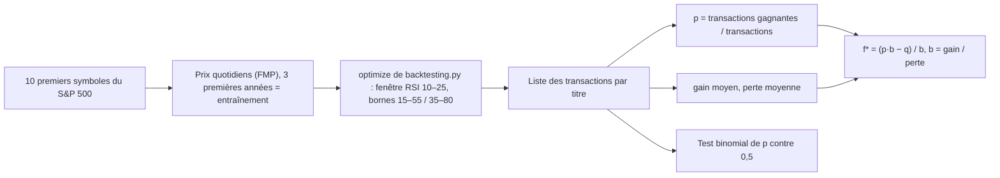

# Kelly_RM

<div class="repo-status-row"><span class="repo-badge kind">Carnets</span><span class="repo-badge algorithm">Critère de Kelly</span></div>

<div class="repo-tech-badges"><span class="tag tool">Python</span><span class="tag tool">Jupyter</span><span class="tag tool">backtesting.py</span><span class="tag tool">pandas</span><span class="tag tool">NumPy</span><span class="tag tool">httpx</span><span class="tag tool">Altair</span><span class="tag tool">seaborn</span></div>

Kelly_RM est un dépôt de recherche d’AlgoÉTS sur la gestion du risque avec le critère de Kelly, la règle qui fixe la taille d’une mise à partir de la probabilité de gain et du rapport de gain. Le README à la racine est vide ; le code associe une simulation de pile ou face à un carnet qui backteste une stratégie RSI, mesure les chances de gain par titre et en tire une fraction de Kelly. Il s’adresse à qui veut voir le comportement de la formule avant de l’appliquer à une stratégie.

## Aperçu {#overview}

`Kelly_game/betting_strategies.py` définit `BaseGame`, un jeu répété de pile ou face avec une pièce biaisée. Les sous-classes ne décident que de la mise : `Kelly` mise la fraction optimale de la richesse, `KellyWithAnEstimate` attend dix lancers puis mise selon la fréquence observée, `ConstantDollar` mise un montant fixe et `BetLikeADummy` mise gros après trois piles. La classe trace l’évolution de la richesse, simule la distribution des taux de croissance et compare la croissance espérée selon la fraction misée, avec le point de Kelly en repère. `Kelly_game/Playing the Game.ipynb` fait jouer les quatre stratégies côte à côte ; il se présente comme le code d’accompagnement d’une vidéo sur le critère de Kelly.

`sandbox/Main strategy.ipynb` transpose l’idée au trading. Il télécharge des historiques de prix avec `src/data.py` (fonctions Financial Modeling Prep et Binance appuyées sur `src/request_api.py`), coupe chaque série en trois ans d’entraînement et une suite inédite, puis optimise `RsiOscillator` (`src/strategy.py`) avec backtesting.py. À partir des transactions obtenues, il calcule par titre la probabilité de gain ainsi que la moyenne et la variance des gains et des pertes, garde les titres présents dans les deux périodes et applique f* = (p·b − q)/b avec b = gain moyen / perte moyenne.

## Fonctionnement de l’algorithme {#algorithm}

**La fraction de Kelly.** Pour un pari gagné avec une probabilité *p*, qui rapporte *b* fois la mise (et fait perdre la mise sinon), la fraction de la richesse qui maximise le taux de croissance à long terme vaut

```text
f* = p − q / b = (p·b − q) / b,   avec q = 1 − p
```

`BaseGame.kelly_bet` calcule `p + (p − 1) / b`, la même expression, et la borne à [0, 1] : ni pari sur pile ni levier. La quantité que Kelly maximise est la croissance logarithmique espérée par pari, `g(f) = p · ln(1 + b·f) + q · ln(1 − f)`, que `plot_exp_growth_rates_by_perc_wager` trace en fonction de *f*.

**Exemple avec le jeu du carnet.** `Playing the Game.ipynb` utilise p = 0,5, b = 1,5, 10 lancers et une richesse de départ de 500 $.

| Fraction misée | g(f) par lancer | Richesse typique après 10 lancers |
| --- | --- | --- |
| 5 % | +1,05 % | × 1,11 |
| **f* = 1/6 ≈ 16,7 %** | **+2,04 %** | **× 1,23** |
| 1/3 (deux fois Kelly) | 0,00 % | × 1,00 |
| 40 % | −2,04 % | × 0,82 |

La première mise de Kelly vaut donc 500 / 6 ≈ 83,33 $. Miser deux fois la fraction de Kelly donne une croissance nulle, et toute mise au-delà fait fondre la richesse avec le temps, même si chaque lancer a une espérance positive. La colonne « richesse typique » vaut `exp(10 · g)` : c’est le résultat médian, pas la moyenne.

**Les quatre stratégies.** `Kelly` mise f* de la richesse courante avec le vrai *p*. `KellyWithAnEstimate` ne mise rien pendant les dix premiers lancers, puis prend la fréquence observée de face comme *p*. `ConstantDollar` mise un montant fixe quelle que soit la richesse. `BetLikeADummy` mise gros après trois piles d’affilée, l’erreur du joueur. `play_game` plafonne toute mise à la richesse courante et s’arrête à zéro.

**Des lancers aux transactions.** `sandbox/Main strategy.ipynb` optimise une stratégie RSI par titre sur ses trois premières années de données (la boucle télécharge les dix premiers symboles du S&P 500, par la fonction FMP écrite pour les paires crypto), récupère les transactions et calcule par titre `p` = part des transactions gagnantes, une taille de gain et une taille de perte, puis `b = gain / perte` et `f* = (p·b − q)/b`.



Dans le carnet, `Win_Size` vaut 0 pour les transactions perdantes et `Loss_Size` vaut 0 pour les gagnantes, et les deux sont ensuite moyennés sur *toutes* les transactions. Les moyennes valent donc p · E[gain] et q · E[perte], et `b` donne (p · E[gain]) / (q · E[perte]) au lieu du rapport de gain E[gain] / E[perte]. Pour p = 0,6, le `b` calculé vaut 1,5 fois le vrai rapport, ce qui gonfle la fraction de Kelly.

## Démarrage {#installation}

La description du projet en français, `docs/README.md`, donne l’étape d’installation :

```shell
pip install -r requirements.txt
jupyter notebook
```

Définissez `FMP_API_KEY` (et `BINANCE_API_KEY` pour la fonction Binance) dans l’environnement ; `src/config.py` les lit. Les carnets importent aussi des paquets absents de `requirements.txt`, comme `pandas_ta`, `scipy`, `sympy` et `altair` ; `environment.yml` est un export conda complet qui ajoute `pandas-ta` et SciPy, sans couvrir tous les imports.

## Guide du dépôt {#reader-guide}

- `Kelly_game/betting_strategies.py` contient le jeu de pile ou face et ses stratégies de mise.
- `Kelly_game/Playing the Game.ipynb` compare les stratégies avec des graphiques Altair.
- `sandbox/Main strategy.ipynb` enchaîne l’optimisation RSI, l’estimation des chances et la fraction de Kelly.
- `src/data.py`, `src/request_api.py` et `src/config.py` récupèrent les prix chez FMP et Binance.
- `src/strategy.py` définit les stratégies backtesting.py `Ema` et `RsiOscillator`.
- `src/signal.py` trace des lignes de support et de résistance avec trendln et un seuil de R².
- `docs/README.md` est la description du projet ; `docs/Kelle_complement.pdf` est un article de référence sur la stratégie optimale en incertitude de paramètres, par approche Monte Carlo.
- `docs/notebook/strategy.ipynb` est un carnet vide.

## Fonctionnalités {#features}

- stratégies Kelly, Kelly estimé, montant constant et « mise forte après des piles » sur une pièce simulée ;
- graphiques de richesse, histogrammes de taux de croissance et croissance espérée selon la fraction misée ;
- historiques d’actions et de cryptomonnaies FMP et chandelles de contrats à terme Binance avec httpx ;
- recherche par grille des paramètres RSI avec carte de chaleur seaborn ;
- statistiques de probabilité de gain et de taille des gains et pertes par titre, en entraînement et en données inédites ;
- fraction de Kelly pour chaque titre retenu.

## Limites {#limits}

- Le `README.md` à la racine est vide. `docs/README.md` décrit des limites de risque dans `config.py`, un ajustement à la volatilité, une interface utilisateur et un script principal ; rien de cela n’existe dans le code, et `src/config.py` ne contient que les clés d’API et les URL de base.
- Les dépendances sont incomplètes : `pandas_ta`, `trendln`, `fmp_python`, `scikit-learn`, `scipy`, `sympy` et `altair` sont importés sans figurer dans `requirements.txt`.
- `sandbox/Main strategy.ipynb` ajoute un chemin Windows codé en dur à `sys.path` et appelle la fonction de prix des cryptomonnaies pour des symboles d’actions du S&P 500. Il utilise `DataFrame.append`, retiré de pandas 2, et ses filtres de cohérence valent −1, ce qui les désactive.
- Dans `src/strategy.py`, la stratégie `Ema` calcule sa moyenne à 150 périodes avec le paramètre de 80 périodes.
- Aucun test n’existe, même si `pytest` figure dans `requirements-dev.txt`.
- Les résultats dépendent de l’état des carnets et de données d’API en direct ; le dépôt ne les conserve pas.

## Sources {#sources}

- [Dépôt GitHub](https://github.com/AlgoETS/Kelly_RM)
- [Description du projet (`docs/README.md`)](https://github.com/AlgoETS/Kelly_RM/blob/main/docs/README.md)
- [`Kelly_game/betting_strategies.py`](https://github.com/AlgoETS/Kelly_RM/blob/main/Kelly_game/betting_strategies.py)
- [`sandbox/Main strategy.ipynb`](https://github.com/AlgoETS/Kelly_RM/blob/main/sandbox/Main%20strategy.ipynb)
- [`src/data.py`](https://github.com/AlgoETS/Kelly_RM/blob/main/src/data.py)
- [`src/strategy.py`](https://github.com/AlgoETS/Kelly_RM/blob/main/src/strategy.py)
