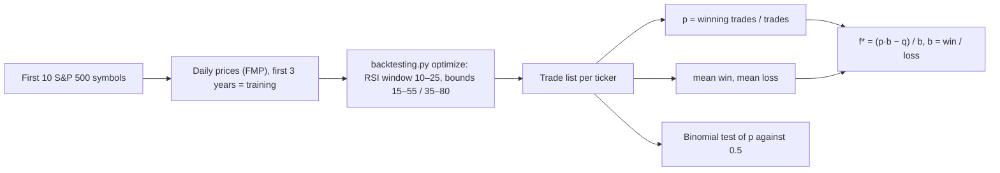

# Kelly_RM

<div class="repo-status-row"><span class="repo-badge kind">Notebooks</span><span class="repo-badge algorithm">Kelly criterion</span></div>

<div class="repo-tech-badges"><span class="tag tool">Python</span><span class="tag tool">Jupyter</span><span class="tag tool">backtesting.py</span><span class="tag tool">pandas</span><span class="tag tool">NumPy</span><span class="tag tool">httpx</span><span class="tag tool">Altair</span><span class="tag tool">seaborn</span></div>

Kelly_RM is an AlgoÉTS research repository about risk management with the Kelly criterion, the rule that sets a bet size from the probability of winning and the payoff ratio. Its root README is empty; the code pairs a coin-flip simulation of Kelly betting with a notebook that backtests an RSI strategy, measures win odds per ticker and turns them into a Kelly fraction. It suits readers who want to see how the formula behaves before applying it to a strategy.

## Overview {#overview}

`Kelly_game/betting_strategies.py` defines `BaseGame`, a repeated biased coin-flip game. Subclasses only decide the wager: `Kelly` bets the optimal fraction of wealth, `KellyWithAnEstimate` waits ten flips and bets on the observed frequency, `ConstantDollar` bets a fixed amount and `BetLikeADummy` bets big after three tails. The class plots wealth paths, simulates growth-rate distributions and draws expected growth against the fixed fraction wagered, with the Kelly point marked. `Kelly_game/Playing the Game.ipynb` runs the four strategies side by side; it describes itself as companion code for a video on the Kelly criterion.

`sandbox/Main strategy.ipynb` applies the idea to trading. It downloads price histories through `src/data.py` (Financial Modeling Prep and Binance helpers built on `src/request_api.py`), splits each series into three years of training data and an unseen remainder, and optimizes `RsiOscillator` from `src/strategy.py` with backtesting.py. From the resulting trade tables it computes, per ticker, the win probability and the mean and variance of win and loss sizes, keeps tickers seen in both periods, then applies f* = (p·b − q)/b with b = mean win / mean loss.

## How the algorithm works {#algorithm}

**The Kelly fraction.** For a bet won with probability *p* that pays *b* times the stake (and loses the stake otherwise), the fraction of wealth that maximises the long-run growth rate is

```text
f* = p − q / b = (p·b − q) / b,   with q = 1 − p
```

`BaseGame.kelly_bet` computes `p + (p − 1) / b`, the same expression, and clips it to [0, 1]: no short bets and no leverage. The quantity Kelly maximises is the expected log growth per bet, `g(f) = p · ln(1 + b·f) + q · ln(1 − f)`, which `plot_exp_growth_rates_by_perc_wager` draws against *f*.

**Worked example with the notebook's game.** `Playing the Game.ipynb` uses p = 0.5, b = 1.5, 10 flips and 500 $ of starting wealth.

| Fraction wagered | g(f) per flip | Typical wealth after 10 flips |
| --- | --- | --- |
| 5% | +1.05% | × 1.11 |
| **f* = 1/6 ≈ 16.7%** | **+2.04%** | **× 1.23** |
| 1/3 (twice Kelly) | 0.00% | × 1.00 |
| 40% | −2.04% | × 0.82 |

So the first Kelly bet is 500 / 6 ≈ 83.33 $. Betting twice the Kelly fraction gives zero growth, and anything above it shrinks wealth over time even though every flip has a positive expected value. The "typical wealth" column is `exp(10 · g)`, the median outcome, not the mean.

**The four strategies.** `Kelly` bets f* of current wealth with the true *p*. `KellyWithAnEstimate` bets nothing for the first ten flips, then uses the observed heads frequency as *p*. `ConstantDollar` bets a fixed amount whatever the wealth. `BetLikeADummy` bets big after three tails in a row, the gambler's fallacy. `play_game` caps any wager at the current wealth and stops at zero.

**From coin flips to trades.** `sandbox/Main strategy.ipynb` optimises an RSI strategy per ticker on its first three years of data (the loop downloads the first ten S&P 500 symbols, through the FMP helper written for crypto pairs), takes the trades, and computes per ticker `p` = share of winning trades, a win size and a loss size, then `b = win size / loss size` and `f* = (p·b − q)/b`.



In the notebook, `Win_Size` is 0 for losing trades and `Loss_Size` is 0 for winning trades, and both are then averaged over *all* trades. The means are therefore p · E[win] and q · E[loss], so `b` comes out as (p · E[win]) / (q · E[loss]) instead of the payoff ratio E[win] / E[loss]. For p = 0.6, the computed `b` is 1.5 times the true ratio, which inflates the Kelly fraction.

## Getting started {#installation}

The French project description in `docs/README.md` gives the install step:

```shell
pip install -r requirements.txt
jupyter notebook
```

Set `FMP_API_KEY` (and `BINANCE_API_KEY` for the Binance helper) in the environment; `src/config.py` reads them. The notebooks also import packages that are not in `requirements.txt`, such as `pandas_ta`, `scipy`, `sympy` and `altair`; `environment.yml` is a full conda export that adds `pandas-ta` and SciPy but not every import.

## Repository guide {#reader-guide}

- `Kelly_game/betting_strategies.py` contains the coin-flip game and its betting strategies.
- `Kelly_game/Playing the Game.ipynb` compares the strategies with Altair charts.
- `sandbox/Main strategy.ipynb` runs the RSI optimization, odds estimation and Kelly fraction.
- `src/data.py`, `src/request_api.py` and `src/config.py` fetch prices from FMP and Binance.
- `src/strategy.py` defines the `Ema` and `RsiOscillator` backtesting.py strategies.
- `src/signal.py` draws support and resistance lines with trendln and an R² threshold.
- `docs/README.md` is the French project description; `docs/Kelle_complement.pdf` is a reference paper on optimal trading under parameter uncertainty with a Monte Carlo approach.
- `docs/notebook/strategy.ipynb` is an empty placeholder.

## Features {#features}

- Kelly, estimated-Kelly, constant-dollar and "bet big after tails" strategies on a simulated coin;
- wealth-path charts, growth-rate histograms and expected growth versus wager fraction;
- FMP stock and crypto history and Binance futures klines through httpx;
- RSI parameter grid search with a seaborn heatmap;
- per-ticker win probability and win/loss size statistics on training and unseen data;
- Kelly fraction per retained ticker.

## Limits {#limits}

- The root `README.md` is empty. `docs/README.md` describes risk limits in `config.py`, volatility adjustment, a user interface and a main script; none of these are in the code, and `src/config.py` only holds API keys and base URLs.
- Dependencies are incomplete: `pandas_ta`, `trendln`, `fmp_python`, `scikit-learn`, `scipy`, `sympy` and `altair` are imported but not listed in `requirements.txt`.
- `sandbox/Main strategy.ipynb` inserts a hard-coded Windows path into `sys.path` and calls the crypto price helper for S&P 500 stock symbols. It uses `DataFrame.append`, which pandas 2 removed, and its consistency filters are set to −1, which disables them.
- In `src/strategy.py`, the `Ema` strategy computes its 150-period line with the 80-period parameter.
- There are no tests, although `pytest` is in `requirements-dev.txt`.
- Results depend on saved notebook state and live API data; the repository does not record them.

## Sources {#sources}

- [GitHub repository](https://github.com/AlgoETS/Kelly_RM)
- [Project description (`docs/README.md`)](https://github.com/AlgoETS/Kelly_RM/blob/main/docs/README.md)
- [`Kelly_game/betting_strategies.py`](https://github.com/AlgoETS/Kelly_RM/blob/main/Kelly_game/betting_strategies.py)
- [`sandbox/Main strategy.ipynb`](https://github.com/AlgoETS/Kelly_RM/blob/main/sandbox/Main%20strategy.ipynb)
- [`src/data.py`](https://github.com/AlgoETS/Kelly_RM/blob/main/src/data.py)
- [`src/strategy.py`](https://github.com/AlgoETS/Kelly_RM/blob/main/src/strategy.py)
