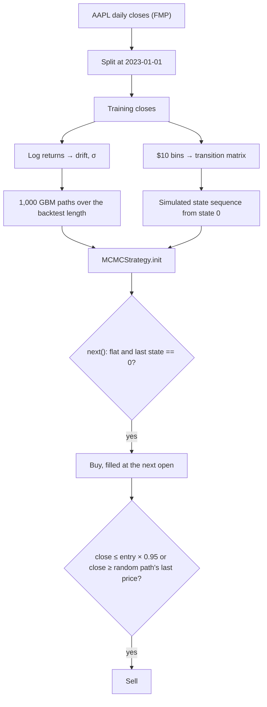

# MarkokChainMonteCarlo

<div class="repo-status-row"><span class="repo-badge kind">Notebooks</span><span class="repo-badge algorithm">Monte Carlo</span></div>

<div class="repo-tech-badges"><span class="tag tool">Python</span><span class="tag tool">Jupyter</span><span class="tag tool">backtesting.py</span><span class="tag tool">pandas</span><span class="tag tool">NumPy</span><span class="tag tool">SciPy</span><span class="tag tool">httpx</span><span class="tag tool">scikit-learn</span></div>

MarkokChainMonteCarlo is an AlgoÉTS research repository that backtests investment strategies with stochastic price simulations. Its notebooks estimate Apple (AAPL) price paths with a forward Monte Carlo model and a Markov chain over price ranges, then use those simulations inside a backtesting.py strategy compared with buy and hold. The forward Monte Carlo part is explained step by step in [Predicting Stock Prices with Monte Carlo Simulations]().

## Overview {#overview}

`mcmc.ipynb` and `backtest.ipynb` share the same opening: an httpx helper downloads the full AAPL daily history from Financial Modeling Prep, and the data is split at 2023-01-01 into a training part and a hold-out part. `monte_carlo_simulation` estimates drift and volatility from log returns and propagates prices with random shocks; `mcmc.ipynb` adds variants with rolling volatility, occasional extreme moves and an optional stochastic drift, and plots 364-day projections with 1,000 or 10,000 paths. A Markov chain is built by cutting training closes into $10 bins from 0 to 200, counting bin-to-bin moves with `pandas.crosstab` and sampling a sequence with `markov_chain_simulation`. The notebook ends with a linear regression on the day index.

`backtest.ipynb` defines `MCMCStrategy`: it simulates paths and Markov states when the backtest starts, buys when the last simulated state is 0, and exits on a 5 % stop loss or when the close reaches a take-profit price drawn from a simulated path. `BuyAndHoldStrategy` serves as the baseline. Both run with 10,000 in cash, a 0.2 % commission and exclusive orders on the two periods. `proto.ipynb` is the first prototype on randomly generated prices, and `output/MCMCStrategy.html` is a saved backtesting.py chart.

## How the algorithms work {#algorithm}

**Forward Monte Carlo.** `monte_carlo_simulation` treats the price as geometric Brownian motion estimated from history:

```text
rᵢ = ln(Pᵢ / Pᵢ₋₁)                      daily log returns of the training closes
drift = mean(r) − ½ · var(r)
σ = std(r)
Pₜ₊₁ = Pₜ · exp(drift + σ · Z),  Z ~ N(0, 1)   (Z drawn as norm.ppf(uniform))
```

The loop repeats this for `days` steps and `iterations` paths, each path starting from the last training close. For example, with a mean log return of 0.0010 and σ = 0.02 (variance 0.0004), the drift is 0.0008, and a draw of Z = 1 moves 100 to 100 · e^0.0208 ≈ 102.10. These inputs are illustrative; the notebook estimates its own from AAPL.

One subtlety: the mean of *log* returns already equals μ − σ²/2 for geometric Brownian motion, so subtracting ½ var again counts the correction twice. With σ = 0.02 that is 0.0002 per day, and over the notebook's 364-day horizon it lowers the median path by a factor e^(−364 · 0.0002) ≈ 0.93, about 7%. `monte_carlo_simulation_with_roulette` adds, with 5% probability per day, an extra shock of ±3σ to every path at once.

**Markov chain over price bins.** The training closes are cut into $10 bins with `pd.cut` (0–10, 10–20, …, 190–200, and one bin above 200). `pd.crosstab(current, next, normalize='index')` counts how often a close in bin *i* is followed by a close in bin *j* and divides by the row total, which gives the transition probability P(i → j). `markov_chain_simulation` then walks the chain: from the current state it draws the next one with `np.random.choice(states, p=row)`.

A toy example shows the counting. Six closes of 148, 152, 155, 149, 151 and 158 fall in bins (140, 150], (150, 160], (150, 160], (140, 150], (150, 160], (150, 160]. The five moves are: 140→150 twice, 150→150 twice, 150→140 once. So the row for (140, 150] is 100% to (150, 160], and the row for (150, 160] is 2/3 stay and 1/3 down.

**The strategy.** `MCMCStrategy.init` runs both simulations once over the whole backtest length; `next` buys when the last simulated Markov state equals 0 and, once long, exits on a 5% stop below the entry or when the close reaches a take-profit drawn from a random path's last simulated price.



As written, the states are bin intervals such as (0, 10], while the strategy starts the chain from the integer 0 and compares the last state with 0. The start lookup and the buy test mix an integer with interval labels, so the entry condition does not behave as the comments describe.

## Getting started {#installation}

The README installs the libraries with:

```bash
pip install panda lxml bs4 httpx backtesting yfinance pandas_ta scipy rich TA-Lib
```

`requirements.txt` pins a smaller set (`backtesting`, `httpx`, `numpy`, `pandas`, `pandas-ta`). The notebooks also use Matplotlib and scikit-learn. Put your own Financial Modeling Prep key in the `FMP_API_KEY` cell, then open the notebooks:

```bash
jupyter notebook backtest.ipynb
```

## Repository guide {#reader-guide}

- `mcmc.ipynb` covers data split, Monte Carlo variants, the Markov chain, plots and the linear regression.
- `backtest.ipynb` repeats the simulations and runs `MCMCStrategy` and `BuyAndHoldStrategy`.
- `proto.ipynb` is the prototype on synthetic prices.
- `output/MCMCStrategy.html` is a saved backtest chart.
- `images/` holds the README illustrations.
- `Algo Markov Chain Monte Carlo (MCMC)_.pdf` is a PDF document stored with the code.

## Features {#features}

- AAPL daily history from Financial Modeling Prep, split at 2023-01-01;
- forward Monte Carlo price paths, with rolling-volatility and extreme-move variants;
- Markov chain over $10 price bins with an empirical transition matrix;
- backtesting.py strategy using simulated states and take-profit levels;
- buy and hold baseline on the same periods;
- linear trend fit on the day index.

## Limits {#limits}

- Despite the name, there is no Markov chain Monte Carlo sampler (such as Metropolis–Hastings) in the code; the notebooks combine a forward Monte Carlo simulation with a separate Markov chain.
- `MCMCStrategy` simulates once, at the start of the backtest, over the full series and reads the last element of a fixed state list, so its entry condition does not change from bar to bar. It also starts the chain from a hard-coded state 0.
- The transition matrix only covers closes from 0 to 200, with one open bin above.
- An FMP API key is written in the notebooks; replace it with your own.
- The README install line contains `panda` instead of `pandas`, and `requirements.txt` does not list every import.
- The notebooks do not keep their backtest outputs, and the results depend on random draws without a fixed seed (except in `proto.ipynb`).

## Sources {#sources}

- [GitHub repository](https://github.com/AlgoETS/MarkokChainMonteCarlo)
- [README](https://github.com/AlgoETS/MarkokChainMonteCarlo/blob/main/README.md)
- [`mcmc.ipynb`](https://github.com/AlgoETS/MarkokChainMonteCarlo/blob/main/mcmc.ipynb)
- [`backtest.ipynb`](https://github.com/AlgoETS/MarkokChainMonteCarlo/blob/main/backtest.ipynb)
- [`proto.ipynb`](https://github.com/AlgoETS/MarkokChainMonteCarlo/blob/main/proto.ipynb)
