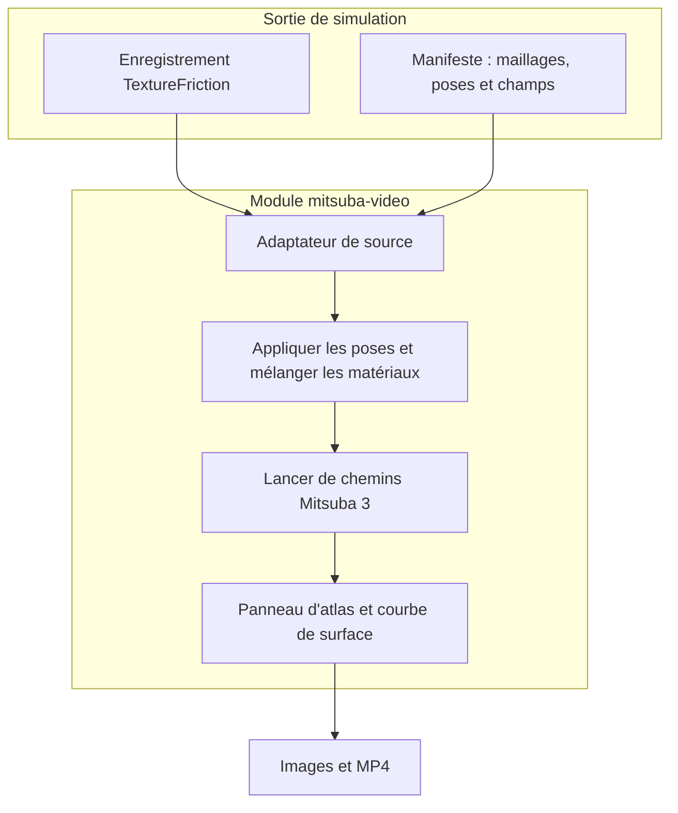

# MistubaVideo

MistubaVideo effectue le rendu de sorties de simulation avec Mitsuba 3, sous [ETSim](https://github.com/ETSim). La commande par lots traite des séquences OBJ ; le module `mitsuba-video` lit les poses et champs de surface enregistrés grâce aux adaptateurs de manifeste et de TextureFriction. Les faits ci-dessous viennent de la documentation du dépôt, lue pour la [présentation du projet]().

## Aperçu

**Pourquoi il existe.** Une simulation calcule le mouvement et les changements de surface ; rendre un enregistrement montre où les corps ont bougé et comment l'apparence des matériaux a évolué, et permet de changer caméra ou éclairage sans relancer la simulation.

**Cas d'usage.** Transformer poses et champs d'usure enregistrés en images, cartes de chaleur, panneaux d'atlas et vidéos pour rapports et présentations.

## Démarrage

```bash
python main.py multi --folder exports          # rendu par lots d'une séquence OBJ
mitsuba-video inspect path/to/manifest.json    # vérifier les données d'entrée
mitsuba-video preview path/to/manifest.json    # vérifier caméra et cadrage
mitsuba-video render path/to/manifest.json -q preview
```

Préréglages de qualité : `preview`, `draft`, `paper`. `encode` réassemble des images existantes en vidéo ; FFmpeg fait l'encodage.

## Fonctions et composants

| Étape | Données |
| --- | --- |
| Entrée | Maillages, matériaux, poses et champs de surface enregistrés ; un manifeste versionné (corps, maillages, matériaux, poses, images de champ) ou un enregistrement TextureFriction via un adaptateur ; `ManifestWriter` permet à un autre simulateur d'exporter ce format |
| Traitement | Application des poses, mélange des matériaux de base et affectés selon le champ, lancer de chemins Mitsuba 3 ; carte de chaleur, panneau d'atlas UV et courbe de surface couverte en option |
| Sortie | Images beauty et composites, CSV de surface du champ, `render_config.json` avec paramètres et temps, MP4 ; images EXR linéaires en option |

## Architecture



## Limites et points à vérifier

- La courbe de surface mesure la surface couverte du champ enregistré, pas la surface visible de l'objet rendu.
- Conservez les réglages d'affichage avec le rendu : changer l'échelle de la carte de chaleur fait paraître différent le même champ.
- Le module documente des tests pytest pour les transformations, le mélange des matériaux, les lecteurs OBJ/MTL et le schéma de manifeste ; aucun pourcentage de couverture mesuré n'est cité ici.

## Liens

- [Sources et utilisation](https://github.com/ETSim/MistubaVideo)
- [Module de rendu](https://github.com/ETSim/MistubaVideo/tree/main/packages/mitsuba_video)
- [TrueMapData]() mesure les surfaces que ces enregistrements montrent
