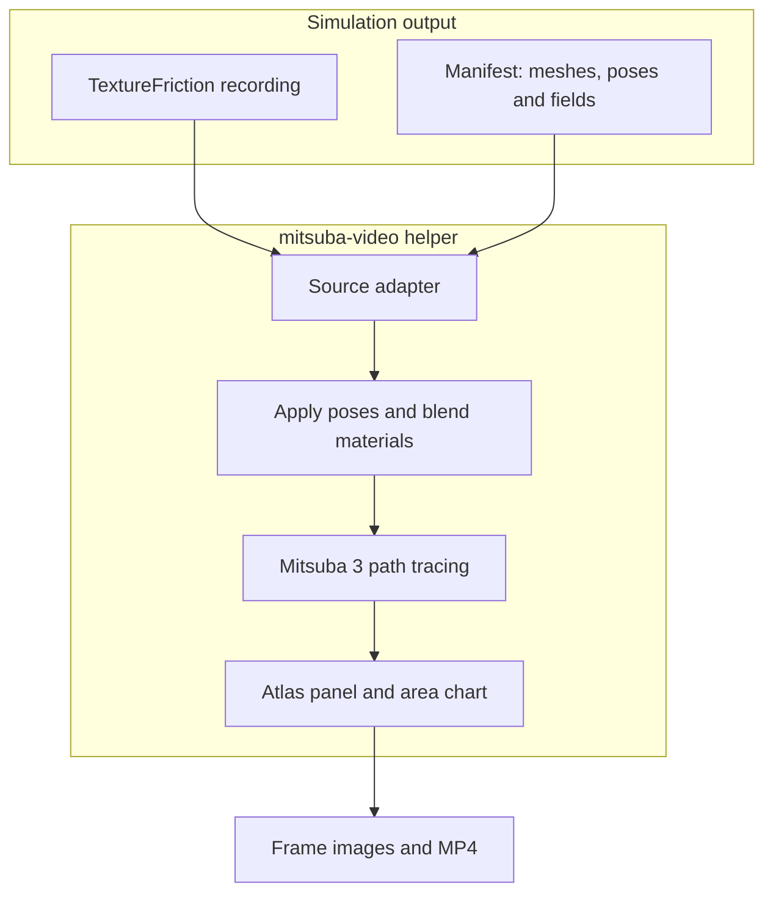

# MistubaVideo

MistubaVideo renders simulation exports with Mitsuba 3, under [ETSim](https://github.com/ETSim). The batch command processes OBJ sequences; the `mitsuba-video` helper reads recorded body poses and surface fields through manifest and TextureFriction source adapters. Facts below come from the repository documentation as read for the [project introduction]().

## Overview

**Why it exists.** A simulation computes motion and surface change; rendering a recording shows where bodies moved and how material appearance evolved, and lets you change camera or lighting without repeating the simulation.

**Best fit.** Turning recorded poses and wear fields into frames, heatmaps, atlas panels and video for reports and talks.

## Getting started

```bash
python main.py multi --folder exports          # batch-render an OBJ sequence
mitsuba-video inspect path/to/manifest.json    # check the input data
mitsuba-video preview path/to/manifest.json    # check camera and framing
mitsuba-video render path/to/manifest.json -q preview
```

Quality presets: `preview`, `draft`, `paper`. `encode` reassembles existing frames into video; FFmpeg does the encoding.

## Features and components

| Stage | Data |
| --- | --- |
| Input | Meshes, materials, recorded poses and surface fields; a versioned manifest (bodies, meshes, materials, poses, field images) or a TextureFriction recording through a source adapter; `ManifestWriter` lets another simulator export the format |
| Processing | Apply recorded poses, blend base and affected materials using the surface field, Mitsuba 3 path tracing; optional heatmap, UV-atlas panel and covered-area chart |
| Output | Beauty and composite frames, field-area CSV, `render_config.json` with settings and timings, MP4; optional linear EXR frames |

## Architecture



## Constraints and checks

- The area chart measures the recorded field's covered area, not the visible area of the rendered object.
- Keep display settings with the render: changing the heatmap range makes the same field look different.
- The package documents pytest tests for transforms, material blending, OBJ/MTL readers and the manifest schema and writer; no measured coverage percentage is quoted here.

## Links

- [Source and usage](https://github.com/ETSim/MistubaVideo)
- [Render helper package](https://github.com/ETSim/MistubaVideo/tree/main/packages/mitsuba_video)
- [TrueMapData]() measures the surfaces these recordings show
