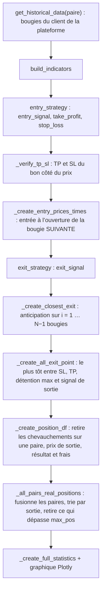

# nova-backtest

<div class="repo-status-row"><span class="repo-badge kind">Bibliothèque Python</span><span class="repo-badge fork">Fork</span><span class="repo-badge archived">Archivé</span><span class="repo-badge algorithm">Algorithme</span></div>

<div class="repo-tech-badges"><span class="tag tool">Python</span><span class="tag tool">pandas</span><span class="tag tool">NumPy</span><span class="tag tool">Plotly</span><span class="tag tool">Poetry</span><span class="tag tool">pytest</span><span class="tag tool">Sphinx</span></div>

nova-backtest est une bibliothèque Python de backtesting de stratégies de trading crypto, publiée sur PyPI sous le nom `novalabs-backtest` (version 1.1.10 dans `pyproject.toml`). Elle télécharge les bougies historiques de Binance, Bybit, OKX, KuCoin, Huobi, MEXC, BTCEX et Oanda, applique une stratégie à de nombreuses paires à la fois et produit des statistiques. Ce dépôt est un fork archivé du projet NovaLabs ; les commits faits ici en avril 2023 renomment le dossier du paquet et mettent à jour le README. L’intérêt du code est sa façon de simuler les transactions sans boucle bougie par bougie.

## Aperçu {#overview}

Une stratégie est une sous-classe de `BackTest` (`novalabs-backtest/utils/backtest.py`) qui remplit trois méthodes sur un DataFrame pandas de bougies :

- `build_indicators(df)` ajoute les colonnes d’indicateurs ;
- `entry_strategy(df)` fixe `entry_signal` (1 achat, −1 vente à découvert, `NaN` rien), `take_profit`, `stop_loss` et `position_size` sur la bougie du signal ;
- `exit_strategy(df)` fixe `exit_signal` (ou `NaN` partout).

Le constructeur reçoit la plateforme, l’intervalle des bougies, les paires (une liste, `"All pairs"` ou `"Random N"`), la période, le capital de départ, le levier, le nombre maximal de positions ouvertes et la durée maximale de détention. Chaque position reçoit `levier / max_pos` du capital, et les frais maker de la plateforme viennent de `FEES` dans `utils/constant.py` (Binance 0,02 %, Bybit 0,01 %, OKX 0,015 %).

## Simulation d’une transaction {#algorithm}

`run_backtest` traite chaque paire par opérations sur des colonnes entières, puis fusionne les paires.



1. **Entrée.** Un signal sur la bougie *t* est exécuté à l’ouverture de la bougie *t + 1* : la stratégie ne peut pas négocier au cours de clôture qu’elle vient d’utiliser pour décider.
2. **Anticipation.** `_create_closest_exit` convertit la durée maximale de détention en un nombre de bougies *N* et construit, pour chaque décalage *i* de 1 à *N − 1*, une colonne avec l’heure à laquelle la bougie *t + i* a touché le stop ou l’objectif. Pour un achat, le stop est touché quand le plus bas de cette bougie est au niveau du stop ou en dessous ; l’objectif ne compte que si le plus haut l’atteint **et** que le plus bas est resté au-dessus du stop. Quand une bougie touche les deux, la transaction est comptée comme stoppée : c’est la lecture prudente, puisqu’on ignore l’ordre des deux mouvements dans la bougie. Les ventes à découvert sont symétriques.
3. **Sortie.** L’heure de sortie est la plus tôt entre le stop le plus proche, l’objectif le plus proche, l’entrée plus la durée maximale, et la bougie qui suit un `exit_signal` opposé. Stops et objectifs s’exécutent à leur propre prix ; les deux autres sorties à l’ouverture suivante.
4. **Une transaction à la fois par paire.** Les transactions dont l’entrée précède la sortie de la transaction précédente sur la même paire sont retirées.
5. **Résultat et frais.** Sur un nominal de 100, la variation vaut `sens × (sortie − entrée) / entrée`, et les frais `100 × (2 + variation − frais) × frais` : des frais à l’entrée, puis sur la valeur de sortie après les premiers frais.
6. **Plafond du portefeuille.** Les transactions de toutes les paires sont fusionnées et triées par heure de sortie ; celles qui s’ouvriraient alors que `max_pos` positions sont déjà ouvertes sont supprimées, car un vrai compte n’aurait pas pu les prendre. La taille des positions vaut `levier / max_pos × capital`, avec en option une capitalisation (`geometric_sizes`).

**Transaction détaillée.** La stratégie d’exemple du README, `MACD_HIST`, achète quand l’histogramme du MACD devient positif et place l’objectif et le stop à `tp_sl_delta = 0.05` de la clôture. Supposons que la bougie suivante ouvre à 100 et, pour simplifier, que la clôture du signal valait aussi 100 : l’objectif est à 105 et le stop à 95. La bougie *t + 2* a un plus bas de 97 et un plus haut de 103 : rien ne se passe. La bougie *t + 3* a un plus bas de 96 et un plus haut de 105,5 : le plus haut atteint l’objectif et le plus bas reste au-dessus du stop, la transaction sort donc à 105 sur cette bougie. La variation est de +5 % et les frais Binance de 0,02 % : sur un nominal de 100, les frais valent 100 × (2 + 0,05 − 0,0002) × 0,0002 = 0,041 et le résultat réalisé 5 − 0,041 = 4,959. Avec un levier de 2 et `max_pos = 4`, chaque position mobilise la moitié du capital. (Les valeurs des bougies sont illustratives ; les étapes et les formules sont celles du code.)

## Démarrage {#installation}

```bash
pip install novalabs-backtest
```

Le README écrit `pip install novelabs-backtest`, avec une coquille dans le nom du paquet. Une stratégie hérite ensuite de `BackTest`, implémente les trois méthodes et appelle `run_backtest()`, qui enregistre `results/{stratégie}_pairs_stats.csv` et `results/{stratégie}_overall_stats.json`. Certains clients de plateforme demandent des clés d’API passées par `key`, `secret` et `passphrase`.

## Guide du dépôt {#reader-guide}

- `novalabs-backtest/utils/backtest.py` : la classe `BackTest` (1 262 lignes) : données, sorties, positions, plafond du portefeuille, statistiques et graphiques.
- `novalabs-backtest/clients/` : un client par plateforme derrière `client_interface.py`, créé par la fabrique `clients()`.
- `novalabs-backtest/utils/indicators.py`, `helpers.py`, `constant.py` : indicateurs, conversions d’intervalles et frais.
- `novalabs-backtest/data/` : collecteurs Discord, Reddit, Telegram et carnet d’ordres.
- `tests/` : tests des clients (format, plus ancien horodatage, historique, informations des paires, heure du serveur, mises à jour) et des indicateurs.
- `.github/workflows/` : tests, publication sur PyPI et génération de la documentation ; `docs/` est un site Sphinx.

## Limites {#limits}

- La boucle d’anticipation s’arrête à *N − 1* bougies, une de moins que la durée maximale de détention, et son coût croît avec *N* : deux nouvelles colonnes par bougie de détention.
- Dans une même bougie, toucher à la fois le stop et l’objectif compte toujours comme un stop, même si le prix a pu atteindre l’objectif d’abord.
- Les frais utilisent le taux maker pour les deux jambes ; les ordres au marché, le financement et le glissement ne sont pas modélisés.
- L’exemple `MACD_HIST` du README lit des fichiers CSV locaux et n’hérite pas de `BackTest` : il ne montre pas la vraie API de la bibliothèque.
- Le dépôt est archivé, le nom de dossier `novalabs-backtest` contient un trait d’union (impossible à importer tel quel depuis les sources) et la commande d’installation du README a une coquille.
- Les badges du README pointent vers `Nova-DevTeam/nova-backtest` et vers un badge de couverture dans un dépôt au nom différent (`nove-backtest`).

## Sources {#sources}

- [Dépôt GitHub](https://github.com/antoinebou12/nova-backtest)
- [Paquet PyPI `novalabs-backtest`](https://pypi.org/project/novalabs-backtest/)
- [`novalabs-backtest/utils/backtest.py`](https://github.com/antoinebou12/nova-backtest/blob/Master/novalabs-backtest/utils/backtest.py)
- [`novalabs-backtest/utils/constant.py`](https://github.com/antoinebou12/nova-backtest/blob/Master/novalabs-backtest/utils/constant.py)
- [README](https://github.com/antoinebou12/nova-backtest/blob/Master/README.md)
