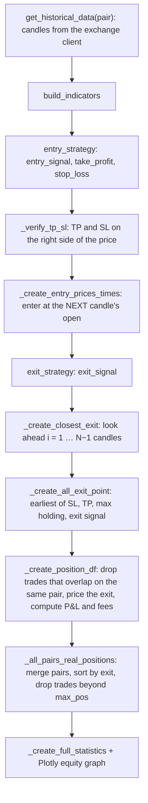

# nova-backtest

<div class="repo-status-row"><span class="repo-badge kind">Python library</span><span class="repo-badge fork">Fork</span><span class="repo-badge archived">Archived</span><span class="repo-badge algorithm">Algorithm</span></div>

<div class="repo-tech-badges"><span class="tag tool">Python</span><span class="tag tool">pandas</span><span class="tag tool">NumPy</span><span class="tag tool">Plotly</span><span class="tag tool">Poetry</span><span class="tag tool">pytest</span><span class="tag tool">Sphinx</span></div>

nova-backtest is a Python library for backtesting crypto trading strategies, published on PyPI as `novalabs-backtest` (version 1.1.10 in `pyproject.toml`). It downloads historical candles from Binance, Bybit, OKX, KuCoin, Huobi, MEXC, BTCEX and Oanda, runs a strategy over many pairs at once and reports statistics. This repository is an archived fork of the NovaLabs project; the commits made here in April 2023 rename the package directory and update the README. The interest of the code is how it simulates trades without a bar-by-bar loop.

## Overview {#overview}

A strategy is a subclass of `BackTest` (`novalabs-backtest/utils/backtest.py`) that fills three methods on a pandas DataFrame of candles:

- `build_indicators(df)` adds indicator columns;
- `entry_strategy(df)` sets `entry_signal` (1 long, −1 short, `NaN` nothing), `take_profit`, `stop_loss` and `position_size` on the signal candle;
- `exit_strategy(df)` sets `exit_signal` (or `NaN` everywhere).

The constructor takes the exchange, the candle interval, the pairs (a list, `"All pairs"` or `"Random N"`), the period, the starting bankroll, the leverage, the maximum number of open positions and the maximum holding time. Each position gets `leverage / max_pos` of the bankroll, and the exchange's maker fee comes from `FEES` in `utils/constant.py` (Binance 0.02%, Bybit 0.01%, OKX 0.015%).

## How a trade is simulated {#algorithm}

`run_backtest` processes each pair with whole-column operations, then merges the pairs.



1. **Entry.** A signal on candle *t* is filled at the open of candle *t + 1*, so the strategy cannot trade on the close it just used to decide.
2. **Look-ahead.** `_create_closest_exit` converts the maximum holding time into a number of candles *N* and builds, for each shift *i* from 1 to *N − 1*, a column with the time candle *t + i* touched the stop or the target. For a long, the stop is hit when that candle's low is at or below the stop; the target counts only when the high reaches it **and** the low stayed above the stop. When one candle touches both, the trade is recorded as stopped out, which is the cautious reading since the order of the two moves inside a candle is unknown. Shorts mirror this.
3. **Exit.** The exit time is the earliest of the closest stop, the closest target, entry + maximum holding, and the candle after an opposite `exit_signal`. Stops and targets fill at their own price; the other two exits fill at the next open.
4. **One trade at a time per pair.** Trades whose entry falls before the previous trade's exit on the same pair are removed.
5. **Profit and fees.** On a notional of 100, the move is `side × (exit − entry) / entry`, and fees are `100 × (2 + move − fee) × fee`: one fee on the way in, and one on the exit value after the first fee.
6. **Portfolio cap.** All pairs' trades are merged and sorted by exit time; trades that would open while `max_pos` positions are already open are deleted, because a real account could not have taken them. Position sizes are `leverage / max_pos × bankroll`, optionally compounding (`geometric_sizes`).

**Worked trade.** The README's example strategy, `MACD_HIST`, goes long when the MACD histogram turns positive and puts the target and the stop `tp_sl_delta = 0.05` away from the close. Say the next candle opens at 100 and, for simplicity, the signal close was also 100: the target is 105 and the stop 95. Candle *t + 2* has a low of 97 and a high of 103, so nothing happens. Candle *t + 3* has a low of 96 and a high of 105.5: the high reaches the target and the low stays above the stop, so the trade exits at 105 on that candle. The move is +5% and the Binance fee 0.02%, so the fees on a notional of 100 are 100 × (2 + 0.05 − 0.0002) × 0.0002 = 0.041 and the realised P&L is 5 − 0.041 = 4.959. With a leverage of 2 and `max_pos = 4`, each position uses half of the bankroll. (The candle values are illustrative; the steps and formulas are the code's.)

## Getting started {#installation}

```bash
pip install novalabs-backtest
```

The README writes `pip install novelabs-backtest`, with a typo in the package name. A strategy then subclasses `BackTest`, implements the three methods and calls `run_backtest()`, which saves `results/{strategy}_pairs_stats.csv` and `results/{strategy}_overall_stats.json`. Some exchange clients need API keys passed as `key`, `secret` and `passphrase`.

## Repository guide {#reader-guide}

- `novalabs-backtest/utils/backtest.py`: the `BackTest` class (1,262 lines): data, exits, positions, portfolio cap, statistics and plots.
- `novalabs-backtest/clients/`: one client per exchange behind `client_interface.py`, created by the `clients()` factory.
- `novalabs-backtest/utils/indicators.py`, `helpers.py`, `constant.py`: indicators, interval conversions and fees.
- `novalabs-backtest/data/`: Discord, Reddit, Telegram and order-book collectors.
- `tests/`: client tests (format, earliest timestamp, history, pair info, server time, updates) and indicator tests.
- `.github/workflows/`: tests, PyPI publishing and documentation builds; `docs/` is a Sphinx site.

## Limits {#limits}

- The look-ahead loop stops at *N − 1* candles, one short of the maximum holding time, and its cost grows with *N*: two new columns per candle of holding time.
- Within one candle, a touch of both stop and target is always counted as a stop, even when the price may have reached the target first.
- Fees use the maker rate for both legs; market-order fills, funding and slippage are not modelled.
- The repository is archived, the directory name `novalabs-backtest` contains a hyphen (so it cannot be imported as written from source), and the README install command has a typo.
- The README's `MACD_HIST` example reads local CSV files and does not subclass `BackTest`, so it does not show the library's real API.
- The README badges point to `Nova-DevTeam/nova-backtest` and a coverage badge in another repository name (`nove-backtest`).

## Sources {#sources}

- [GitHub repository](https://github.com/antoinebou12/nova-backtest)
- [PyPI package `novalabs-backtest`](https://pypi.org/project/novalabs-backtest/)
- [`novalabs-backtest/utils/backtest.py`](https://github.com/antoinebou12/nova-backtest/blob/Master/novalabs-backtest/utils/backtest.py)
- [`novalabs-backtest/utils/constant.py`](https://github.com/antoinebou12/nova-backtest/blob/Master/novalabs-backtest/utils/constant.py)
- [README](https://github.com/antoinebou12/nova-backtest/blob/Master/README.md)
