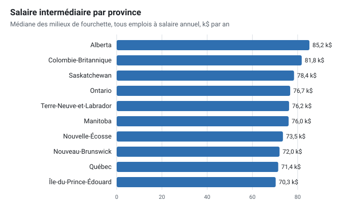
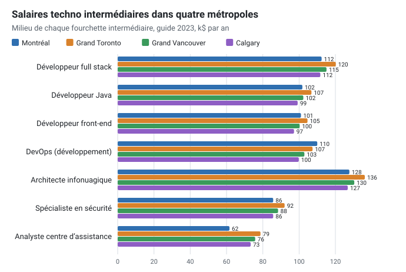
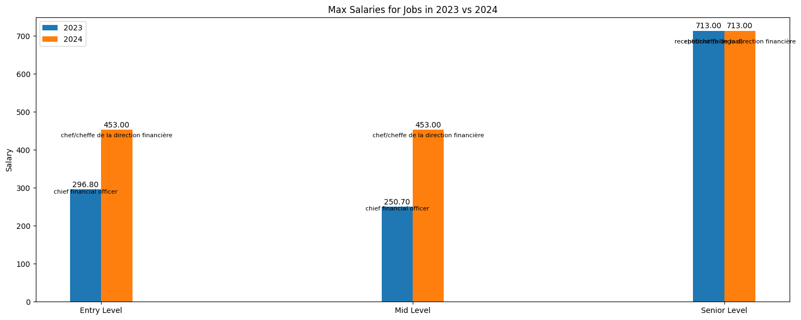

# Salary

<div class="repo-status-row"><span class="repo-badge kind">Analyse de données</span><span class="repo-badge api">API</span><span class="repo-badge docker">Docker</span></div>

<div class="repo-tech-badges"><span class="tag tool">Python</span><span class="tag tool">pandas</span><span class="tag tool">Polars</span><span class="tag tool">PyPDF2</span><span class="tag tool">Jupyter</span><span class="tag tool">FastAPI</span><span class="tag tool">BeautifulSoup</span><span class="tag tool">pre-commit</span></div>

Salary est un projet de données d’AlgoÉTS sur la rémunération au Canada. Il transforme des guides salariaux de firmes de recrutement (PDF) et des tableaux de salaires fédéraux (CSV) en tableaux de données, puis compare les postes entre provinces, régions et niveaux d’expérience. Il sert à voir, par exemple, comment un architecte infonuagique est payé d’une région à l’autre, et intéressera aussi ceux qui veulent extraire des tableaux de rapports PDF.

## Aperçu {#overview}

L’extraction des PDF repose sur un script par édition de guide. `src/pdf_salary_scraper_2023_1.py` et `src/pdf_salary_scraper_2024_1.py` lisent un guide de `data/pdf/` avec PyPDF2, suivent la province et la région courantes à partir de listes de noms fixes, séparent chaque ligne en un titre de poste et trois fourchettes (junior, intermédiaire et senior) et enregistrent le résultat en pickle dans `data/pickle/`. `src/pdf.py` est un essai antérieur avec PyMuPDF qui étiquette le texte selon la taille de police pour repérer les titres.

`src/wages_in_time.py` charge les fichiers du Guichet-Emplois `data/csv/wage_2012.csv` à `wage_2022.csv` avec Polars, harmonise les noms de colonnes d’une année à l’autre, met la table combinée en cache dans `data/pickle/wages.pkl` et affiche les postes les mieux payés par année ainsi que les postes d’ingénierie les mieux payés par province. `src/stackoverflow_scraper.py` récupère le tableau des salaires du sondage Stack Overflow 2022.

L’analyse se fait dans `sandbox/salary_exploration_2023.ipynb` et `sandbox/salary_exploration_2024.ipynb`, avec des versions des mêmes fonctions dans `src/analyse.py` : séparer les fourchettes, calculer les moyennes par niveau, classer les postes, filtrer l’ingénierie et le Québec, comparer un poste entre régions et provinces et trouver les postes aux plus grands écarts régionaux. `api/app.py` expose les pickles 2023 et 2024 en JSON avec FastAPI, et `web/` contient deux pages HTML statiques.

## Résultats du guide 2023 {#results}

Le dépôt conserve le texte brut du guide 2023 (le README cite Randstad comme source) dans `sandbox/output/output.txt` : une ligne par cellule de tableau, marquée du niveau de titre d’où elle vient. Relire ce fichier en gardant les en-têtes de tableau, au lieu de supposer que chaque ligne est débutant / intermédiaire / senior, donne les chiffres ci-dessous. Tous les montants sont ceux du guide, en milliers de dollars par an, et chaque chiffre est la médiane des milieux de fourchette (pour « 75.0 - 90.0 », le milieu vaut 82,5). L’article associé, [Ce que dit un guide salarial canadien quand on lit bien ses tableaux](), raconte la même analyse avec plus de contexte.

**Ce que contient le fichier.**

| Décompte | Lignes |
| --- | --- |
| Lignes avec des fourchettes de salaire | 19 387 |
| Dans des tableaux débutant / intermédiaire / senior | 17 915 |
| Dans des tableaux par années d’expérience (1, 3, 5, 10 ans) | 760 |
| Dans des tableaux par chiffre d’affaires (10 M$, 100 M$, 1 000 M$) | 677 |
| Doublons exacts (même emploi, région et province) | 3 607 |
| Fourchettes cassées (haut au-delà de trois fois le bas, ou sous le bas) | 3 |
| Lignes emploi-région propres restantes | 14 305 |

Les 1 437 lignes des tableaux par expérience et par chiffre d’affaires concernent la finance et les RH. Les scripts d’extraction les lisent comme débutant, intermédiaire et senior : c’est ainsi qu’un chef de la direction financière d’une entreprise de 1 000 M$ de chiffre d’affaires (594,1 k$ en haut de fourchette) devient un salaire « senior » dans les carnets. Parmi les lignes propres, les 1 242 de la famille soutien industriel sont des taux horaires (19,8 $, 22,3 $ et 24,9 $ de l’heure selon le niveau) ; elles sont donc séparées des 13 063 lignes annuelles, qui couvrent 371 emplois dans 57 régions.

**Niveaux.** Le milieu médian vaut 66,2 k$ au niveau débutant, 75,9 k$ au niveau intermédiaire et 86,8 k$ au niveau senior. Le pas entre niveaux est très régulier : pour l’emploi médian, le salaire senior vaut 1,30 fois le salaire débutant, et 80 % des lignes se situent entre 1,22 et 1,36.


**Provinces.** L’Alberta a le milieu intermédiaire médian le plus élevé (85,2 k$), suivie de la Colombie-Britannique (81,8 k$) et de la Saskatchewan (78,4 k$) ; le Québec (71,4 k$) et l’Île-du-Prince-Édouard (70,3 k$) ferment la marche. Ces médianes mélangent les emplois que chaque région liste, et le Québec compte à lui seul 16 régions, la plupart hors de Montréal : l’écart vient donc en partie des emplois et des lieux comptés, pas seulement du salaire pour un même emploi.



**Un même emploi, quatre villes.** Comparer un seul emploi entre régions retire l’effet de composition. Pour les développeurs et les architectes, les quatre métropoles sont à moins d’environ 10 % les unes des autres : un développeur full stack intermédiaire est à 112,4 k$ à Montréal, 120,2 k$ dans le Grand Toronto, 115,1 k$ dans le Grand Vancouver et 111,7 k$ à Calgary, et le poste DevOps (développement) est le mieux payé à Montréal, à 110,0 k$. L’exception est le soutien : un analyste de centre d’assistance intermédiaire est à 61,6 k$ à Montréal contre 78,7 k$ dans le Grand Toronto.



**Emplois les mieux payés.** Parmi les emplois listés dans au moins 25 régions, les milieux intermédiaires médians les plus élevés sont directeur des opérations (190,4 k$), directeur du commerce électronique (159,7 k$), directeur de construction (153,6 k$), directeur de fabrication (153,3 k$) et directeur de l’approvisionnement (152,3 k$). Côté technologies, viennent en tête directeur des TI (151,8 k$), responsable technique (143,1 k$) et architecte d’applications (132,2 k$).

**Ce que montre plutôt le carnet de comparaison.** `sandbox/compare_2023_to_2024.ipynb` compare directement les fichiers pickle 2023 et 2024. Son graphique des salaires maximums place « receptionist (bilingual) » à 713 k$, la ligne cassée du comté de Simcoe, et affiche les mêmes 713 k$ pour 2024, parce que les listes de minimums et de maximums 2024 lisent leur valeur senior dans `df_sorted_2023`. Dans le pickle 2024, `entry_max` a exactement la même moyenne (94,67) et le même écart-type que `mid_max`, signe d’une fourchette débutant assemblée avec les mauvais nombres. Le guide 2024 est aussi en français (`ingénieur·e chimiste`) alors que celui de 2023 est en anglais : on ne peut pas apparier les emplois des deux années par leur titre.



## Démarrage {#installation}

Le README donne ces étapes :

```bash
pip install -r requirements.txt
python src/pdf.py
jupyter notebook
```

Lancez les scripts d’extraction depuis la racine du dépôt, car ils utilisent des chemins comme `data/pdf/2023_salary_guide.pdf` :

```bash
python src/pdf_salary_scraper_2023_1.py
python src/wages_in_time.py
```

`api/setup.md` décrit le déploiement de l’API avec Docker et Vercel ; en local, on peut la démarrer avec uvicorn depuis le répertoire `api/` :

```bash
cd api
uvicorn app:app --reload
```

## Guide du dépôt {#reader-guide}

- `src/pdf_salary_scraper_2023_1.py` et `src/pdf_salary_scraper_2024_1.py` extraient les guides 2023 et 2024 (le README indique Randstad comme source) ; les scripts `_2` et `generic_wip` en sont des variantes sous forme de fonctions.
- `src/wages_in_time.py` combine les tableaux de salaires 2012 à 2022 du Guichet-Emplois.
- `src/stackoverflow_scraper.py` récupère le tableau des salaires du sondage Stack Overflow.
- `src/analyse.py` et `src/utils.py` regroupent les fonctions d’analyse et de pickle ; `src/__init__.py` liste provinces et régions.
- `sandbox/` contient les carnets d’exploration 2023 et 2024 et une comparaison 2023-2024.
- `data/pdf/`, `data/csv/`, `data/pickle/` et `data/geo/` contiennent les guides de plusieurs firmes de recrutement, les tableaux de salaires, les pickles extraits et des fichiers de formes des provinces ; `data/csv/README.md` décrit les colonnes des salaires.
- `api/` contient l’application FastAPI, le Dockerfile, le fichier Compose et les notes de déploiement.
- `web/index.html` présente des résultats 2023 en texte statique ; `web/job_search.html` est une maquette de formulaire de recherche.

## Fonctionnalités {#features}

- extraire poste, province, région et fourchettes junior, intermédiaire et senior des guides salariaux en PDF ;
- réunir onze années de tableaux de salaires du Guichet-Emplois dans un seul tableau Polars ;
- classer les postes selon le salaire maximal, au total, par année, par province et pour l’ingénierie ;
- comparer un poste entre régions et provinces et trouver les plus grands écarts régionaux ;
- récupérer les salaires du sondage Stack Overflow ;
- servir les guides 2023 et 2024 extraits en JSON avec FastAPI.

## Limites {#limits}

- Le README annonce un modèle de prédiction des salaires selon la région, l’expérience et la scolarité ; le dépôt contient du code d’extraction et d’exploration, mais aucun modèle.
- Les commandes du README nomment `src/pdf_salary_scraper.py` et un `stackoverflow_scraper.py` à la racine, qui n’existent pas sous ces noms.
- `requirements.txt` omet PyMuPDF, Polars et BeautifulSoup, que les scripts importent ; `src/wages_in_time.py` utilise une ancienne API de Polars.
- La province et la région viennent du premier nom d’une liste fixe trouvé n’importe où sur la page, la fourchette junior joint le bas de la première paire au haut de la deuxième, et les lignes à quatre fourchettes sont ignorées. Le README et `web/index.html` donnent une réceptionniste bilingue à 713 000 $ comme salaire le plus élevé de 2023, signe d’erreurs d’extraction.
- `src/wages_in_time.py` annualise les salaires horaires avec 40 × 45 heures dans une fonction et 45 × 45 dans une autre, et signale les fichiers 2017 et 2018 comme mal formatés.
- Les fichiers de déploiement se contredisent : `vercel.json` construit un `app.py` à la racine alors que l’application est `api/app.py`, le Dockerfile lance `unicorn` sur le port 8000 alors que Compose publie le port 5000, et l’API lit les pickles par des chemins relatifs `../data`.
- `src/test.py` importe des fonctions qui n’existent pas, et `setup.py` pointe encore vers un répertoire de paquet `code` avec une description héritée d’un gabarit.

## Sources {#sources}

- [Dépôt GitHub](https://github.com/AlgoETS/Salary)
- [README](https://github.com/AlgoETS/Salary/blob/main/README.md)
- [`src/pdf_salary_scraper_2024_1.py`](https://github.com/AlgoETS/Salary/blob/main/src/pdf_salary_scraper_2024_1.py)
- [`src/wages_in_time.py`](https://github.com/AlgoETS/Salary/blob/main/src/wages_in_time.py)
- [`sandbox/salary_exploration_2023.ipynb`](https://github.com/AlgoETS/Salary/blob/main/sandbox/salary_exploration_2023.ipynb)
- [`sandbox/compare_2023_to_2024.ipynb`](https://github.com/AlgoETS/Salary/blob/main/sandbox/compare_2023_to_2024.ipynb)
- [`sandbox/output/output.txt`](https://github.com/AlgoETS/Salary/blob/main/sandbox/output/output.txt)
- [`api/app.py`](https://github.com/AlgoETS/Salary/blob/main/api/app.py)
- [`data/csv/README.md`](https://github.com/AlgoETS/Salary/blob/main/data/csv/README.md)
