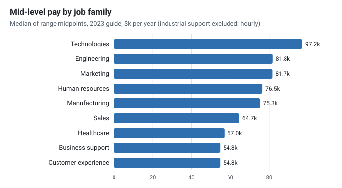
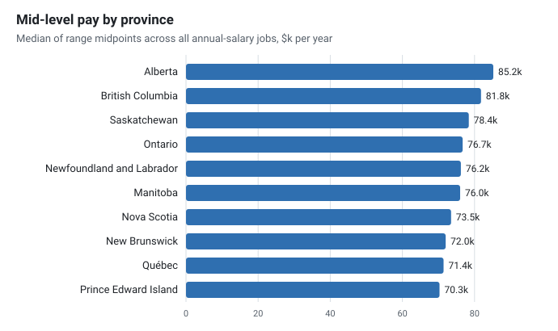
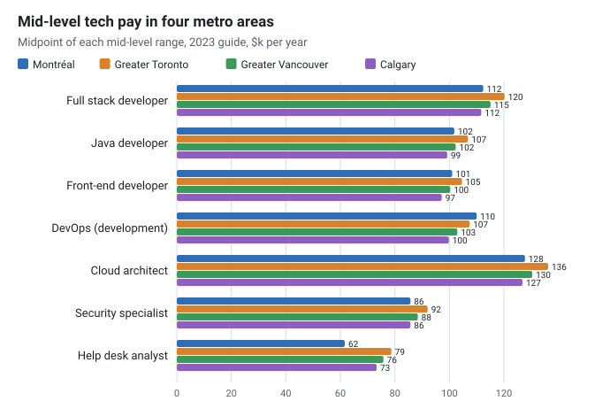
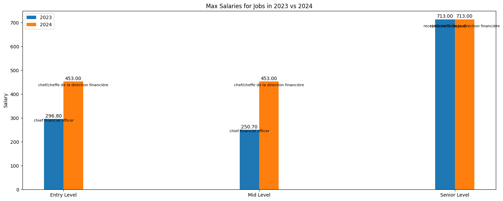

# Salary

<div class="repo-status-row"><span class="repo-badge kind">Data analysis</span><span class="repo-badge api">API</span><span class="repo-badge docker">Docker</span></div>

<div class="repo-tech-badges"><span class="tag tool">Python</span><span class="tag tool">pandas</span><span class="tag tool">Polars</span><span class="tag tool">PyPDF2</span><span class="tag tool">Jupyter</span><span class="tag tool">FastAPI</span><span class="tag tool">BeautifulSoup</span><span class="tag tool">pre-commit</span></div>

Salary is an AlgoÉTS data project about pay in Canada. It turns recruitment-firm salary guides (PDF) and federal wage tables (CSV) into data frames, then compares jobs across provinces, regions and experience levels. It is useful to anyone who wants to see how a job such as cloud architect is paid from one region to another, and to readers interested in extracting tables from PDF reports.

## Overview {#overview}

The PDF path is handled by one script per guide edition. `src/pdf_salary_scraper_2023_1.py` and `src/pdf_salary_scraper_2024_1.py` read a guide in `data/pdf/` with PyPDF2, track the current province and region from fixed name lists, split each line into a job title and three salary ranges (entry, mid and senior) and save the result as a pickle in `data/pickle/`. `src/pdf.py` is an earlier PyMuPDF experiment that tags text by font size to find headings.

`src/wages_in_time.py` loads the Job Bank wage files `data/csv/wage_2012.csv` to `wage_2022.csv` with Polars, harmonizes column names across years, caches the combined table in `data/pickle/wages.pkl` and prints the best-paid jobs per year and the best-paid engineering jobs per province. `src/stackoverflow_scraper.py` scrapes the salary table of the 2022 Stack Overflow survey.

Analysis happens in `sandbox/salary_exploration_2023.ipynb` and `sandbox/salary_exploration_2024.ipynb`, with helper versions of the same functions in `src/analyse.py`: split the ranges, compute means per level, rank jobs, filter engineering and Québec jobs, compare one job across regions and provinces, and find the jobs with the widest regional spread. `api/app.py` exposes the 2023 and 2024 pickles as JSON through FastAPI, and `web/` holds two static HTML pages.

## Results from the 2023 guide {#results}

The repository keeps the raw text of the 2023 guide (the README names Randstad as the source) in `sandbox/output/output.txt`: one line per table cell, tagged with the heading level it came from. Re-reading that file with the table headers kept, instead of assuming every row is entry / mid / senior, gives the numbers below. All amounts are the guide's own, in thousands of dollars per year, and each figure is the median of range midpoints (for "75.0 - 90.0", the midpoint is 82.5). The companion article, [What a Canadian salary guide says once the tables are read correctly](), tells the same story with more context.

**What is in the file.**

| Count | Rows |
| --- | --- |
| Rows with salary ranges | 19,387 |
| In entry / mid / senior tables | 17,915 |
| In tables by years of experience (1, 3, 5, 10 years) | 760 |
| In tables by company revenue (10 M$, 100 M$, 1,000 M$) | 677 |
| Exact duplicates (same job, region and province) | 3,607 |
| Broken ranges (high above three times low, or below low) | 3 |
| Clean job-and-region rows left | 14,305 |

The 1,437 rows from the experience and revenue tables are finance and HR roles. The extraction scripts read them as entry, mid and senior, which is how a chief financial officer at a company with 1,000 M$ in revenue (594.1k at the top of the range) ends up as a "senior" salary in the notebooks. Of the clean rows, the 1,242 in the industrial support family are hourly rates ($19.8, $22.3 and $24.9 an hour at the three levels), so they are kept apart from the 13,063 annual rows, which cover 371 jobs in 57 regions.

**Levels.** The median midpoint is 66.2k at entry level, 75.9k at mid level and 86.8k at senior level. The step between levels is very regular: senior pay is 1.30 times entry pay for the median job, and 80% of rows fall between 1.22 and 1.36.



**Provinces.** Alberta has the highest median mid-level midpoint (85.2k), then British Columbia (81.8k) and Saskatchewan (78.4k); Québec (71.4k) and Prince Edward Island (70.3k) are lowest. These medians mix whatever jobs each region lists, and Québec alone has 16 regions, most of them outside Montréal, so the gap is partly a difference in which jobs and places are counted, not only in pay for the same job.



**Same job, four cities.** Comparing one job across regions removes the job-mix effect. For developer and architect roles the four metro areas are within about 10% of each other: a mid-level full stack developer is at 112.4k in Montréal, 120.2k in Greater Toronto, 115.1k in Greater Vancouver and 111.7k in Calgary, and DevOps (development) is highest in Montréal at 110.0k. The exception is support work: a mid-level help desk analyst is at 61.6k in Montréal against 78.7k in Greater Toronto.



**Best-paid jobs.** Among jobs listed in at least 25 regions, the highest median mid-level midpoints are director of operations (190.4k), e-commerce director (159.7k), construction director (153.6k), manufacturing director (153.3k) and procurement director (152.3k). The best-paid technology roles are IT director (151.8k), technical lead (143.1k) and application architect (132.2k).

**What the comparison notebook shows instead.** `sandbox/compare_2023_to_2024.ipynb` compares the 2023 and 2024 pickles directly. Its maximum-salary chart puts "receptionist (bilingual)" at 713k, the broken Simcoe County row, and shows the same 713k for 2024 because the 2024 minimum and maximum lists read their senior value from `df_sorted_2023`. In the 2024 pickle, `entry_max` has exactly the same mean (94.67) and standard deviation as `mid_max`, which points to an entry range assembled from the wrong numbers. The 2024 guide is also in French (`ingénieur·e chimiste`) while 2023 is in English, so jobs cannot be matched across the two years by title.



## Getting started {#installation}

The README lists these steps:

```bash
pip install -r requirements.txt
python src/pdf.py
jupyter notebook
```

Run the extraction scripts from the repository root, since they use paths such as `data/pdf/2023_salary_guide.pdf`:

```bash
python src/pdf_salary_scraper_2023_1.py
python src/wages_in_time.py
```

`api/setup.md` describes Docker and Vercel deployment of the API; locally, it can be started with uvicorn from the `api/` directory:

```bash
cd api
uvicorn app:app --reload
```

## Repository guide {#reader-guide}

- `src/pdf_salary_scraper_2023_1.py` and `src/pdf_salary_scraper_2024_1.py` extract the 2023 and 2024 guides (the README names Randstad as the source); the `_2` and `generic_wip` scripts are function-based variants.
- `src/wages_in_time.py` combines the 2012–2022 Job Bank wage tables.
- `src/stackoverflow_scraper.py` scrapes the Stack Overflow survey salary table.
- `src/analyse.py` and `src/utils.py` hold analysis and pickle helpers; `src/__init__.py` lists provinces and regions.
- `sandbox/` contains the 2023 and 2024 exploration notebooks and a 2023-to-2024 comparison.
- `data/pdf/`, `data/csv/`, `data/pickle/` and `data/geo/` hold source guides from several recruitment firms, wage tables, extracted pickles and province shapefiles; `data/csv/README.md` documents the wage columns.
- `api/` contains the FastAPI app, Dockerfile, Compose file and deployment notes.
- `web/index.html` shows 2023 results as static text; `web/job_search.html` is a search form mock-up.

## Features {#features}

- extract job, province, region and entry, mid and senior ranges from salary guide PDFs;
- combine eleven years of Job Bank wage tables into one Polars data frame;
- rank jobs by maximum salary, overall, per year, per province and for engineering roles;
- compare one job across regions and provinces and find the widest regional gaps;
- scrape Stack Overflow survey salaries;
- serve the extracted 2023 and 2024 guides as JSON through FastAPI.

## Limits {#limits}

- The README states the goal of a salary prediction model by region, experience and education; the repository contains extraction and exploration code, but no model.
- The README commands name `src/pdf_salary_scraper.py` and a root `stackoverflow_scraper.py`, which do not exist under those names.
- `requirements.txt` misses PyMuPDF, Polars and BeautifulSoup, which the scripts import; `src/wages_in_time.py` uses an older Polars API.
- Province and region come from the first name in a fixed list found anywhere on the page, the entry range joins the low of the first pair with the high of the second, and four-range lines are skipped. The README and `web/index.html` list a bilingual receptionist at $713,000 as the top 2023 salary, which points to extraction errors.
- `src/wages_in_time.py` annualizes hourly wages with 40 × 45 hours in one function and 45 × 45 in another, and flags the 2017 and 2018 files as badly formatted.
- Deployment files disagree: `vercel.json` builds a root `app.py` while the app is `api/app.py`, the Dockerfile runs `unicorn` on port 8000 while Compose maps 5000, and the API reads pickles through `../data` relative paths.
- `src/test.py` imports functions that do not exist, and `setup.py` still points to a `code` package directory and a template description.

## Sources {#sources}

- [GitHub repository](https://github.com/AlgoETS/Salary)
- [README](https://github.com/AlgoETS/Salary/blob/main/README.md)
- [`src/pdf_salary_scraper_2024_1.py`](https://github.com/AlgoETS/Salary/blob/main/src/pdf_salary_scraper_2024_1.py)
- [`src/wages_in_time.py`](https://github.com/AlgoETS/Salary/blob/main/src/wages_in_time.py)
- [`sandbox/salary_exploration_2023.ipynb`](https://github.com/AlgoETS/Salary/blob/main/sandbox/salary_exploration_2023.ipynb)
- [`sandbox/compare_2023_to_2024.ipynb`](https://github.com/AlgoETS/Salary/blob/main/sandbox/compare_2023_to_2024.ipynb)
- [`sandbox/output/output.txt`](https://github.com/AlgoETS/Salary/blob/main/sandbox/output/output.txt)
- [`api/app.py`](https://github.com/AlgoETS/Salary/blob/main/api/app.py)
- [`data/csv/README.md`](https://github.com/AlgoETS/Salary/blob/main/data/csv/README.md)
