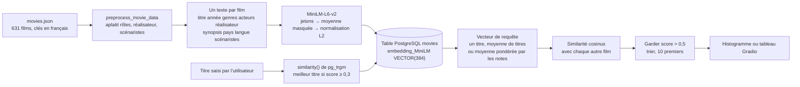
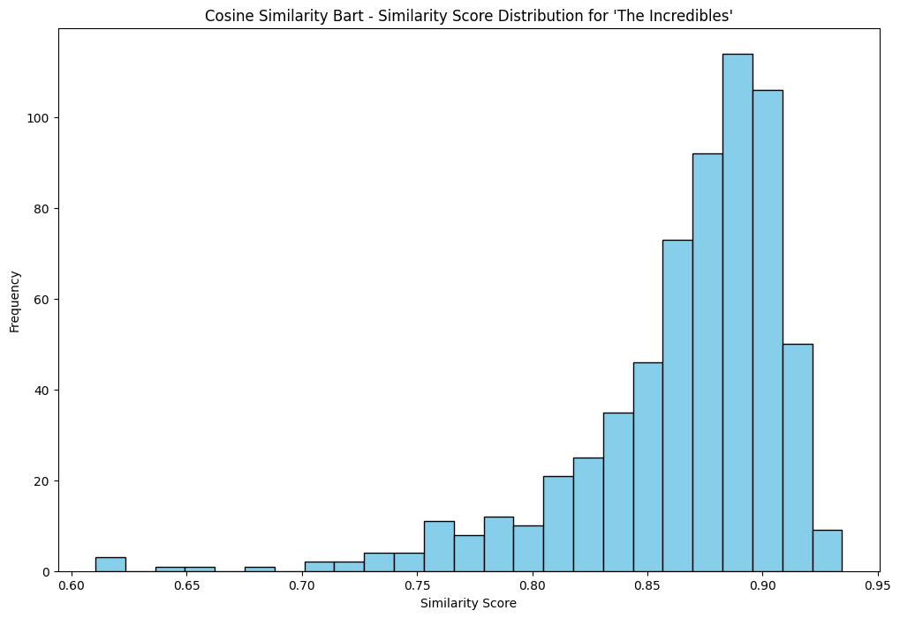
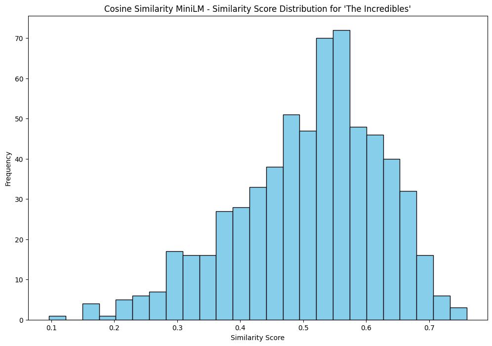
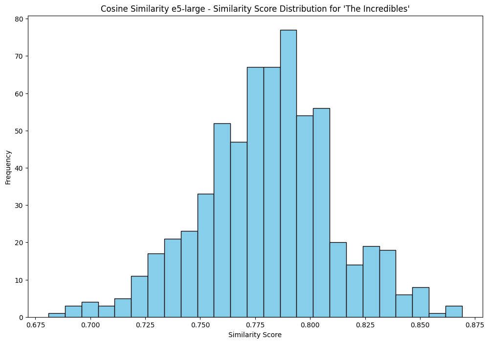
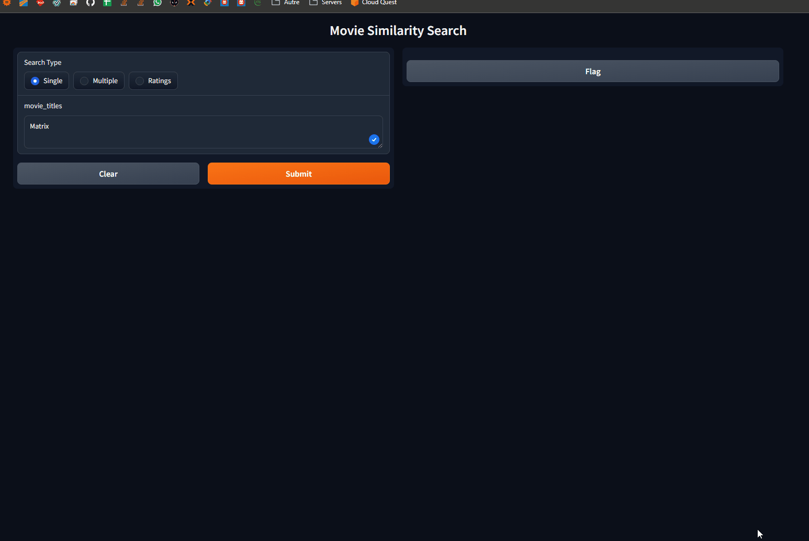

# SimilityVectorEmbedding

<div class="repo-status-row"><span class="repo-badge kind">Carnets</span><span class="repo-badge docker">Docker</span></div>

<div class="repo-tech-badges"><span class="tag tool">Python</span><span class="tag tool">Jupyter</span><span class="tag tool">PostgreSQL</span><span class="tag tool">pgvector</span><span class="tag tool">Qdrant</span><span class="tag tool">Neo4j</span><span class="tag tool">Sentence Transformers</span><span class="tag tool">LangChain</span><span class="tag tool">Ollama</span><span class="tag tool">Gradio</span></div>

SimilityVectorEmbedding regroupe des carnets Jupyter qui transforment un catalogue de films en vecteurs, puis cherchent des films semblables avec plusieurs méthodes de stockage et de classement. C’est un dépôt [AlgoÉTS](https://github.com/AlgoETS) pour qui veut voir la recherche vectorielle appliquée à de vraies fiches de films. L’article [Similarité entre films et recherche vectorielle]() raconte le même travail, avec les animations de démonstration d’origine.

## Aperçu {#overview}

Chaque dossier associe un carnet à la base de données dont il a besoin. Tous lisent un fichier `movies.json` dont les fiches utilisent des clés en français (`titre`, `annee`, `genre`, `realisateur`, `role`, `synopsis` …) sous `films.film`.

- `postgres/0.simple.ipynb` est le parcours complet le plus court : il compose un texte par film (titre, année, genres, acteurs, réalisateur, résumé, pays, langue, scénaristes), l’encode avec `sentence-transformers/all-MiniLM-L6-v2` par mean pooling, normalise les vecteurs et les insère dans une table `movies` avec une colonne `VECTOR(384)`. Le titre saisi est retrouvé avec `pg_trgm`, puis la similarité cosinus classe le reste du catalogue. Le carnet calcule aussi la moyenne de plusieurs titres, pondère des titres selon une note, trace les scores et se termine par une interface Gradio.
- `postgres/1.create_table.ipynb` encode le même catalogue avec cinq configurations (BART, GTE, MiniLM-L12, RoBERTa et e5-large) et range une colonne de vecteurs par modèle.
- `postgres/3.LLMS.ipynb` vectorise une question en langage naturel, lance une requête cosinus pgvector `<=>` et transmet le schéma de la table à une chaîne LangChain reliée à Ollama (`llama2:13b-chat`).
- `qdrant/0.simple.ipynb` insère des vecteurs de 384 dimensions par lots de 100 dans une collection cosinus, l’interroge et projette les vecteurs avec t-SNE et k-means.
- `bm25/0.bm25.ipynb` classe les films par mots-clés avec `rank_bm25`, sans vecteurs.
- `neo4j/1.create_db.ipynb` charge films et personnes sous forme de graphe et note les voisins selon les genres, réalisateurs, scénaristes et acteurs partagés.

## Comment fonctionne la recherche {#pipeline}

Les carnets PostgreSQL suivent une même chaîne de traitement. `postgres/0.simple.ipynb` en est la version la plus lisible ; les étapes ci-dessous le citent.



### 1. D’un enregistrement JSON à un texte

`load_movies_data` lit `films.film` dans `movies.json` ; l’exécution enregistrée charge 631 films. `preprocess_movie_data` traduit les clés françaises en clés anglaises (`titre` → title, `realisateur.__text` → director, `scenariste` → writers) et extrait les noms d’acteurs de `role[].acteur.__text`, en plaçant d’abord un rôle isolé dans une liste. `generate_embedding` assemble ensuite les champs en une chaîne par film, dans cet ordre : titre, année, genres, acteurs, réalisateur, synopsis, pays, langue, scénaristes. Les mots vides anglais de NLTK sont retirés du titre et du synopsis seulement.

### 2. Le plongement

Le modèle est `sentence-transformers/all-MiniLM-L6-v2`, chargé par `AutoModel` de Hugging Face. Le tokeniseur tronque chaque texte à 512 jetons et complète le lot par du remplissage. Le modèle renvoie un vecteur de 384 dimensions par jeton ; `mean_pooling` en fait la moyenne en multipliant par le masque d’attention, pour que les jetons de remplissage ne comptent pas :

```python
token_embeddings = model_output[0]
mask = attention_mask.unsqueeze(-1).expand(token_embeddings.size()).float()
sentence = (token_embeddings * mask).sum(1) / mask.sum(1).clamp(min=1e-9)
```

`F.normalize(..., p=2)` ramène ensuite chaque vecteur à une longueur de 1. Après cette étape, similarité cosinus et produit scalaire donnent le même nombre.

### 3. La table

`setup_database` active les extensions `vector`, `cube` et `pg_trgm`, supprime `movies` si elle existe et la recrée avec des colonnes simples (titre, acteurs, année, pays, langue, durée, synopsis, réalisateur, affiche), deux tableaux `TEXT[]` (genre, scénaristes) et `embedding_MiniLM VECTOR(384)`. `insert_movie` écrit chaque vecteur sous forme de littéral `'[0.01, -0.03, …]'`, que pgvector sait lire. Aucun index HNSW ou IVFFlat n’est créé : chaque recherche compare la requête à toutes les lignes, ce qui reste instantané pour 631 films.

### 4. Trouver le film de départ

Les titres sont saisis approximativement : `get_best_matching_title` demande donc à `pg_trgm` le titre le plus proche, avec `ORDER BY similarity(title, %s) DESC LIMIT 1`. `similarity` est la part de groupes de trois lettres (trigrammes) que les deux chaînes ont en commun, de 0 à 1. Si le meilleur score est sous 0,3, la recherche s’arrête sur « No close match found ». Sinon, le carnet relit le vecteur enregistré de ce film.

### 5. Score et classement

`find_similar_movies` charge le vecteur de chaque autre film et calcule `cosine_similarity(query, embeddings)` avec scikit-learn, en Python. Un film est retenu si son score dépasse 0,5, et les dix premiers sont renvoyés par ordre décroissant. Les deux variantes ne changent que le vecteur de requête :

- **Plusieurs titres** (`find_similar_movies_list`) : la moyenne simple des vecteurs des titres ; une trilogie oriente donc la recherche vers ce que les trois films partagent.
- **Titres notés** (`find_similar_movies_ratings`) : une moyenne pondérée. Le film placé à `influential_index` reçoit le poids `(note − 1) × influence_factor` ; les autres gardent leur note comme poids. Dans l’exemple du carnet, The Matrix, Toy Story 2 et The Lion King notés 100, 100 et 1, les poids valent 198, 100 et 1 : la requête est faite aux deux tiers de The Matrix, au tiers de Toy Story 2 et presque pas de The Lion King.

Les autres carnets font la même comparaison dans la base. `3.LLMS.ipynb` trie sur `1 - (embedding_MiniLM <=> query)` : l’opérateur `<=>` de pgvector renvoie la *distance* cosinus, donc un moins cette valeur donne la similarité. `2.analyse.ipynb` essaie aussi `<->` (euclidienne), `<#>` (produit scalaire négatif) et `<+>` (L1).


 : les suites de Matrix restent en tête, et Toy Story, Dinosaur et Hook apparaissent parce qu’un tiers du vecteur de requête vient de Toy Story 2.")

### 6. Choisir un modèle

`1.create_table.ipynb` enregistre cinq plongements par film côte à côte : `facebook/bart-large`, `Alibaba-NLP/gte-large-en-v1.5` et `intfloat/e5-large` par `AutoModel` (1 024 dimensions), puis `all-MiniLM-L12-v2` (384) et `nli-roberta-large` (1 024) par `SentenceTransformer`. `2.analyse.ipynb` trace ensuite, pour un film de départ, le score cosinus de tous les autres films du catalogue. L’étalement des scores compte plus que leur niveau : un modèle dont tous les scores tiennent dans une bande étroite ne peut pas séparer un film proche d’un film sans rapport avec un seuil fixe.







### 7. Regarder l’espace

Le carnet Qdrant range les mêmes vecteurs MiniLM de 384 dimensions dans une collection cosinus, puis les projette en deux dimensions avec t-SNE et les regroupe avec k-means. La projection n’est qu’une image : les distances d’un graphique t-SNE ne sont pas les scores cosinus utilisés pour la recherche.


La cellule Gradio réunit les trois recherches dans une page qui affiche affiches, titres, années et scores. Cet enregistrement vient de l’article associé.



## Démarrage {#installation}

Les carnets installent leurs paquets avec des cellules `!pip install`. Démarrez la base du carnet voulu, puis ouvrez Jupyter :

```shell
git clone https://github.com/AlgoETS/SimilityVectorEmbedding.git
cd SimilityVectorEmbedding/postgres
docker-compose up -d
jupyter notebook
```

`postgres/docker-compose.yml` construit PostgreSQL avec pgvector compilé depuis les sources et `pg_trgm`, sur le port 5432. Les dossiers `qdrant/` et `neo4j/` ont chacun leur `docker-compose.yml` (Qdrant sur 6333/6334, Neo4j sur 7474/7687 avec APOC et Graph Data Science). `neo4j/install_ollama.sh` installe Ollama sous Linux pour le carnet LLM.

## Guide du dépôt {#reader-guide}

- `postgres/0.simple.ipynb` : vecteurs MiniLM, correspondance de titres, recherches simple, multiple ou pondérée, graphique en barres et interface Gradio.
- `postgres/1.create_table.ipynb` : cinq modèles de vectorisation rangés côte à côte dans PostgreSQL.
- `postgres/2.analyse.ipynb` : distributions des scores par modèle et comparaison des scores cosinus, euclidien, produit scalaire, Hamming et Jaccard.
- `postgres/3.LLMS.ipynb` : vectorisation de la question, requête pgvector et invite LangChain + Ollama.
- `postgres/pgvector-archive.ipynb` : une version antérieure, tout-en-un, du carnet d’analyse.
- `postgres/Dockerfile`, `postgres/docker-compose.yml`, `postgres/init-db.sh` : image de la base et activation des extensions.
- `qdrant/0.simple.ipynb`, `qdrant/docker-compose.yml` : la version Qdrant de la recherche, avec graphiques de regroupement.
- `bm25/0.bm25.ipynb` : point de comparaison par mots-clés.
- `neo4j/1.create_db.ipynb`, `neo4j/docker-compose.yml`, `neo4j/personnes.json` : modèle en graphe des films et des personnes.
- `*/movies.json` : le catalogue de films, copié dans chaque dossier.

## Fonctionnalités {#features}

- composer le texte à vectoriser à partir de plusieurs champs, en retirant les mots vides anglais du titre et du résumé ;
- comparer cinq modèles Hugging Face / Sentence Transformers sur le même catalogue ;
- stocker les vecteurs dans PostgreSQL avec pgvector et retrouver des titres approximatifs avec `pg_trgm` ;
- chercher à partir d’un titre, de la moyenne de plusieurs titres ou d’un mélange pondéré par des notes ;
- reprendre la même idée avec Qdrant, puis avec BM25 et un graphe Neo4j pour comparer ;
- poser des questions à un LLM local appuyé sur la table `movies` ;
- lire les résultats en graphiques à barres, projections t-SNE/k-means, vues de graphe et page Gradio.

## Limites {#limits}

- Le README demande `pip install -r requirements.txt` et un carnet `Similarity_Vector_Embedding.ipynb` ; aucun des deux fichiers n’est dans le dépôt. Les dépendances viennent des cellules `!pip install`.
- Le schéma du README montre une seule colonne `VECTOR(768)` ; les carnets créent une colonne par modèle (384 ou 1024 dimensions).
- `postgres/init-db.sh` crée une extension nommée `pgvector`, alors que les carnets créent `vector`, le nom enregistré par pgvector.
- Les carnets suppriment puis recréent la table `movies` et la collection Qdrant, et utilisent des identifiants locaux codés en dur (`postgres/postgres`, `neo4j/password`).
- Le carnet LLM exige un serveur Ollama avec `llama2:13b-chat` ; la cellule Gradio appelle `launch(share=True)`, qui ouvre un lien de partage public.
- Dans `1.create_table.ipynb`, les vecteurs BART, GTE et e5 valent `last_hidden_state.mean(dim=1)` : la moyenne inclut les jetons de remplissage, contrairement à la moyenne masquée du carnet simple, et les synopsis courts sont dilués. La fiche du modèle e5 demande aussi un préfixe `passage: ` que le carnet n’ajoute pas.
- La recherche exclut les titres tels qu’ils ont été saisis, mais cherche le titre trouvé par correspondance approximative. Saisir « the matrix » en minuscules peut renvoyer The Matrix comme son propre meilleur résultat.
- `0.simple.ipynb` récupère tous les vecteurs et les note en Python ; seuls les carnets d’analyse et de LLM confient le classement à pgvector. Aucun index vectoriel n’est construit.
- Il n’y a pas de tests. Les sorties enregistrées dans les carnets montrent des exécutions passées, pas des mesures de performance.

## Sources {#sources}

- [Dépôt GitHub](https://github.com/AlgoETS/SimilityVectorEmbedding)
- [README](https://github.com/AlgoETS/SimilityVectorEmbedding/blob/main/README.md)
- [`postgres/0.simple.ipynb`](https://github.com/AlgoETS/SimilityVectorEmbedding/blob/main/postgres/0.simple.ipynb)
- [`postgres/1.create_table.ipynb`](https://github.com/AlgoETS/SimilityVectorEmbedding/blob/main/postgres/1.create_table.ipynb)
- [`postgres/2.analyse.ipynb`](https://github.com/AlgoETS/SimilityVectorEmbedding/blob/main/postgres/2.analyse.ipynb)
- [`postgres/3.LLMS.ipynb`](https://github.com/AlgoETS/SimilityVectorEmbedding/blob/main/postgres/3.LLMS.ipynb)
- [Article associé : Similarité entre films et recherche vectorielle]()
- [`qdrant/0.simple.ipynb`](https://github.com/AlgoETS/SimilityVectorEmbedding/blob/main/qdrant/0.simple.ipynb)
- [`neo4j/1.create_db.ipynb`](https://github.com/AlgoETS/SimilityVectorEmbedding/blob/main/neo4j/1.create_db.ipynb)
