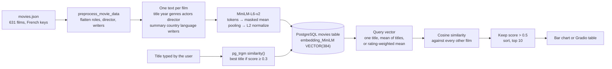
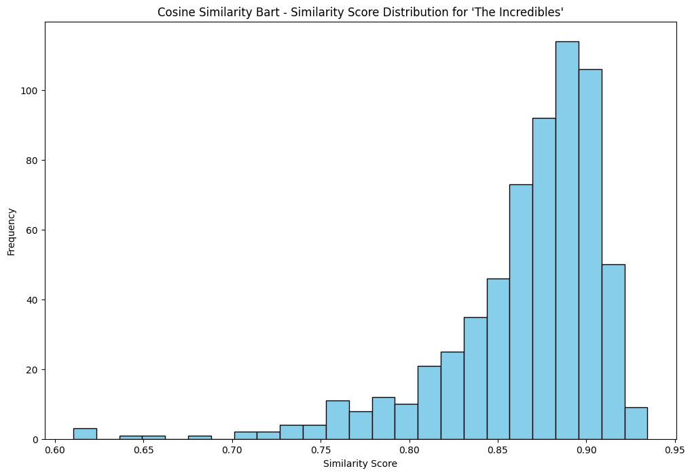
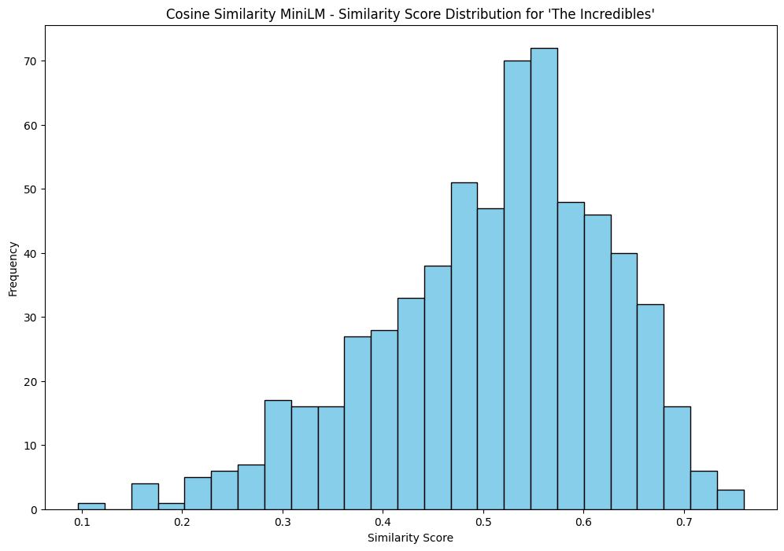
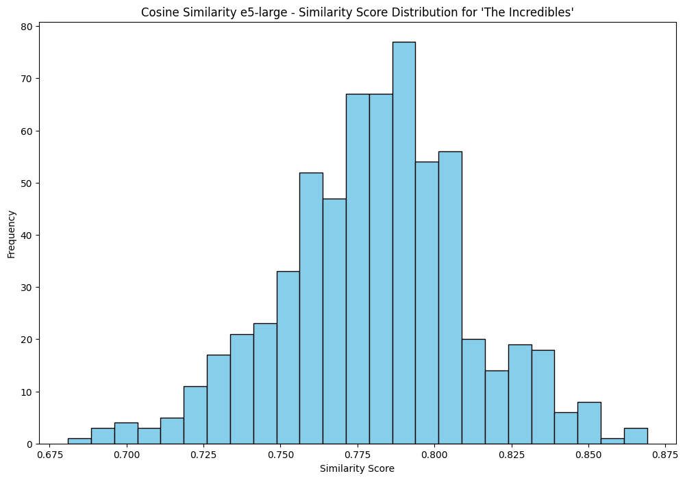
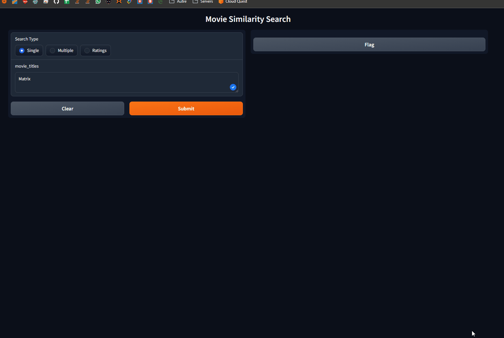

# SimilityVectorEmbedding

<div class="repo-status-row"><span class="repo-badge kind">Notebooks</span><span class="repo-badge docker">Docker</span></div>

<div class="repo-tech-badges"><span class="tag tool">Python</span><span class="tag tool">Jupyter</span><span class="tag tool">PostgreSQL</span><span class="tag tool">pgvector</span><span class="tag tool">Qdrant</span><span class="tag tool">Neo4j</span><span class="tag tool">Sentence Transformers</span><span class="tag tool">LangChain</span><span class="tag tool">Ollama</span><span class="tag tool">Gradio</span></div>

SimilityVectorEmbedding is a set of Jupyter notebooks that turn a movie catalog into embeddings and look for similar films with several storage and ranking approaches. It is an [AlgoÉTS](https://github.com/AlgoETS) repository for readers who want to see vector search applied to real movie records. The article [Exploring movie similarities with vector search algorithms]() tells the same work as a story, with the original demo animations.

## Overview {#overview}

Each folder pairs a notebook with the database it needs. All of them read a `movies.json` file whose records use French keys (`titre`, `annee`, `genre`, `realisateur`, `role`, `synopsis` …) under `films.film`.

- `postgres/0.simple.ipynb` is the shortest full path: it builds one text per film (title, year, genres, actors, director, summary, country, language, writers), encodes it with `sentence-transformers/all-MiniLM-L6-v2` using mean pooling, normalizes the vectors and inserts them into a `movies` table with a `VECTOR(384)` column. Titles typed by the user are matched with `pg_trgm` before cosine similarity ranks the rest of the catalog. It also averages several titles, weights titles by rating, plots the scores and ends with a Gradio interface.
- `postgres/1.create_table.ipynb` encodes the same catalog with five configurations (BART, GTE, MiniLM-L12, RoBERTa and e5-large) and stores one vector column per model.
- `postgres/3.LLMS.ipynb` embeds a natural-language question, runs a pgvector `<=>` cosine query and sends the table schema to a LangChain chain backed by Ollama (`llama2:13b-chat`).
- `qdrant/0.simple.ipynb` upserts 384-dimension vectors in batches of 100 into a cosine collection, searches it, and projects the vectors with t-SNE and k-means.
- `bm25/0.bm25.ipynb` ranks films by keywords with `rank_bm25`, without embeddings.
- `neo4j/1.create_db.ipynb` loads movies and people as a graph and scores neighbours by shared genres, directors, writers and actors.

## How the search works {#pipeline}

The PostgreSQL notebooks follow one pipeline. `postgres/0.simple.ipynb` is the clearest version, so the steps below quote it.



### 1. From a JSON record to a text

`load_movies_data` reads `films.film` from `movies.json`; the saved run loads 631 films. `preprocess_movie_data` maps the French keys to English ones (`titre` → title, `realisateur.__text` → director, `scenariste` → writers) and pulls actor names out of `role[].acteur.__text`, wrapping a single role in a list first. `generate_embedding` then glues the fields into one string per film, in this order: title, year, genres, actors, director, summary, country, language, writers. English stopwords are removed from the title and the summary only, with NLTK's list.

### 2. The embedding

The model is `sentence-transformers/all-MiniLM-L6-v2`, loaded through Hugging Face `AutoModel`. The tokenizer truncates each text to 512 tokens and pads the batch. The model returns one 384-dimension vector per token; `mean_pooling` averages them, multiplying by the attention mask so padding tokens do not count:

```python
token_embeddings = model_output[0]
mask = attention_mask.unsqueeze(-1).expand(token_embeddings.size()).float()
sentence = (token_embeddings * mask).sum(1) / mask.sum(1).clamp(min=1e-9)
```

`F.normalize(..., p=2)` then scales every vector to length 1. After that step, cosine similarity and the dot product give the same number.

### 3. The table

`setup_database` enables the `vector`, `cube` and `pg_trgm` extensions, drops `movies` if it exists and recreates it with plain columns (title, actors, year, country, language, duration, summary, director, poster), two `TEXT[]` arrays (genre, scenarists) and `embedding_MiniLM VECTOR(384)`. `insert_movie` writes each vector as a `'[0.01, -0.03, …]'` literal, which pgvector parses. No HNSW or IVFFlat index is created, so every search compares the query with every row; for 631 films that is instant.

### 4. Finding the query film

Users type titles loosely, so `get_best_matching_title` asks `pg_trgm` for the closest title: `ORDER BY similarity(title, %s) DESC LIMIT 1`. `similarity` is the share of three-letter chunks (trigrams) the two strings have in common, from 0 to 1. If the best score is below 0.3 the search stops with "No close match found". Otherwise the notebook reads that film's stored vector back.

### 5. Scoring and ranking

`find_similar_movies` loads every other film's vector and computes `cosine_similarity(query, embeddings)` with scikit-learn, in Python. A film is kept when its score is above 0.5, and the top ten are returned in descending order. The two variants only change the query vector:

- **Several titles** (`find_similar_movies_list`): the plain mean of the titles' vectors, so a trilogy pulls the search towards what the three films share.
- **Rated titles** (`find_similar_movies_ratings`): a weighted mean. The film at `influential_index` gets weight `(rating − 1) × influence_factor`; the others keep their rating as weight. With the notebook's example, The Matrix, Toy Story 2 and The Lion King rated 100, 100 and 1, the weights are 198, 100 and 1, so the query is about two thirds The Matrix, one third Toy Story 2 and almost nothing of The Lion King.

The other notebooks run the same comparison inside the database. `3.LLMS.ipynb` orders by `1 - (embedding_MiniLM <=> query)`: pgvector's `<=>` operator returns the cosine *distance*, so one minus it is the similarity. `2.analyse.ipynb` also tries `<->` (Euclidean), `<#>` (negative inner product) and `<+>` (L1).


: the Matrix sequels stay on top, and Toy Story, Dinosaur and Hook appear because a third of the query vector comes from Toy Story 2.")

### 6. Choosing a model

`1.create_table.ipynb` stores five embeddings per film side by side: `facebook/bart-large`, `Alibaba-NLP/gte-large-en-v1.5` and `intfloat/e5-large` through `AutoModel` (1,024 dimensions), and `all-MiniLM-L12-v2` (384) and `nli-roberta-large` (1,024) through `SentenceTransformer`. `2.analyse.ipynb` then plots, for one query film, the cosine score of every other film in the catalog. The spread of those scores matters more than their level: a model whose scores all sit in a narrow band cannot separate a close match from an unrelated film with a fixed threshold.







### 7. Looking at the space

The Qdrant notebook stores the same 384-dimension MiniLM vectors in a cosine collection, then projects them to two dimensions with t-SNE and groups them with k-means. The projection is only a picture: distances in a t-SNE plot are not the cosine scores used for search.


The Gradio cell wraps the three searches in one page that shows posters, titles, years and scores. This recording comes from the companion article.



## Getting started {#installation}

The notebooks install their own packages with `!pip install` cells. Start the database for the notebook you want to run, then open Jupyter:

```shell
git clone https://github.com/AlgoETS/SimilityVectorEmbedding.git
cd SimilityVectorEmbedding/postgres
docker-compose up -d
jupyter notebook
```

`postgres/docker-compose.yml` builds PostgreSQL with pgvector compiled from source and `pg_trgm`, on port 5432. The `qdrant/` and `neo4j/` folders each have their own `docker-compose.yml` (Qdrant on 6333/6334, Neo4j on 7474/7687 with APOC and Graph Data Science). `neo4j/install_ollama.sh` installs Ollama on Linux for the LLM notebook.

## Repository guide {#reader-guide}

- `postgres/0.simple.ipynb`: MiniLM embeddings, title matching, single/multiple/rated searches, bar chart and Gradio UI.
- `postgres/1.create_table.ipynb`: five embedding models stored side by side in PostgreSQL.
- `postgres/2.analyse.ipynb`: score distributions per model and comparisons of cosine, Euclidean, inner-product, Hamming and Jaccard scoring.
- `postgres/3.LLMS.ipynb`: question embedding, pgvector query and LangChain + Ollama prompt.
- `postgres/pgvector-archive.ipynb`: an earlier all-in-one version of the analysis notebook.
- `postgres/Dockerfile`, `postgres/docker-compose.yml`, `postgres/init-db.sh`: database image and extension setup.
- `qdrant/0.simple.ipynb`, `qdrant/docker-compose.yml`: the Qdrant version of the search, with clustering plots.
- `bm25/0.bm25.ipynb`: keyword ranking baseline.
- `neo4j/1.create_db.ipynb`, `neo4j/docker-compose.yml`, `neo4j/personnes.json`: graph model of films and people.
- `*/movies.json`: the movie catalog, copied into each folder.

## Features {#features}

- build an embedding text from several movie fields, with English stopwords removed from title and summary;
- compare five Hugging Face / Sentence Transformers models on the same catalog;
- store vectors in PostgreSQL with pgvector and match approximate titles with `pg_trgm`;
- search by one title, the mean of several titles, or a rating-weighted mix of titles;
- run the same idea on Qdrant, then on BM25 keywords and a Neo4j graph for comparison;
- ask questions through a local LLM grounded on the `movies` table;
- view results as bar charts, t-SNE/k-means plots, graph views and a Gradio page.

## Limits {#limits}

- The README asks for `pip install -r requirements.txt` and a `Similarity_Vector_Embedding.ipynb` notebook; neither file is in the repository. Dependencies come from the `!pip install` cells.
- The README schema shows a single `VECTOR(768)` column; the notebooks create per-model columns (384 or 1024 dimensions).
- `postgres/init-db.sh` creates an extension named `pgvector`, while the notebooks create `vector`, the name pgvector registers.
- Notebooks drop and recreate the `movies` table and the Qdrant collection, and use hard-coded local credentials (`postgres/postgres`, `neo4j/password`).
- The LLM notebook needs a running Ollama server with `llama2:13b-chat`; the Gradio cell uses `launch(share=True)`, which opens a public share link.
- In `1.create_table.ipynb`, the BART, GTE and e5 vectors are `last_hidden_state.mean(dim=1)`: the mean includes padding tokens, unlike the masked pooling of the simple notebook, so short summaries are diluted by padding. The e5 model card also asks for a `passage: ` prefix that the notebook does not add.
- The search excludes the titles exactly as typed, but looks up the fuzzy-matched title. Typing "the matrix" in lower case can return The Matrix itself as its own best match.
- `0.simple.ipynb` fetches every vector and scores it in Python; only the analysis and LLM notebooks let pgvector do the ranking. No vector index is built.
- There are no tests. Saved notebook outputs show past runs, not benchmarks.

## Sources {#sources}

- [GitHub repository](https://github.com/AlgoETS/SimilityVectorEmbedding)
- [README](https://github.com/AlgoETS/SimilityVectorEmbedding/blob/main/README.md)
- [`postgres/0.simple.ipynb`](https://github.com/AlgoETS/SimilityVectorEmbedding/blob/main/postgres/0.simple.ipynb)
- [`postgres/1.create_table.ipynb`](https://github.com/AlgoETS/SimilityVectorEmbedding/blob/main/postgres/1.create_table.ipynb)
- [`postgres/2.analyse.ipynb`](https://github.com/AlgoETS/SimilityVectorEmbedding/blob/main/postgres/2.analyse.ipynb)
- [`postgres/3.LLMS.ipynb`](https://github.com/AlgoETS/SimilityVectorEmbedding/blob/main/postgres/3.LLMS.ipynb)
- [Companion article: Exploring movie similarities with vector search algorithms]()
- [`qdrant/0.simple.ipynb`](https://github.com/AlgoETS/SimilityVectorEmbedding/blob/main/qdrant/0.simple.ipynb)
- [`neo4j/1.create_db.ipynb`](https://github.com/AlgoETS/SimilityVectorEmbedding/blob/main/neo4j/1.create_db.ipynb)
