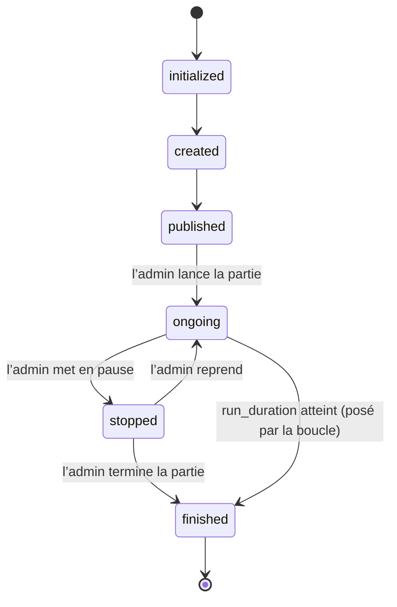
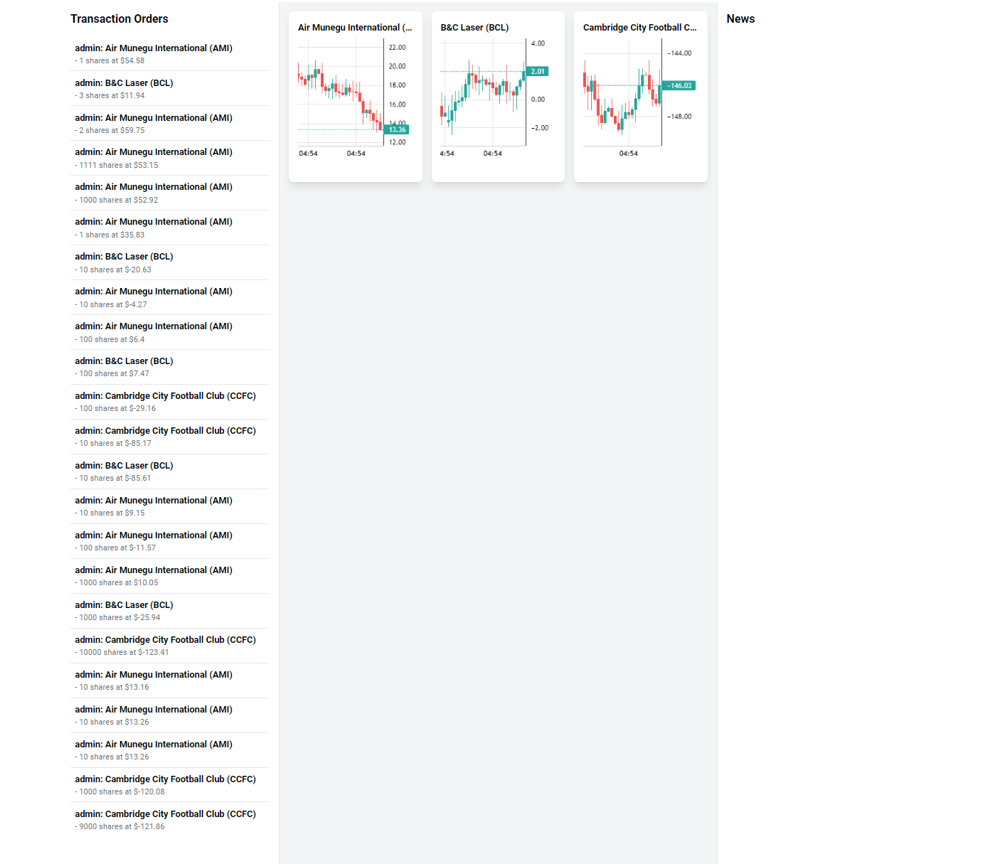
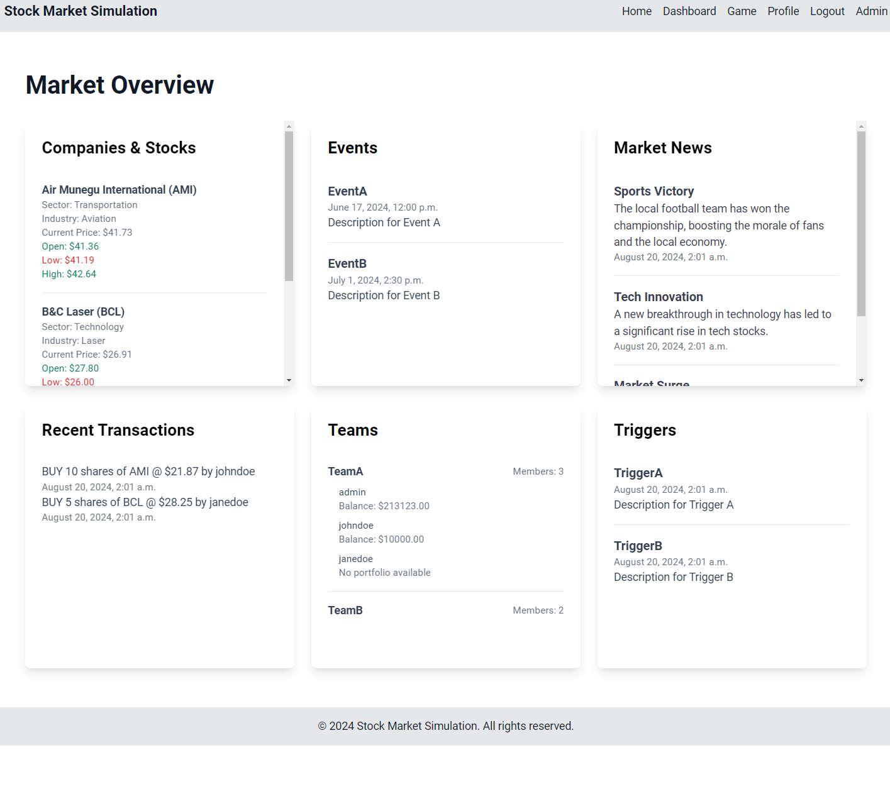
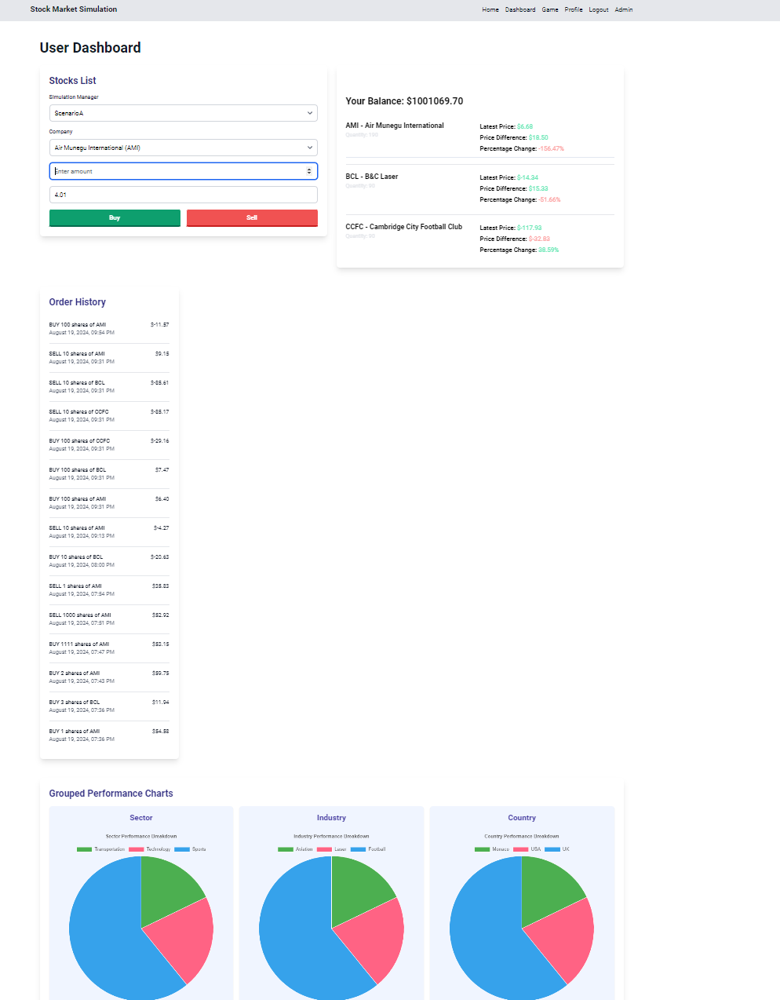
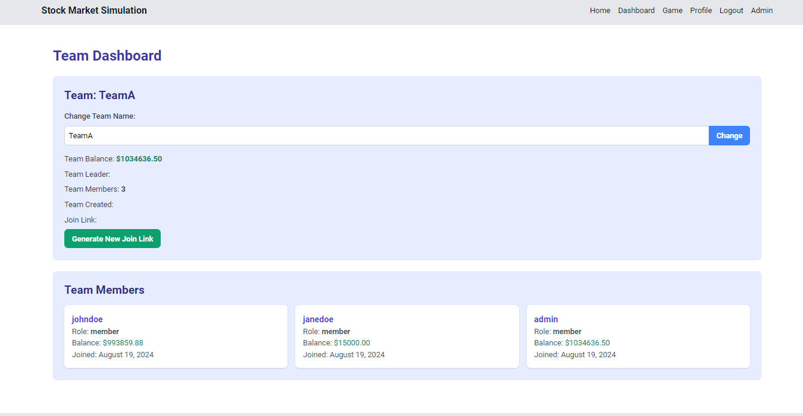

# Simulateur

<div class="repo-status-row"><span class="repo-badge kind">Application web</span><span class="repo-badge api">API</span><span class="repo-badge docker">Docker</span></div>

<div class="repo-tech-badges"><span class="tag tool">Python</span><span class="tag tool">Django</span><span class="tag tool">Django REST framework</span><span class="tag tool">Channels</span><span class="tag tool">Daphne</span><span class="tag tool">Celery</span><span class="tag tool">PostgreSQL</span><span class="tag tool">Redis</span><span class="tag tool">MinIO</span><span class="tag tool">Ollama</span><span class="tag tool">Wagtail</span></div>

Simulateur est une plateforme de simulation boursière construite avec Django : un administrateur prépare un scénario avec des entreprises fictives, des actualités et des événements, puis des équipes de joueurs échangent les actions simulées pendant que les cours bougent en temps réel. C’est un dépôt [AlgoÉTS](https://github.com/AlgoETS) pour les groupes qui veulent animer un jeu de marché, avec une interface d’administration qui règle les paramètres et le déroulement de chaque simulation.

## Aperçu {#overview}

Le projet Django se trouve dans `simulateur/`. `simulateur/settings.py` déclare deux applications locales, `simulation` et `backtesting`, et utilise SQLite sauf si `DATABASE_ENGINE=postgresql` est défini.

- **Moteur de prix.** `simulation/logic/simulation_manager.py` garde un `SimulationManager` par simulation. Tant que l’état est `ongoing`, il attend le pas de temps configuré, saute au besoin les heures de fermeture de la Bourse de New York et écrit une chandelle OHLC par action à partir du modèle de bruit choisi (`brownian`, `perlin`, `random_walk`, `fbm`, `random` ou `monte_carlo` dans `logic/noise_patterns/`). Chaque chandelle est enregistrée dans `StockPriceHistory` puis poussée vers la couche WebSocket.
- **Cycle de vie.** `manage.py start_simulation <ids>` passe les simulations à l’état `ongoing`, vérifie leur état toutes les cinq secondes et applique les réglages modifiés. Les états sont initialized, created, published, ongoing, stopped et finished.
- **Mises à jour en direct.** `simulation/channels/consumers.py` sert `ws/simulation/<room>/` et relaie cours, actualités, événements et déclencheurs vers le tableau de jeu.
- **Échanges.** `simulation/api/portfolio.py` traite les ordres d’achat et de vente selon le dernier prix et le solde du portefeuille, et expose positions, rendement et classements.
- **Création de scénarios.** Le tableau de bord admin suit cinq étapes (réglages, entreprises et actions, équipes, événements, révision). `simulation/api/ai_llm.py` peut rédiger actualités, événements, déclencheurs, entreprises ou scénarios complets avec un modèle Ollama (`OLLAMA_MODEL`, `llama3` par défaut).
- **Application de backtesting.** `backtesting/` ajoute une recherche de graphiques, la gestion de stratégies et une page bac à sable, des points d’accès de données nommés pour FMP, CoinGecko et yfinance, ainsi que des tâches Celery pour exécuter les stratégies.

`run.py` relie le tout : il installe les dépendances, applique les migrations, crée un superadmin, charge les CSV de `data/`, puis démarre Daphne (et, au besoin, les simulations et le CMS Wagtail sur le port 8001) dans des fils d’exécution séparés. Dans l’image Docker, `run.sh` exécute les mêmes étapes de migration, de chargement et de superadmin avant `run.py --start-simulation 1`.

## Comment bougent les cours {#price-engine}

À chaque pas, `SimulationManager.apply_changes` lit la dernière clôture `P` de l’action (ou `0.0` si l’action n’a pas encore d’historique) et demande une chandelle au modèle de bruit choisi. Chaque modèle implémente `NoiseStrategy.generate_noise(price, fluctuation_rate, time_index)`. Dans les formules ci-dessous, `σ` est le `fluctuation_rate` de la simulation (0,1 par défaut), `N(0, σ)` un tirage normal et `U(a, b)` un tirage uniforme. L’ouverture vaut toujours `P`.

| Réglage | Classe | Clôture | Haut et bas |
| --- | --- | --- | --- |
| `brownian` | `BrownianMotion` | `P + N(0, σ)` | max/min de l’ouverture et de la clôture, élargis de `U(0, 2σ)` |
| `perlin` | `Perlin` | `P + pnoise1(0.1 · t) · 10σ` | mêmes mèches que `brownian` |
| `random_walk` | `RandomWalk` | `P ± U(0, 5σ)`, signe tiré à pile ou face | max/min de l’ouverture et de la clôture, sans mèche |
| `fbm` | `Fbm` | uniforme entre le bas et le haut | `P + U(0, 5σ)` et `P − U(0, 5σ)` |
| `random` | `RandomCandle` | même code que `fbm` | même code que `fbm` |
| `monte_carlo` | `MonteCarlo` | moyenne de 100 trajectoires simulées | max et min de ces trajectoires |

Ce que chaque modèle donne en pratique :

- **Mouvement brownien.** Chaque clôture ajoute un pas gaussien à la précédente. Les pas sont indépendants : la série erre sans mémoire ni tendance. Le pas est absolu (en dollars), pas un pourcentage.
- **Bruit de Perlin.** `noise.pnoise1` renvoie une valeur lisse et continue pour une entrée donnée : les chandelles successives dérivent par vagues au lieu de sauter. `t` est un compteur unique partagé par toutes les actions de la simulation et incrémenté après chaque chandelle ; avec trois actions, chacune lit donc un échantillon sur trois de la même courbe.
- **Marche aléatoire.** Un pile ou face choisit la hausse ou la baisse, puis un montant uniforme jusqu’à `5σ` fixe l’amplitude. Les chandelles ont un corps mais pas d’ombres.
- **« Mouvement brownien fractionnaire » et aléatoire.** Les deux tirent un haut et un bas autour de l’ouverture, puis placent la clôture n’importe où entre les deux. Rien ne relie l’accroissement d’une chandelle à celui de la suivante : la corrélation à long terme qui définit le mouvement brownien fractionnaire n’est pas modélisée, et les deux classes sont identiques ligne pour ligne.
- **Monte-Carlo.** La classe simule 100 trajectoires de mouvement brownien géométrique sans dérive, `S(t) = S(t−1) · exp(−σ²/2 · dt + σ · √dt · Z)`, et les résume en une chandelle. C’est le seul modèle multiplicatif, donc le seul qui ne peut pas passer sous zéro. Avec l’horizon par défaut `time_horizon=1`, toutefois, la boucle `for t in range(1, 1)` ne s’exécute jamais : toutes les trajectoires restent à `P` et la chandelle est plate.

Comme les cinq premiers modèles ajoutent un pas absolu au prix, rien n’empêche un cours de devenir négatif. La capture du tableau de jeu ci-dessous le montre : l’action Cambridge City Football Club s’échange autour de −146.

## Cycle de vie d’une simulation {#lifecycle}

`SimulationManager.state` est un champ Django `TextChoices`. `ChangeSimulationManagerState`, dans `simulation/api/simulation_manager.py`, n’accepte que les transitions ci-dessous, et les boutons « Move to … » du tableau admin proposent la même liste. La boucle de simulation réagit à l’état qu’elle lit dans la base : elle démarre sur `ongoing`, sort de sa boucle sur `stopped` ou `finished`, et le fil de surveillance s’arrête définitivement sur `finished`.



Deux boucles pilotent ce cycle. `manage.py start_simulation <ids>` passe chaque simulation à `ongoing` dans une transaction `select_for_update`, puis lance un fil par simulation qui relit la ligne toutes les cinq secondes, appelle `start_simulation()` quand l’état est `ongoing` et réapplique les `SimulationSettings` quand ils changent. Dans `start_simulation()`, chaque itération relit la ligne, vérifie l’état, saute le calcul des prix pendant la fermeture de la Bourse de New York (fins de semaine, et hors de 9 h à 16 h, heure de l’Est) si `close_stock_market_at_night` est activé, écrit les chandelles, puis dort `timer_step × unité` secondes (10 secondes par défaut). Après `run_duration` (100 000 secondes), la boucle écrit elle-même `finished`.

## Mises à jour en direct par WebSocket {#websocket}

Les cours arrivent au navigateur par Django Channels, avec une couche de canaux Redis pub/sub (`channels_redis.pubsub.RedisPubSubChannelLayer`, hôte `redis` par défaut).

```mermaid
sequenceDiagram
  participant Loop as Boucle SimulationManager
  participant DB as PostgreSQL
  participant Layer as Couche de canaux Redis
  participant Consumer as SimulationConsumer
  participant Browser as Tableau de jeu
  Browser->>Consumer: connexion ws/simulation/<simulation_manager_id>/
  Consumer->>Layer: group_add("simulation_<id>")
  loop à chaque pas de temps
    Loop->>Loop: le modèle de bruit produit une chandelle OHLC
    Loop->>DB: StockPriceHistory.objects.create(...)
    Loop->>Layer: group_send("simulation_1", type="stock_update")
    Layer->>Consumer: stock_update(event)
    Consumer->>Browser: JSON {ticker, open, high, low, close, timestamp}
    Browser->>Browser: bufferUpdate() redessine le graphique
  end
  Browser->>Consumer: {"type": "news", "message": ...}
  Consumer->>Layer: group_send(type="news_update")
  Layer->>Consumer: news_update(event)
  Consumer->>Browser: {"type": "news", "message": ...}
```

Le consommateur (`simulation/channels/consumers.py`) rejoint un groupe par salle et répartit les messages entrants selon leur `type` : `stock`, `news`, `trigger`, `event` et `transaction`. Chaque gestionnaire rediffuse au groupe, et la méthode `*_update` correspondante renvoie le contenu à chaque navigateur connecté. Le tableau de jeu (`templates/dashboard/game_dashboard.html`) lit l’identifiant de simulation dans le paramètre `simulation_manager_id` de l’URL (`1` par défaut), se reconnecte jusqu’à dix fois toutes les cinq secondes et envoie au tampon du graphique les messages qui portent un `ticker` et un `timestamp`.

## Écrans {#screens}

Ces captures viennent du README du dépôt.

 et liste des simulations avec leurs boutons de transition d’état.")









## Démarrage {#installation}

Le parcours Docker Compose du README lance Django, Celery, PostgreSQL, un serveur Dragonfly compatible Redis et MinIO. Le fichier Compose et son `.env` se trouvent dans `simulateur/` :

```shell
cd simulateur
cp env-default .env
docker compose --profile all down
docker compose --profile all up -d --build
```

Sans Docker, passez par `run.py` (le README écrit `python3 -m run.py`, mais le script se lance directement) :

```shell
cd simulateur
python3 run.py --install
python3 run.py --start-simulation 1
```

`--install` crée un superadmin de développement local avec l’identifiant d’exemple du README (`admin`/`admin`) et remplit la base ; changez-le avant d’exposer l’application. Pour créer un autre superadmin avec vos propres valeurs :

```shell
python3 manage.py createsuperadmin --username=<nom> --password=<mot-de-passe> --email=<courriel>
```

Les tests Django de `simulation/tests/` se lancent avec `python3 manage.py test`. Les pages Swagger et ReDoc sont servies à `/swagger/` et `/redoc/`.

## Guide du dépôt {#reader-guide}

- `simulateur/run.py` : installation, migrations, données initiales et démarrage de Daphne, des simulations ou du CMS.
- `simulateur/simulateur/` : réglages, routes racines, point d’entrée ASGI (`asgi.py`) et application Celery.
- `simulateur/simulation/logic/` : boucle de simulation, modèles de bruit, courtier et file d’achat et de vente.
- `simulateur/simulation/api/` : vues REST des entreprises, actions, scénarios, gestionnaires de simulation, actualités, événements, déclencheurs, équipes, portefeuilles et génération par IA.
- `simulateur/simulation/channels/` : consommateur WebSocket et routage.
- `simulateur/simulation/models/` : modèles de scénario, entreprise, action, équipe, portefeuille, ordre et réglages.
- `simulateur/simulation/management/commands/` : `start_simulation`, `seed_database` et `createsuperadmin`.
- `simulateur/simulation/templates/` : tableaux de bord admin, jeu, équipe et utilisateur, composés de gabarits partiels.
- `simulateur/simulation/tests/` : tests de l’API, des modèles, de la logique, des canaux et des commandes.
- `simulateur/backtesting/` : vues, API de données, modèles et tâches Celery de backtesting.
- `simulateur/cms/` : un projet Wagtail distinct.
- `simulateur/data/` : données initiales en CSV (entreprises, actions, scénarios, équipes, utilisateurs, événements, déclencheurs …).
- `notebooks/` : prototypes du courtier, des agents, du bruit, des graphiques et des stratégies.
- `docs/diagrams/` : diagrammes PlantUML de cas d’utilisation et de séquence.

## Fonctionnalités {#features}

- créer des entreprises avec leur historique, des actions, des équipes et des profils de joueurs ;
- régler par simulation le pas de temps, le taux de fluctuation, la fermeture hors séance et le modèle de bruit ;
- démarrer, arrêter et terminer les simulations depuis le tableau admin ou en ligne de commande ;
- diffuser chandelles OHLC, actualités, événements et déclencheurs aux joueurs par WebSocket ;
- acheter et vendre des actions selon le solde du portefeuille, puis suivre positions et rendement ;
- classer joueurs et équipes et inviter des joueurs avec un lien d’équipe ;
- rédiger le contenu d’un scénario avec un modèle Ollama local ;
- se connecter avec un compte local ou Google, GitHub, Microsoft et Notion grâce à django-allauth ;
- exposer des vérifications de santé, des métriques Prometheus et une description OpenAPI.

## Limites {#limits}

- Le README indique Django 4.2.13 ; `requirements.txt` fixe Django 5.0.8. Le badge du README annonce Python 3.12, alors que l’image Docker utilise Python 3.10.
- Les cours sont diffusés dans la salle WebSocket `1`, quel que soit l’identifiant de simulation : tel qu’écrit, seule la simulation 1 reçoit les mises à jour en direct.
- Le mode d’échange `dynamic` s’appuie sur `logic/broker.py`, qui importe le module `BuySellQueue` au lieu de la classe et omet l’argument `simulation_manager` ; ce chemin semble inachevé. Le mode par défaut est `static`.
- `logic/noise_patterns/` contient aussi des modèles GBM, Heston, Ornstein-Uhlenbeck et Vasicek que le gestionnaire de simulation ne propose pas.
- Le formulaire de réglages propose `other` comme fonction de bruit et le gestionnaire accepte `random` ; aucune des deux listes ne contient l’autre valeur, et choisir `other` lève `Unsupported noise function`.
- Le modèle `monte_carlo` renvoie des chandelles plates avec son horizon par défaut d’un pas, et les modèles additifs permettent des cours négatifs (voir [Comment bougent les cours](#price-engine)).
- Le consommateur envoie les actualités sous la forme `{"type": "news", "message": …}`, mais le tableau de jeu lit `messageData.news_items` et `messageData.transactions` : sur cette page, actualités et transactions reçues par WebSocket valent `undefined`.
- Le réglage `interval` est enregistré et réappliqué, mais la boucle ne dort que `timer_step`.
- La vue d’achat et de vente accepte un champ `price` venant de la requête et ne revient à la dernière clôture que s’il est absent.
- `backtesting/batchbacktesting.py` importe des modules `src.data` et `strategies` absents du dépôt.
- Les points d’accès IA exigent un serveur Ollama joignable ; `entrypoint.sh` en démarre un et télécharge un modèle, mais ni le Dockerfile ni le fichier Compose ne l’utilisent.
- Les valeurs par défaut reposent sur des identifiants de démonstration faibles (`admin`/`admin`, `minioadmin`, `postgres`), et `scripts/` contient un certificat et une clé pour localhost.

## Sources {#sources}

- [Dépôt GitHub](https://github.com/AlgoETS/Simulateur)
- [README](https://github.com/AlgoETS/Simulateur/blob/main/README.md)
- [`simulateur/run.py`](https://github.com/AlgoETS/Simulateur/blob/main/simulateur/run.py)
- [`simulateur/simulation/logic/simulation_manager.py`](https://github.com/AlgoETS/Simulateur/blob/main/simulateur/simulation/logic/simulation_manager.py)
- [`simulateur/simulation/logic/noise_patterns/`](https://github.com/AlgoETS/Simulateur/tree/main/simulateur/simulation/logic/noise_patterns)
- [`simulateur/simulation/api/simulation_manager.py`](https://github.com/AlgoETS/Simulateur/blob/main/simulateur/simulation/api/simulation_manager.py)
- [`simulateur/simulation/channels/consumers.py`](https://github.com/AlgoETS/Simulateur/blob/main/simulateur/simulation/channels/consumers.py)
- [`simulateur/simulation/management/commands/start_simulation.py`](https://github.com/AlgoETS/Simulateur/blob/main/simulateur/simulation/management/commands/start_simulation.py)
- [`simulateur/simulation/urls.py`](https://github.com/AlgoETS/Simulateur/blob/main/simulateur/simulation/urls.py)
- [`simulateur/simulation/api/portfolio.py`](https://github.com/AlgoETS/Simulateur/blob/main/simulateur/simulation/api/portfolio.py)
- [`simulateur/docker-compose.yml`](https://github.com/AlgoETS/Simulateur/blob/main/simulateur/docker-compose.yml)
