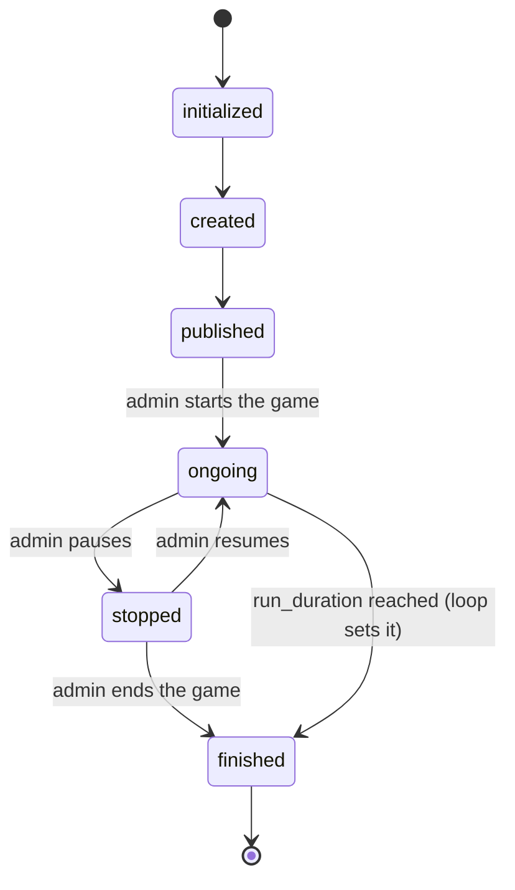
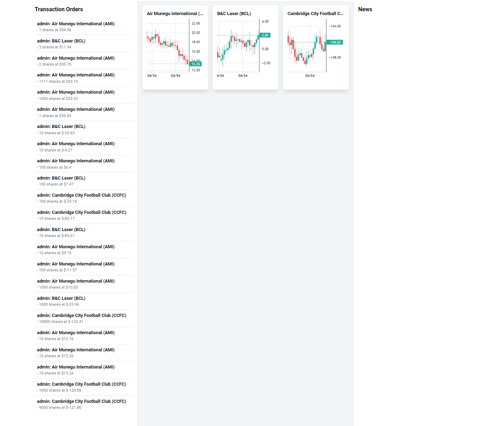
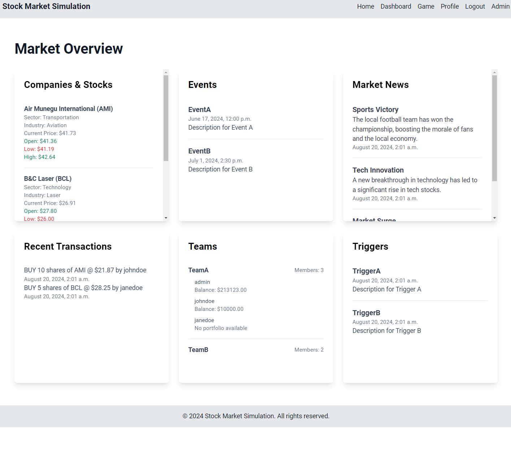
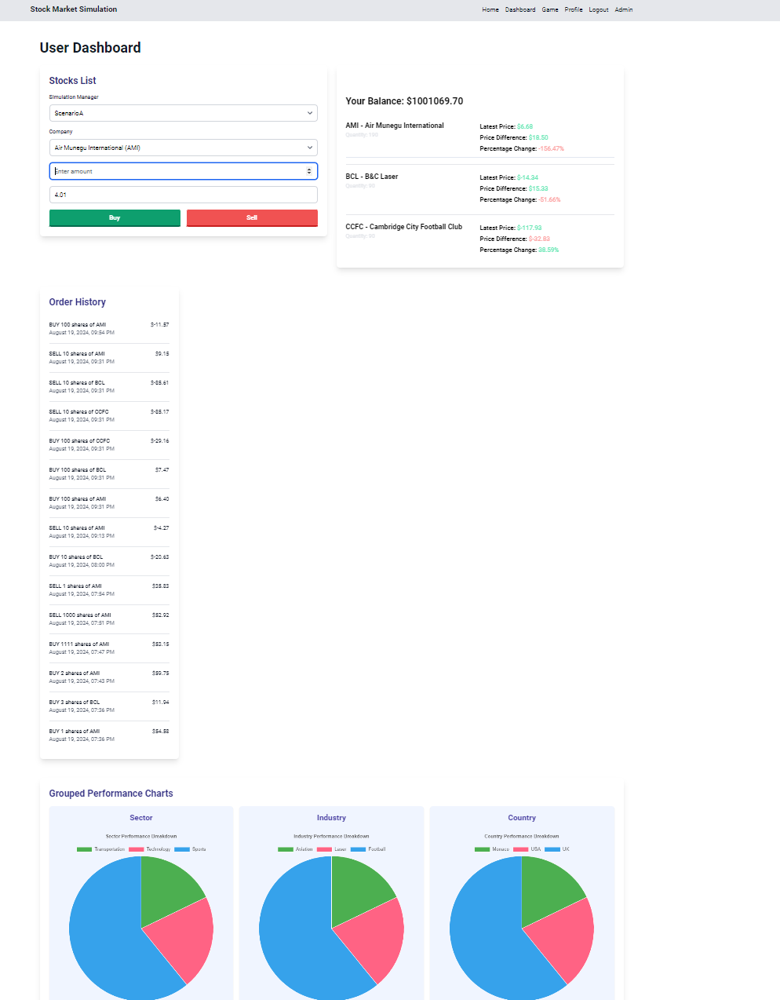
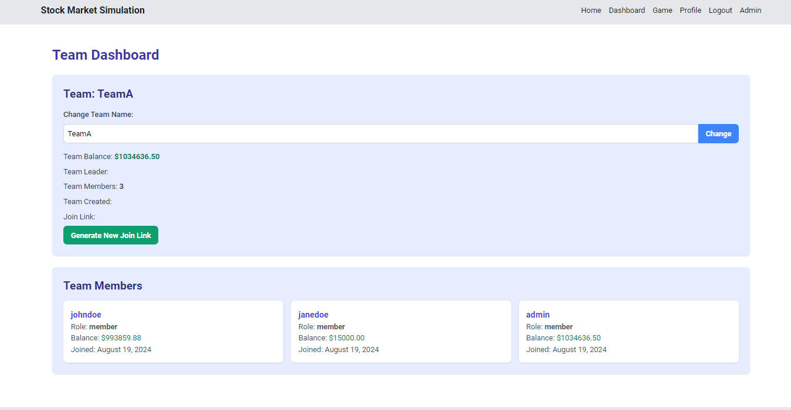

# Simulateur

<div class="repo-status-row"><span class="repo-badge kind">Web app</span><span class="repo-badge api">API</span><span class="repo-badge docker">Docker</span></div>

<div class="repo-tech-badges"><span class="tag tool">Python</span><span class="tag tool">Django</span><span class="tag tool">Django REST framework</span><span class="tag tool">Channels</span><span class="tag tool">Daphne</span><span class="tag tool">Celery</span><span class="tag tool">PostgreSQL</span><span class="tag tool">Redis</span><span class="tag tool">MinIO</span><span class="tag tool">Ollama</span><span class="tag tool">Wagtail</span></div>

Simulateur is a stock-market simulation platform built with Django: an admin prepares a scenario with fictional companies, news and events, and teams of players trade the simulated stocks while prices move in real time. It is an [AlgoÉTS](https://github.com/AlgoETS) repository for groups that want to run a market game together, with an admin interface that controls the settings and the flow of each simulation.

## Overview {#overview}

The Django project lives in `simulateur/`. `simulateur/settings.py` registers two local apps, `simulation` and `backtesting`, and uses SQLite unless `DATABASE_ENGINE=postgresql` is set.

- **Price engine.** `simulation/logic/simulation_manager.py` holds one `SimulationManager` per simulation. While the state is `ongoing`, it sleeps for the configured timer step, skips New York market-closed hours if asked, and writes an OHLC candle per stock from the chosen noise model (`brownian`, `perlin`, `random_walk`, `fbm`, `random` or `monte_carlo` in `logic/noise_patterns/`). Each candle is stored as `StockPriceHistory` and pushed to the WebSocket layer.
- **Lifecycle.** `manage.py start_simulation <ids>` sets the simulations to `ongoing`, polls their state every five seconds and applies changed settings. The states are initialized, created, published, ongoing, stopped and finished.
- **Live updates.** `simulation/channels/consumers.py` serves `ws/simulation/<room>/` and relays stock updates, news, events and triggers to the game dashboard.
- **Trading.** `simulation/api/portfolio.py` handles buy and sell orders against the latest price and the portfolio balance, and exposes holdings, performance and leaderboards.
- **Scenario authoring.** The admin dashboard walks through five steps (settings, companies and stocks, teams, events, review). `simulation/api/ai_llm.py` can draft news, events, triggers, companies or whole scenarios with an Ollama model (`OLLAMA_MODEL`, `llama3` by default).
- **Backtesting app.** `backtesting/` adds chart search, strategy management and a sandbox page, data endpoints named for FMP, CoinGecko and yfinance, and Celery tasks for strategy runs.

`run.py` ties it together: it installs requirements, applies migrations, creates a superadmin, seeds the CSV files in `data/`, then starts Daphne (and optionally simulations and the Wagtail CMS on port 8001) in separate threads. In the Docker image, `run.sh` runs the same migrate, seed and superadmin steps before `run.py --start-simulation 1`.

## How prices move {#price-engine}

Every tick, `SimulationManager.apply_changes` reads the stock's last close `P` (or `0.0` when the stock has no history yet) and asks the selected noise model for one candle. Each model implements `NoiseStrategy.generate_noise(price, fluctuation_rate, time_index)`. In the formulas below, `σ` is the simulation's `fluctuation_rate` (0.1 by default), `N(0, σ)` is a normal draw and `U(a, b)` a uniform draw. The open is always `P`.

| Setting | Class | Close | High and low |
| --- | --- | --- | --- |
| `brownian` | `BrownianMotion` | `P + N(0, σ)` | max/min of open and close, pushed out by `U(0, 2σ)` |
| `perlin` | `Perlin` | `P + pnoise1(0.1 · t) · 10σ` | same wicks as `brownian` |
| `random_walk` | `RandomWalk` | `P ± U(0, 5σ)`, sign chosen by a coin flip | max/min of open and close, no wicks |
| `fbm` | `Fbm` | uniform between low and high | `P + U(0, 5σ)` and `P − U(0, 5σ)` |
| `random` | `RandomCandle` | same code as `fbm` | same code as `fbm` |
| `monte_carlo` | `MonteCarlo` | mean of 100 simulated paths | max and min of those paths |

What each one means in practice:

- **Brownian motion.** Each close adds a Gaussian step to the previous close. Steps are independent, so the series wanders with no memory and no trend. The step is absolute (dollars), not a percentage.
- **Perlin noise.** `noise.pnoise1` returns a smooth, continuous value for a given input, so successive candles drift in waves instead of jumping. `t` is one counter shared by every stock in the simulation and incremented after each candle, so with three stocks each one reads every third sample of the same curve.
- **Random walk.** A coin flip picks up or down, then a uniform amount up to `5σ` sets the size. Candles have bodies but no shadows.
- **"Fractional Brownian motion" and random.** Both draw a high and a low around the open, then drop the close anywhere between them. Nothing links one candle's increment to the next, so the long-range correlation that defines fractional Brownian motion is not modelled; the two classes are line-for-line the same.
- **Monte Carlo.** The class simulates 100 geometric Brownian motion paths with zero drift, `S(t) = S(t−1) · exp(−σ²/2 · dt + σ · √dt · Z)`, and summarises them as a candle. This is the only multiplicative model, so it cannot cross zero. With the default `time_horizon=1`, though, the loop `for t in range(1, 1)` never runs, every path stays at `P`, and the candle is flat.

Because the first five models add an absolute step to the price, nothing stops a price from going below zero. The game-dashboard screenshot below shows exactly that: the Cambridge City Football Club stock trades around −146.

## Simulation lifecycle {#lifecycle}

`SimulationManager.state` is a Django `TextChoices` field. `ChangeSimulationManagerState` in `simulation/api/simulation_manager.py` only accepts the transitions below, and the admin dashboard's "Move to …" buttons offer the same list. The simulation loop reacts to the state it reads from the database: it starts on `ongoing`, leaves its loop on `stopped` or `finished`, and the monitoring thread exits for good on `finished`.



Two loops drive this. `manage.py start_simulation <ids>` sets each simulation to `ongoing` inside a `select_for_update` transaction, then runs one thread per simulation that polls the row every five seconds, calls `start_simulation()` when the state is `ongoing`, and re-applies `SimulationSettings` when they change. Inside `start_simulation()`, each iteration refreshes the row, checks the state, skips pricing while the New York market is closed (weekends, and outside 09:00 to 16:00 Eastern) if `close_stock_market_at_night` is set, writes the candles, then sleeps `timer_step × unit` seconds (10 seconds by default). After `run_duration` (100,000 seconds) the loop itself writes `finished`.

## Live updates over WebSocket {#websocket}

Prices reach the browser through Django Channels with a Redis pub/sub channel layer (`channels_redis.pubsub.RedisPubSubChannelLayer`, host `redis` by default).

```mermaid
sequenceDiagram
  participant Loop as SimulationManager loop
  participant DB as PostgreSQL
  participant Layer as Redis channel layer
  participant Consumer as SimulationConsumer
  participant Browser as Game dashboard
  Browser->>Consumer: connect ws/simulation/<simulation_manager_id>/
  Consumer->>Layer: group_add("simulation_<id>")
  loop every timer step
    Loop->>Loop: noise model builds an OHLC candle
    Loop->>DB: StockPriceHistory.objects.create(...)
    Loop->>Layer: group_send("simulation_1", type="stock_update")
    Layer->>Consumer: stock_update(event)
    Consumer->>Browser: JSON {ticker, open, high, low, close, timestamp}
    Browser->>Browser: bufferUpdate() redraws the candle chart
  end
  Browser->>Consumer: {"type": "news", "message": ...}
  Consumer->>Layer: group_send(type="news_update")
  Layer->>Consumer: news_update(event)
  Consumer->>Browser: {"type": "news", "message": ...}
```

The consumer (`simulation/channels/consumers.py`) joins one group per room and dispatches incoming messages by their `type`: `stock`, `news`, `trigger`, `event` and `transaction`. Each handler re-broadcasts to the group, and the matching `*_update` method sends the payload back down to every connected browser. The game dashboard (`templates/dashboard/game_dashboard.html`) reads the simulation id from the `simulation_manager_id` query parameter (default `1`), reconnects up to ten times at five-second intervals, and routes messages that carry a `ticker` and a `timestamp` to the chart buffer.

## Screens {#screens}

These screenshots come from the repository README.

 and the list of simulations with their state transition buttons.")









## Getting started {#installation}

The README's Docker Compose path runs Django, Celery, PostgreSQL, a Redis-compatible Dragonfly server and MinIO. The compose file and its `.env` live in `simulateur/`:

```shell
cd simulateur
cp env-default .env
docker compose --profile all down
docker compose --profile all up -d --build
```

Without Docker, use `run.py` (the README writes `python3 -m run.py`, but the script is run directly):

```shell
cd simulateur
python3 run.py --install
python3 run.py --start-simulation 1
```

`--install` creates a local-development superadmin with the README's sample `admin`/`admin` login and seeds the database; change it before exposing the app. Another superadmin can be created with your own values:

```shell
python3 manage.py createsuperadmin --username=<name> --password=<password> --email=<email>
```

The Django test suite under `simulation/tests/` runs with `python3 manage.py test`. Swagger and ReDoc pages are served at `/swagger/` and `/redoc/`.

## Repository guide {#reader-guide}

- `simulateur/run.py`: install, migrate, seed and start Daphne, simulations or the CMS.
- `simulateur/simulateur/`: settings, URL root, ASGI entry (`asgi.py`) and Celery app.
- `simulateur/simulation/logic/`: simulation loop, noise models, broker and buy/sell queue.
- `simulateur/simulation/api/`: REST views for companies, stocks, scenarios, simulation managers, news, events, triggers, teams, portfolios and AI generation.
- `simulateur/simulation/channels/`: WebSocket consumer and routing.
- `simulateur/simulation/models/`: scenario, company, stock, team, portfolio, order and settings models.
- `simulateur/simulation/management/commands/`: `start_simulation`, `seed_database` and `createsuperadmin`.
- `simulateur/simulation/templates/`: admin, game, team and user dashboards built from partials.
- `simulateur/simulation/tests/`: tests for the API, models, logic, channels and commands.
- `simulateur/backtesting/`: backtesting views, data APIs, models and Celery tasks.
- `simulateur/cms/`: a separate Wagtail project.
- `simulateur/data/`: CSV seed data (companies, stocks, scenarios, teams, users, events, triggers …).
- `notebooks/`: prototypes for the broker, agents, noise, charts and strategies.
- `docs/diagrams/`: PlantUML use-case and sequence diagrams.

## Features {#features}

- create companies with backstories, stocks, teams and user profiles;
- configure the timer step, fluctuation rate, market-hours closing and noise model per simulation;
- start, stop and finish simulations from the admin dashboard or the command line;
- stream OHLC candles, news, events and triggers to players over WebSockets;
- buy and sell stocks within a portfolio balance and follow holdings and performance;
- rank players and teams on leaderboards and invite players with team join links;
- draft scenario content with a local Ollama model;
- sign in with accounts or Google, GitHub, Microsoft and Notion through django-allauth;
- expose health checks, Prometheus metrics and an OpenAPI description.

## Limits {#limits}

- The README lists Django 4.2.13; `requirements.txt` pins Django 5.0.8. The README badge says Python 3.12 while the Docker image uses Python 3.10.
- Price broadcasts are sent to WebSocket room `1` regardless of the simulation id, so only simulation 1 receives live updates as written.
- The `dynamic` trading mode relies on `logic/broker.py`, which imports the `BuySellQueue` module instead of the class and omits the `simulation_manager` argument; that path looks unfinished. The default mode is `static`.
- `logic/noise_patterns/` also contains GBM, Heston, Ornstein-Uhlenbeck and Vasicek models that the simulation manager does not offer.
- The settings form offers `other` as a noise function and the manager accepts `random`; neither matches the other list, so choosing `other` raises `Unsupported noise function`.
- The `monte_carlo` model returns flat candles with its default one-step horizon, and the additive models allow negative prices (see [How prices move](#price-engine)).
- The consumer sends news as `{"type": "news", "message": …}`, but the game dashboard reads `messageData.news_items` and `messageData.transactions`, so WebSocket news and transactions arrive as `undefined` on that page.
- The `interval` setting is stored and re-applied but the loop only sleeps for `timer_step`.
- The buy and sell view accepts a `price` field from the request and only falls back to the latest close when it is missing.
- `backtesting/batchbacktesting.py` imports `src.data` and `strategies` modules that are not in the repository.
- The AI endpoints need a reachable Ollama server; `entrypoint.sh` starts one and pulls a model, but the Dockerfile and compose file do not use it.
- Defaults use weak demo credentials (`admin`/`admin`, `minioadmin`, `postgres`), and `scripts/` contains a localhost certificate and key.

## Sources {#sources}

- [GitHub repository](https://github.com/AlgoETS/Simulateur)
- [README](https://github.com/AlgoETS/Simulateur/blob/main/README.md)
- [`simulateur/run.py`](https://github.com/AlgoETS/Simulateur/blob/main/simulateur/run.py)
- [`simulateur/simulation/logic/simulation_manager.py`](https://github.com/AlgoETS/Simulateur/blob/main/simulateur/simulation/logic/simulation_manager.py)
- [`simulateur/simulation/logic/noise_patterns/`](https://github.com/AlgoETS/Simulateur/tree/main/simulateur/simulation/logic/noise_patterns)
- [`simulateur/simulation/api/simulation_manager.py`](https://github.com/AlgoETS/Simulateur/blob/main/simulateur/simulation/api/simulation_manager.py)
- [`simulateur/simulation/channels/consumers.py`](https://github.com/AlgoETS/Simulateur/blob/main/simulateur/simulation/channels/consumers.py)
- [`simulateur/simulation/management/commands/start_simulation.py`](https://github.com/AlgoETS/Simulateur/blob/main/simulateur/simulation/management/commands/start_simulation.py)
- [`simulateur/simulation/urls.py`](https://github.com/AlgoETS/Simulateur/blob/main/simulateur/simulation/urls.py)
- [`simulateur/simulation/api/portfolio.py`](https://github.com/AlgoETS/Simulateur/blob/main/simulateur/simulation/api/portfolio.py)
- [`simulateur/docker-compose.yml`](https://github.com/AlgoETS/Simulateur/blob/main/simulateur/docker-compose.yml)
