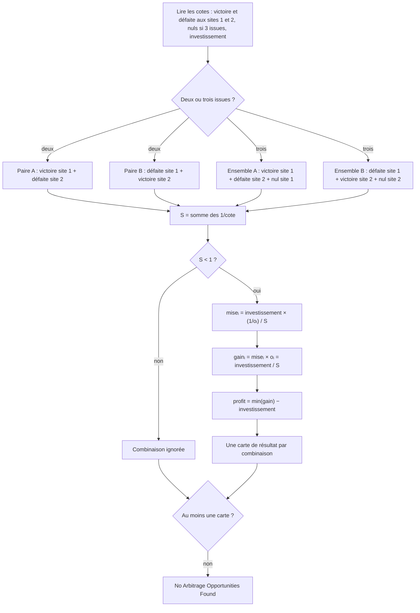

# Sport-Arbitrage

<div class="repo-status-row"><span class="repo-badge kind">Page statique</span></div>

<div class="repo-tech-badges"><span class="tag tool">HTML</span><span class="tag tool">JavaScript</span><span class="tag tool">Tailwind CSS</span><span class="tag tool">Python</span><span class="tag tool">Jupyter</span></div>

Sport-Arbitrage est une petite calculatrice web pour l’arbitrage en paris sportifs : on saisit les cotes que deux sites offrent pour un même match, et elle indique si parier sur des issues opposées aux deux endroits assure un gain, puis comment répartir la mise. C’est un dépôt [AlgoÉTS](https://github.com/AlgoETS) qui contient une page web et un carnet Python reposant sur les mêmes formules.

## Aperçu {#overview}

`index.html` est un formulaire unique mis en forme avec Tailwind CSS 2.2.19 chargé depuis un CDN. Toute la logique se trouve dans `script.js` :

- `hasArbitrageOpportunity(odds)` additionne les inverses des cotes et signale une occasion quand la somme est inférieure à 1.
- `calculateArbitragePercentage` renvoie `(1 − Σ 1/cote) × 100`.
- `calculateOptimalStakes` répartit la mise totale proportionnellement à l’inverse de chaque cote, pour que chaque issue rapporte le même montant.
- `calculateTotalReturn` et `calculateGuaranteedProfit` donnent le gain par issue, puis le plus petit gain moins la mise.
- `calculateArbitrage()` lit le formulaire, teste deux paires entre les sites (victoire au site 1 avec défaite au site 2, et défaite au site 1 avec victoire au site 2), ajoute un match nul à chaque paire en mode trois issues, puis affiche une carte par occasion.

`arbitrage.ipynb` reprend les mêmes fonctions en Python, avec des cotes d’exemple codées en dur dans la première cellule.

## Fonctionnement de l’algorithme {#algorithm}

**Probabilité implicite.** Une cote décimale `o` rapporte `o` fois la mise quand le pari gagne, mise comprise. La probabilité à laquelle ce pari est à l’équilibre vaut `1/o` : c’est la probabilité implicite. Chez un même bookmaker, les probabilités implicites de toutes les issues dépassent 1 au total ; l’excédent est sa marge. Deux sites aux avis un peu différents peuvent pourtant diverger assez pour qu’en prenant la meilleure cote de chaque issue d’un site à l’autre, la somme passe sous 1.

**Condition d’arbitrage.** Pour des issues qui couvrent tous les résultats possibles, avec des cotes `o₁ … oₙ` prises sur n’importe quels sites :

```text
S = 1/o₁ + 1/o₂ + … + 1/oₙ
il y a arbitrage quand S < 1
```

**Répartition des mises.** Pour obtenir le même gain quelle que soit l’issue, chaque mise doit être proportionnelle à sa probabilité implicite : `miseᵢ = investissement × (1/oᵢ) / S`. Chaque issue rapporte alors `miseᵢ × oᵢ = investissement / S`, et le profit garanti vaut `investissement × (1/S − 1)`. C’est exactement ce que calculent `calculateOptimalStakes`, `calculateTotalReturn` et `calculateGuaranteedProfit`.

**Exemple détaillé, deux issues.** Le site 1 propose 2,10 sur une victoire et 1,80 sur une défaite ; le site 2, 1,75 sur une victoire et 2,05 sur une défaite.

| Étape | Valeur |
| --- | --- |
| Site 1 seul : 1/2,10 + 1/1,80 | 1,0317, une marge de 3,2 %, pas d’arbitrage |
| Site 2 seul : 1/1,75 + 1/2,05 | 1,0592 |
| Victoire au site 1 + défaite au site 2 : 1/2,10 + 1/2,05 = 0,4762 + 0,4878 | **0,9640 < 1, arbitrage** |
| Défaite au site 1 + victoire au site 2 : 1/1,80 + 1/1,75 | 1,1270, aucun |
| Mises pour 1 000 $ : 1000 × 0,4762 / 0,9640 et 1000 × 0,4878 / 0,9640 | 493,98 $ sur la victoire, 506,02 $ sur la défaite |
| Gain dans les deux cas : 493,98 × 2,10 = 506,02 × 2,05 | 1 037,35 $ |
| Profit garanti | 37,35 $, soit 3,73 % de l’investissement |

La page affiche un « pourcentage d’arbitrage » de 3,60 %, qui vaut `(1 − S) × 100`. C’est l’écart sous 1, pas le rendement : le rendement sur la somme misée est `1/S − 1`, ici 3,73 %.

**Trois issues.** Avec un match nul, les mêmes formules prennent trois cotes. Une victoire à 2,60 au site 1, une défaite à 3,40 au site 2 et un nul à 3,50 au site 1 donnent S = 0,3846 + 0,2941 + 0,2857 = 0,9644. Pour 1 000 $, les mises valent 398,79 $, 304,96 $ et 296,25 $, chaque issue rapporte 1 036,86 $ et le profit est de 36,86 $.



## Démarrage {#installation}

Rien à compiler. Clonez le dépôt et ouvrez la page dans un navigateur (la feuille Tailwind vient de jsDelivr : sans réseau, la mise en forme manque) :

```shell
git clone https://github.com/AlgoETS/Sport-Arbitrage.git
cd Sport-Arbitrage
```

Ouvrez ensuite `index.html`, choisissez 2 ou 3 cotes, remplissez les cotes et la mise totale, puis cliquez sur **Calculate**. Pour la version Python :

```shell
jupyter notebook arbitrage.ipynb
```

## Guide du dépôt {#reader-guide}

- `index.html` : formulaire de la calculatrice, consignes et zone de résultats.
- `script.js` : affichage des champs, test d’arbitrage, répartition de la mise, gains et profit.
- `arbitrage.ipynb` : version Python des formules pour le cas à deux issues.
- `style.css` : styles de mise en page de base (non référencés par `index.html`).

## Fonctionnalités {#features}

- passer d’un marché à deux issues (victoire/défaite) à un marché à trois issues (victoire/défaite/nul) ;
- tester des paires entre les deux sites avec la somme des inverses des cotes ;
- afficher le pourcentage d’arbitrage, les mises optimales, le gain par issue et le profit garanti ;
- tout calculer dans le navigateur, sans serveur ni compte ;
- vérifier les mêmes calculs dans un carnet Jupyter.

## Limites {#limits}

- Seules deux paires fixes sont testées. En mode trois issues, le nul du site 1 accompagne toujours la victoire au site 1 et la défaite au site 2, et le nul du site 2 la défaite au site 1 et la victoire au site 2 ; les autres combinaisons ne sont jamais essayées.
- Le « pourcentage d’arbitrage » affiché vaut `(1 − S) × 100`, un peu moins que le rendement réel `1/S − 1`.
- Les formules supposent des cotes décimales, et le formulaire ne valide pas les saisies : un champ vide donne `NaN`.
- Les mises ne sont pas arrondies et ignorent frais, plafonds de mise et variations de cotes : le « profit garanti » ne tient que si chaque pari est accepté aux cotes saisies.
- `style.css` n’est pas relié à la page, et le carnet ne couvre que le cas à deux issues.
- Il n’y a pas de tests.

## Sources {#sources}

- [Dépôt GitHub](https://github.com/AlgoETS/Sport-Arbitrage)
- [README](https://github.com/AlgoETS/Sport-Arbitrage/blob/main/README.md)
- [`index.html`](https://github.com/AlgoETS/Sport-Arbitrage/blob/main/index.html)
- [`script.js`](https://github.com/AlgoETS/Sport-Arbitrage/blob/main/script.js)
- [`arbitrage.ipynb`](https://github.com/AlgoETS/Sport-Arbitrage/blob/main/arbitrage.ipynb)
