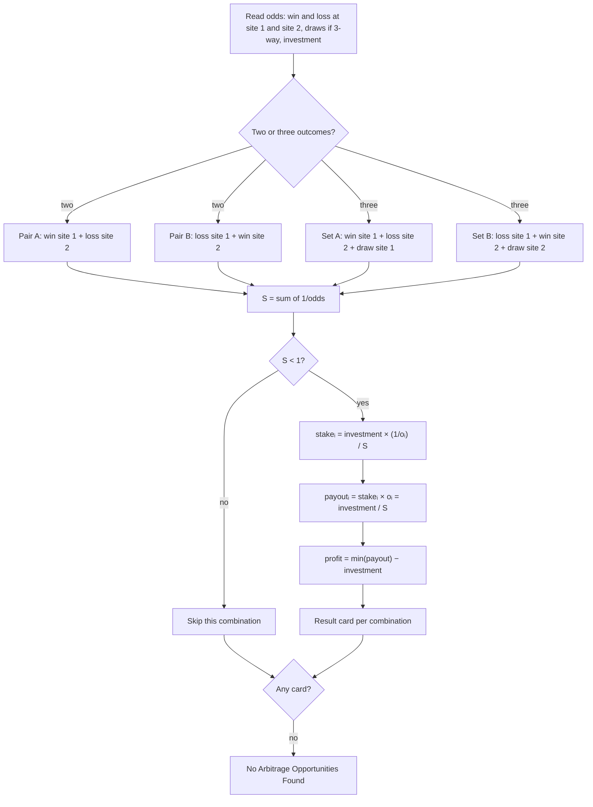

# Sport-Arbitrage

<div class="repo-status-row"><span class="repo-badge kind">Static page</span></div>

<div class="repo-tech-badges"><span class="tag tool">HTML</span><span class="tag tool">JavaScript</span><span class="tag tool">Tailwind CSS</span><span class="tag tool">Python</span><span class="tag tool">Jupyter</span></div>

Sport-Arbitrage is a small web calculator for sports-betting arbitrage: you enter the odds two betting sites give for the same match, and it tells you whether betting on opposite outcomes at both sites locks in a profit, and how to split the stake. It is an [AlgoÉTS](https://github.com/AlgoETS) repository with a browser page and a Python notebook that run the same formulas.

## Overview {#overview}

`index.html` is a single form styled with Tailwind CSS 2.2.19 from a CDN. All the logic is in `script.js`:

- `hasArbitrageOpportunity(odds)` adds the inverses of the odds and reports an opportunity when the sum is below 1.
- `calculateArbitragePercentage` returns `(1 − Σ 1/odds) × 100`.
- `calculateOptimalStakes` splits the total investment in proportion to each inverse odd, so every outcome returns the same amount.
- `calculateTotalReturn` and `calculateGuaranteedProfit` give the return per outcome and the smallest return minus the investment.
- `calculateArbitrage()` reads the form, tests two cross-site pairings (win at site 1 with loss at site 2, and loss at site 1 with win at site 2) and adds a draw to each pairing in three-outcome mode, then writes one result card per opportunity.

`arbitrage.ipynb` contains the same functions in Python, with sample odds hard-coded in the first cell.

## How the algorithm works {#algorithm}

**Implied probability.** Decimal odds `o` pay `o` times the stake when the bet wins, stake included. The probability at which that bet breaks even is `1/o`, called the implied probability. At one bookmaker, the implied probabilities of all outcomes add up to more than 1; the excess is the bookmaker's margin. Two sites with slightly different opinions can still disagree enough that, by taking the best price for each outcome across sites, the sum falls below 1.

**The arbitrage condition.** For outcomes that cover every possible result, with odds `o₁ … oₙ` taken from any sites:

```text
S = 1/o₁ + 1/o₂ + … + 1/oₙ
arbitrage exists when S < 1
```

**Stake sizing.** To get the same payout whichever outcome happens, each stake must be proportional to its implied probability: `stakeᵢ = investment × (1/oᵢ) / S`. Every outcome then pays `stakeᵢ × oᵢ = investment / S`, so the guaranteed profit is `investment × (1/S − 1)`. This is exactly what `calculateOptimalStakes`, `calculateTotalReturn` and `calculateGuaranteedProfit` compute.

**Worked example, two outcomes.** Site 1 offers 2.10 on a win and 1.80 on a loss; site 2 offers 1.75 on a win and 2.05 on a loss.

| Step | Value |
| --- | --- |
| Site 1 alone: 1/2.10 + 1/1.80 | 1.0317, a 3.2% margin, no arbitrage |
| Site 2 alone: 1/1.75 + 1/2.05 | 1.0592 |
| Win at site 1 + loss at site 2: 1/2.10 + 1/2.05 = 0.4762 + 0.4878 | **0.9640 < 1, arbitrage** |
| Loss at site 1 + win at site 2: 1/1.80 + 1/1.75 | 1.1270, none |
| Stakes for 1,000 $: 1000 × 0.4762 / 0.9640 and 1000 × 0.4878 / 0.9640 | 493.98 $ on the win, 506.02 $ on the loss |
| Payout either way: 493.98 × 2.10 = 506.02 × 2.05 | 1,037.35 $ |
| Guaranteed profit | 37.35 $, or 3.73% of the investment |

The page reports an "arbitrage percentage" of 3.60%, which is `(1 − S) × 100`. That number is the gap below 1, not the return: the return on the money staked is `1/S − 1`, here 3.73%.

**Three outcomes.** With a draw, the same formulas take three odds. Win at 2.60 on site 1, loss at 3.40 on site 2 and draw at 3.50 on site 1 give S = 0.3846 + 0.2941 + 0.2857 = 0.9644. For 1,000 $, the stakes are 398.79 $, 304.96 $ and 296.25 $, each outcome pays 1,036.86 $, and the profit is 36.86 $.



## Getting started {#installation}

Nothing needs to be built. Clone the repository and open the page in a browser (the Tailwind stylesheet loads from jsDelivr, so the page needs network access to look right):

```shell
git clone https://github.com/AlgoETS/Sport-Arbitrage.git
cd Sport-Arbitrage
```

Then open `index.html`, choose 2 or 3 odds, fill in the odds and the total investment, and click **Calculate**. To run the Python version:

```shell
jupyter notebook arbitrage.ipynb
```

## Repository guide {#reader-guide}

- `index.html`: the calculator form, instructions and result area.
- `script.js`: field toggling, arbitrage test, stake split, returns and profit display.
- `arbitrage.ipynb`: Python version of the formulas for the two-outcome case.
- `style.css`: basic layout styles (not referenced by `index.html`).

## Features {#features}

- switch between two-outcome (win/loss) and three-outcome (win/loss/draw) markets;
- test cross-site pairings for an arbitrage with the inverse-odds sum;
- show the arbitrage percentage, optimal stakes, return per outcome and guaranteed profit;
- run entirely in the browser, with no server or account;
- check the same math in a Jupyter notebook.

## Limits {#limits}

- Only two fixed pairings are tested. In three-outcome mode, the draw from site 1 always joins win at site 1 and loss at site 2, and the draw from site 2 joins loss at site 1 and win at site 2; other mixes are never tried.
- The "arbitrage percentage" shown is `(1 − S) × 100`, slightly lower than the actual return `1/S − 1`.
- The formulas assume decimal odds, and the form does not validate input: empty fields produce `NaN`.
- Stakes are not rounded and ignore fees, betting limits and odds changes, so the "guaranteed profit" holds only if every bet is accepted at the entered odds.
- `style.css` is not linked from the page, and the notebook covers only the two-outcome case.
- There are no tests.

## Sources {#sources}

- [GitHub repository](https://github.com/AlgoETS/Sport-Arbitrage)
- [README](https://github.com/AlgoETS/Sport-Arbitrage/blob/main/README.md)
- [`index.html`](https://github.com/AlgoETS/Sport-Arbitrage/blob/main/index.html)
- [`script.js`](https://github.com/AlgoETS/Sport-Arbitrage/blob/main/script.js)
- [`arbitrage.ipynb`](https://github.com/AlgoETS/Sport-Arbitrage/blob/main/arbitrage.ipynb)
