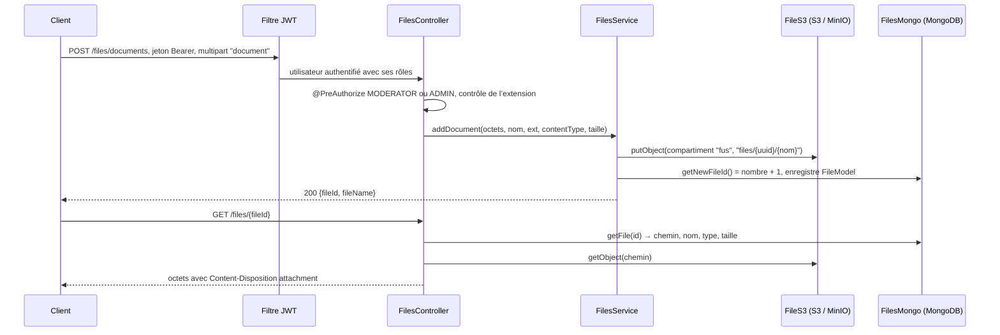

# SpringBootFilesUploader

<div class="repo-status-row"><span class="repo-badge kind">API backend</span><span class="repo-badge api">API</span><span class="repo-badge docker">Docker</span></div>

<div class="repo-tech-badges"><span class="tag tool">Kotlin 1.6</span><span class="tag tool">Spring Boot 2.6</span><span class="tag tool">Spring Security</span><span class="tag tool">JWT</span><span class="tag tool">MongoDB</span><span class="tag tool">S3 / MinIO</span><span class="tag tool">docker-java</span><span class="tag tool">Apache MINA SSHD</span><span class="tag tool">springdoc</span><span class="tag tool">Gradle</span></div>

SpringBootFilesUploader est une API REST en Kotlin construite sur Spring Boot 2.6.3. Son nom décrit sa première tâche : recevoir un fichier, en placer les octets dans un compartiment compatible S3 et sa description dans MongoDB, puis le resservir par son identifiant. Le code va plus loin que le nom. La même application liste et contrôle des conteneurs Docker, interroge un serveur Caddy et exécute des commandes par SSH, le tout derrière une authentification JWT à trois rôles. Le dernier commit date de février 2022 et le README tient en une ligne : tout ce qui suit vient du code source.

## Aperçu {#overview}

Six contrôleurs composent l’API. Les chemins partent de la racine du serveur ; `/auth/**` et la documentation de l’API sont publics, tout le reste exige un jeton porteur (`SecurityConf.kt`).

| Contrôleur | Points d’accès | Rôles dans `@PreAuthorize` |
| --- | --- | --- |
| `AuthController` (`/auth`) | `POST /signin`, `POST /signup`, `POST /signup/admin` | publics ; `/signup/admin` exige `ADMIN` |
| `FilesController` (`/files`) | `POST /documents` (champ multipart `document`), `GET /{id}` | envoi : `MODERATOR` ou `ADMIN` ; téléchargement : tout rôle |
| `UserController` (`/user`) | `GET /{id}/page`, `GET /profile`, `GET /mod`, `GET /admin` | selon le point d’accès |
| `DockerController` (`/containers`) | `GET /ping`, `GET /list`, `PUT /create`, `POST /start/{name}`, `/stop/{name}`, `/restart/{name}`, `/rename/{name}/{newName}` | `MOD` ou `ADMIN` ; création et renommage `ADMIN` |
| `CaddyController` (`/caddy`) | `GET /ping` | authentifié |
| `SSHController` (`/ssh`) | `POST /cli` | `ADMIN` |

La page OpenAPI est servie par springdoc à `/api-docs` (`application.yml`).

## Parcours d’un envoi {#upload}



1. `AuthTokenFilter` lit le jeton porteur, `JwtUtils` le valide avec le `jwtSecret` de la configuration, et les rôles de l’utilisateur viennent de MongoDB.
2. `FilesController.addDocument` refuse une partie manquante et vérifie le nom de fichier avec `DOC_FILE_EXTENSION_REGEX` : tableurs, documents Word, PDF, images courantes, MP4, MOV, ZIP, MP3, WAV, ISO et RAR. Seule l’extension est vérifiée, pas le contenu. Le contrôle de taille est en commentaire.
3. `FilesService.addDocument` construit la clé d’objet `files/{UUID aléatoire}/{nom d’origine}` et écrit les octets par l’interface `FileRepository`, implémentée par `FileS3` avec le SDK AWS. `FileS3` crée le compartiment au démarrage s’il n’existe pas.
4. Le service demande ensuite un identifiant à `FilesMongo`, qui vaut le nombre de documents de la collection plus un, puis enregistre un `FileModel` (identifiant, chemin, nom, extension, UUID, type de contenu, taille).
5. Un téléchargement cherche l’identifiant dans MongoDB, lit l’objet à son chemin enregistré et le renvoie avec le type et la longueur conservés.

Les octets sont écrits avant les métadonnées. Si l’enregistrement MongoDB échoue, l’objet reste dans le compartiment sans rien qui pointe vers lui.

## Structure du projet {#structure}

Vérifiée sur l’arborescence du dépôt. Tout se trouve sous `src/main/kotlin/com/api/project/`, y compris deux fichiers Java.

```text
SpringBootFilesUploader/
├── build.gradle.kts, settings.gradle.kts, gradlew   build Gradle en DSL Kotlin (version 0.0.3)
├── Dockerfile                                         image openjdk11 qui lance build/libs/project-0.0.2.jar
├── docker-compose.yml                                 vide
└── src/
    ├── main/kotlin/com/api/project/
    │   ├── Application.kt
    │   ├── config/            S3Config, DockerConfig, WebClientConfig, SpringDocOpenAPI, GeneralConfig
    │   │   └── security/      SecurityConf (filtre JWT, sessions sans état, chemins publics)
    │   ├── constants/         MAX_DOCUMENT_FILE_SIZE, DOC_FILE_EXTENSION_REGEX
    │   ├── controller/        Auth, Files, User, Docker, Caddy, SSH (+ un DockerComposeController.java vide)
    │   │   └── dto/           FileDTO, DockerDTO, SSHDTO, request/ (connexion, inscription), response/ (JWT, message)
    │   ├── exception/         ApiError, BasicException
    │   ├── models/            UserModel, RoleModel, FileModel, DockerModel, SSHModel, enum/ (ERole, DockerStatus, FilesStatus)
    │   ├── repository/
    │   │   ├── file/          FileRepository (interface), FileS3, FilesMongo
    │   │   ├── user/          UserRepository, RoleRepository (Spring Data MongoDB)
    │   │   ├── docker/        DockerClientAPI, DockerMongo, DockerCompose.java (ébauche)
    │   │   ├── caddy/         CaddyMongo
    │   │   └── SSHRepository.kt
    │   └── service/
    │       ├── FilesService, SSHService
    │       ├── docker/        DockerService, DockerComposeService
    │       ├── caddy/         CaddyAPI, CaddyService, conversion de configuration et modèle JSON
    │       └── jwt/           JwtUtils, AuthTokenFilter, AuthEntryPointJwt, UserDetails*
    ├── main/resources/        application.yml, application-local.yml
    └── test/kotlin/.../ApplicationTests.kt   un seul test contextLoads()
```

## Services externes {#services}

L’application s’attend à joindre ces services, avec les valeurs par défaut de `application.yml` et `application-local.yml` :

| Service | Valeur par défaut | Utilisé par |
| --- | --- | --- |
| MongoDB | `mongodb://localhost:27017/demo` | utilisateurs, rôles, métadonnées des fichiers, fiches Docker et Caddy |
| Stockage compatible S3 (MinIO) | `http://localhost:9000`, compartiment `fus`, clés `minioadmin` | octets des fichiers |
| API Docker Engine | `tcp://127.0.0.1:2375` | points d’accès `/containers` par docker-java |
| API d’administration Caddy | `localhost:2019` | `/caddy/ping` et conversion de configuration |
| Serveur Spring Cloud Config | `http://localhost:8888` (profil local) | configuration externe |
| Hôtes SSH | fournis dans chaque requête `/ssh/cli` | `SSHService` par Apache MINA SSHD |

## Dépendances {#dependencies}

Tirées de `build.gradle.kts`. Les versions absentes viennent des BOM Spring Boot 2.6.3 et Spring Cloud 2021.0.1.

| Bibliothèque | Version | Rôle |
| --- | --- | --- |
| Starters [Spring Boot](https://spring.io/projects/spring-boot) : web, webflux, security, data-mongodb, validation | 2.6.3 | API HTTP, WebClient réactif, sécurité, dépôts MongoDB, validation des requêtes |
| [Kotlin](https://kotlinlang.org/) JVM, `plugin.spring`, `kotlin-reflect`, `kotlin-stdlib-jdk8` | 1.6.10 | Langage et intégration Spring, cible Java 11 |
| [Spring Cloud](https://spring.io/projects/spring-cloud-config) `starter-config`, `starter-bootstrap` | 2021.0.1 | Configuration venant d’un serveur de configuration |
| `spring-security-oauth2-jose` | BOM | Classes JOSE / JWT |
| [`io.jsonwebtoken:jjwt`](https://central.sonatype.com/artifact/io.jsonwebtoken/jjwt/0.9.1) | 0.9.1 | Signature et lecture des jetons d’accès |
| [`com.amazonaws:aws-java-sdk-s3`](https://central.sonatype.com/artifact/com.amazonaws/aws-java-sdk-s3/1.12.159) | 1.12.159 | Client S3 / MinIO pour les octets |
| [`com.github.docker-java:docker-java`](https://central.sonatype.com/artifact/com.github.docker-java/docker-java/3.2.13) + `transport-httpclient5` | 3.2.13 | Client de l’API Docker Engine |
| [`org.apache.sshd:sshd-core`](https://central.sonatype.com/artifact/org.apache.sshd/sshd-core/2.8.0) | 2.8.0 | Client SSH pour `/ssh/cli` |
| [`org.springdoc:springdoc-openapi-ui`](https://central.sonatype.com/artifact/org.springdoc/springdoc-openapi-ui/1.6.6) + `-webflux-ui` | 1.6.6 | Document OpenAPI et Swagger UI |
| [`com.squareup.okhttp3:okhttp`](https://central.sonatype.com/artifact/com.squareup.okhttp3/okhttp/4.9.3) | 4.9.3 | Client HTTP |
| [`com.googlecode.json-simple:json-simple`](https://central.sonatype.com/artifact/com.googlecode.json-simple/json-simple/1.1.1) | 1.1.1 | Réponses `JSONArray` pour la liste des conteneurs |
| Tests : `spring-boot-starter-test`, `spring-security-test`, `io.mockk:mockk` 1.12.2, `com.ninja-squad:springmockk` 3.1.0, `mockwebserver` d’OkHttp | | Outils de test, presque inutilisés |

`spring-boot-starter-parent` est déclaré comme dépendance `implementation` alors que c’est un POM parent, et une BOM Testcontainers (1.15.3) est importée sans aucune dépendance Testcontainers.

## Démarrage {#installation}

Démarrez MongoDB et MinIO en local (le `docker-compose.yml` du dépôt est vide), puis lancez l’application avec le profil `local`, que `application.yml` active par défaut :

```bash
docker run -d -p 27017:27017 mongo
docker run -d -p 9000:9000 -e MINIO_ROOT_USER=minioadmin -e MINIO_ROOT_PASSWORD=minioadmin minio/minio server /data
./gradlew bootRun
```

Le profil `local` pointe aussi vers un serveur Spring Cloud Config sur le port 8888. Les rôles sont lus dans la collection de rôles de MongoDB et rien dans le code ne les crée : insérez `ROLE_USER`, `ROLE_MODERATOR` et `ROLE_ADMIN` avant de vous inscrire.

## Limites {#limits}

- **Rôle de modérateur en libre-service.** `POST /auth/signup` transforme un rôle demandé `"mod"` en `ROLE_MODERATOR` : n’importe qui peut créer un compte autorisé à envoyer des fichiers.
- **Des noms de rôles qui ne correspondent jamais.** `DockerController` vérifie `hasRole('MOD')`, mais les rôles sont `ROLE_USER`, `ROLE_MODERATOR` et `ROLE_ADMIN` ; seuls les administrateurs passent ces contrôles.
- **Identifiants séquentiels et concurrents.** `getNewFileId()` renvoie le nombre de documents plus un : deux envois simultanés peuvent obtenir le même identifiant, et une suppression fait entrer le suivant en collision.
- **Envois sans limite, en mémoire.** Les limites multipart sont fixées à 500 000 Mo, le contrôle de taille est en commentaire et `document.bytes` charge tout le fichier en mémoire avant l’envoi vers S3.
- **Exécution de commandes à distance, par conception.** `/ssh/cli` ouvre un shell sur n’importe quel hôte et y exécute la commande donnée pour un administrateur, et `/containers` parle à un socket TCP Docker sans authentification.
- **Valeurs par défaut versionnées.** `jwtSecret: secret`, les clés MinIO `minioadmin`, un mot de passe du serveur de configuration et une adresse courriel personnelle se trouvent dans les fichiers YAML.
- **Build et documentation.** Le Dockerfile copie `project-0.0.2.jar` alors que le build produit la version 0.0.3, le fichier Compose et le README sont vides, et le seul test vérifie que le contexte se charge.

## Sources {#sources}

- [Dépôt GitHub](https://github.com/antoinebou12/SpringBootFilesUploader)
- [`build.gradle.kts`](https://github.com/antoinebou12/SpringBootFilesUploader/blob/main/build.gradle.kts)
- [`FilesController.kt`](https://github.com/antoinebou12/SpringBootFilesUploader/blob/main/src/main/kotlin/com/api/project/controller/FilesController.kt)
- [`FilesService.kt`](https://github.com/antoinebou12/SpringBootFilesUploader/blob/main/src/main/kotlin/com/api/project/service/FilesService.kt)
- [`FileS3.kt`](https://github.com/antoinebou12/SpringBootFilesUploader/blob/main/src/main/kotlin/com/api/project/repository/file/FileS3.kt)
- [`SecurityConf.kt`](https://github.com/antoinebou12/SpringBootFilesUploader/blob/main/src/main/kotlin/com/api/project/config/security/SecurityConf.kt)
- [`AuthController.kt`](https://github.com/antoinebou12/SpringBootFilesUploader/blob/main/src/main/kotlin/com/api/project/controller/AuthController.kt)
- [`application.yml`](https://github.com/antoinebou12/SpringBootFilesUploader/blob/main/src/main/resources/application.yml)
