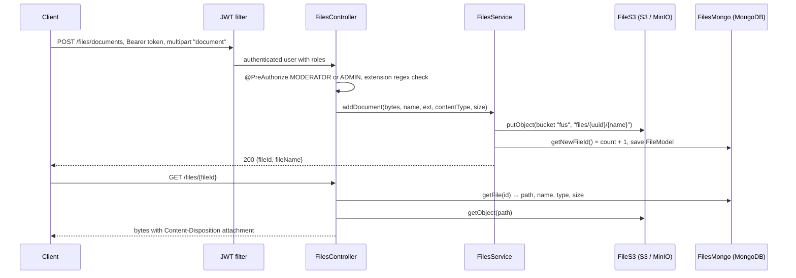

# SpringBootFilesUploader

<div class="repo-status-row"><span class="repo-badge kind">Backend API</span><span class="repo-badge api">API</span><span class="repo-badge docker">Docker</span></div>

<div class="repo-tech-badges"><span class="tag tool">Kotlin 1.6</span><span class="tag tool">Spring Boot 2.6</span><span class="tag tool">Spring Security</span><span class="tag tool">JWT</span><span class="tag tool">MongoDB</span><span class="tag tool">S3 / MinIO</span><span class="tag tool">docker-java</span><span class="tag tool">Apache MINA SSHD</span><span class="tag tool">springdoc</span><span class="tag tool">Gradle</span></div>

SpringBootFilesUploader is a Kotlin REST API built on Spring Boot 2.6.3. The name describes its first job: accept a file upload, put the bytes in an S3-compatible bucket and the description in MongoDB, and serve the file back by id. The code goes further than the name. The same application also lists and controls Docker containers, pings a Caddy server and runs commands over SSH, all behind JWT authentication with three roles. The last commit dates from February 2022, and the README is a single line, so everything below comes from the source.

## Overview {#overview}

Six controllers make up the API. Paths are relative to the server root; `/auth/**` and the API docs are public, everything else needs a bearer token (`SecurityConf.kt`).

| Controller | Endpoints | Roles in `@PreAuthorize` |
| --- | --- | --- |
| `AuthController` (`/auth`) | `POST /signin`, `POST /signup`, `POST /signup/admin` | public; `/signup/admin` needs `ADMIN` |
| `FilesController` (`/files`) | `POST /documents` (multipart field `document`), `GET /{id}` | upload: `MODERATOR` or `ADMIN`; download: any role |
| `UserController` (`/user`) | `GET /{id}/page`, `GET /profile`, `GET /mod`, `GET /admin` | per endpoint |
| `DockerController` (`/containers`) | `GET /ping`, `GET /list`, `PUT /create`, `POST /start/{name}`, `/stop/{name}`, `/restart/{name}`, `/rename/{name}/{newName}` | `MOD` or `ADMIN`; create and rename `ADMIN` |
| `CaddyController` (`/caddy`) | `GET /ping` | authenticated |
| `SSHController` (`/ssh`) | `POST /cli` | `ADMIN` |

The OpenAPI page is served by springdoc at `/api-docs` (`application.yml`).

## How an upload works {#upload}



1. `AuthTokenFilter` reads the bearer token, `JwtUtils` validates it with the `jwtSecret` from the configuration, and the user's roles come from MongoDB.
2. `FilesController.addDocument` rejects a missing part and checks the filename against `DOC_FILE_EXTENSION_REGEX`: spreadsheets, Word documents, PDF, common images, MP4, MOV, ZIP, MP3, WAV, ISO and RAR. Only the extension is checked, not the content. The size check is commented out.
3. `FilesService.addDocument` builds the object key `files/{random UUID}/{original name}` and writes the bytes through the `FileRepository` interface, implemented by `FileS3` with the AWS SDK. `FileS3` creates the bucket at startup if it does not exist.
4. The service then asks `FilesMongo` for an id, which is the number of documents in the collection plus one, and saves a `FileModel` (id, path, name, extension, UUID, content type, size).
5. A download looks the id up in MongoDB, reads the object from its stored path and returns it with the saved content type and length.

The bytes are written before the metadata. If the MongoDB save fails, the object stays in the bucket with nothing pointing to it.

## Project structure {#structure}

Checked against the repository tree. Everything lives under `src/main/kotlin/com/api/project/`, including two Java files.

```text
SpringBootFilesUploader/
├── build.gradle.kts, settings.gradle.kts, gradlew   Gradle Kotlin DSL build (version 0.0.3)
├── Dockerfile                                         openjdk11 image running build/libs/project-0.0.2.jar
├── docker-compose.yml                                 empty
└── src/
    ├── main/kotlin/com/api/project/
    │   ├── Application.kt
    │   ├── config/            S3Config, DockerConfig, WebClientConfig, SpringDocOpenAPI, GeneralConfig
    │   │   └── security/      SecurityConf (JWT filter, stateless sessions, public paths)
    │   ├── constants/         MAX_DOCUMENT_FILE_SIZE, DOC_FILE_EXTENSION_REGEX
    │   ├── controller/        Auth, Files, User, Docker, Caddy, SSH (+ an empty DockerComposeController.java)
    │   │   └── dto/           FileDTO, DockerDTO, SSHDTO, request/ (login, sign-up), response/ (JWT, message)
    │   ├── exception/         ApiError, BasicException
    │   ├── models/            UserModel, RoleModel, FileModel, DockerModel, SSHModel, enum/ (ERole, DockerStatus, FilesStatus)
    │   ├── repository/
    │   │   ├── file/          FileRepository (interface), FileS3, FilesMongo
    │   │   ├── user/          UserRepository, RoleRepository (Spring Data MongoDB)
    │   │   ├── docker/        DockerClientAPI, DockerMongo, DockerCompose.java (stub)
    │   │   ├── caddy/         CaddyMongo
    │   │   └── SSHRepository.kt
    │   └── service/
    │       ├── FilesService, SSHService
    │       ├── docker/        DockerService, DockerComposeService
    │       ├── caddy/         CaddyAPI, CaddyService, config mappers and JSON model
    │       └── jwt/           JwtUtils, AuthTokenFilter, AuthEntryPointJwt, UserDetails*
    ├── main/resources/        application.yml, application-local.yml
    └── test/kotlin/.../ApplicationTests.kt   a single contextLoads() test
```

## External services {#services}

The application expects these to be reachable, with the defaults from `application.yml` and `application-local.yml`:

| Service | Default | Used by |
| --- | --- | --- |
| MongoDB | `mongodb://localhost:27017/demo` | users, roles, file metadata, Docker and Caddy records |
| S3-compatible storage (MinIO) | `http://localhost:9000`, bucket `fus`, `minioadmin` keys | file bytes |
| Docker Engine API | `tcp://127.0.0.1:2375` | `/containers` endpoints through docker-java |
| Caddy admin API | `localhost:2019` | `/caddy/ping` and config mapping |
| Spring Cloud Config server | `http://localhost:8888` (local profile) | external configuration |
| SSH hosts | given in each `/ssh/cli` request | `SSHService` through Apache MINA SSHD |

## Dependencies {#dependencies}

From `build.gradle.kts`. Versions without a number come from the Spring Boot 2.6.3 and Spring Cloud 2021.0.1 BOMs.

| Library | Version | Purpose |
| --- | --- | --- |
| [Spring Boot](https://spring.io/projects/spring-boot) starters: web, webflux, security, data-mongodb, validation | 2.6.3 | HTTP API, reactive WebClient, security, MongoDB repositories, request validation |
| [Kotlin](https://kotlinlang.org/) JVM, `plugin.spring`, `kotlin-reflect`, `kotlin-stdlib-jdk8` | 1.6.10 | Language and Spring integration, Java 11 target |
| [Spring Cloud](https://spring.io/projects/spring-cloud-config) `starter-config`, `starter-bootstrap` | 2021.0.1 | Configuration from a config server |
| `spring-security-oauth2-jose` | BOM | JOSE / JWT support classes |
| [`io.jsonwebtoken:jjwt`](https://central.sonatype.com/artifact/io.jsonwebtoken/jjwt/0.9.1) | 0.9.1 | Signing and parsing the access tokens |
| [`com.amazonaws:aws-java-sdk-s3`](https://central.sonatype.com/artifact/com.amazonaws/aws-java-sdk-s3/1.12.159) | 1.12.159 | S3 / MinIO client for file bytes |
| [`com.github.docker-java:docker-java`](https://central.sonatype.com/artifact/com.github.docker-java/docker-java/3.2.13) + `transport-httpclient5` | 3.2.13 | Docker Engine API client |
| [`org.apache.sshd:sshd-core`](https://central.sonatype.com/artifact/org.apache.sshd/sshd-core/2.8.0) | 2.8.0 | SSH client for `/ssh/cli` |
| [`org.springdoc:springdoc-openapi-ui`](https://central.sonatype.com/artifact/org.springdoc/springdoc-openapi-ui/1.6.6) + `-webflux-ui` | 1.6.6 | OpenAPI document and Swagger UI |
| [`com.squareup.okhttp3:okhttp`](https://central.sonatype.com/artifact/com.squareup.okhttp3/okhttp/4.9.3) | 4.9.3 | HTTP client |
| [`com.googlecode.json-simple:json-simple`](https://central.sonatype.com/artifact/com.googlecode.json-simple/json-simple/1.1.1) | 1.1.1 | `JSONArray` responses for container lists |
| Test: `spring-boot-starter-test`, `spring-security-test`, `io.mockk:mockk` 1.12.2, `com.ninja-squad:springmockk` 3.1.0, OkHttp `mockwebserver` | | Test tooling, mostly unused |

`spring-boot-starter-parent` is declared as an `implementation` dependency although it is a parent POM, and a Testcontainers BOM (1.15.3) is imported without any Testcontainers dependency.

## Getting started {#installation}

Start MongoDB and MinIO locally (the repository's `docker-compose.yml` is empty), then run the app with the `local` profile, which `application.yml` activates by default:

```bash
docker run -d -p 27017:27017 mongo
docker run -d -p 9000:9000 -e MINIO_ROOT_USER=minioadmin -e MINIO_ROOT_PASSWORD=minioadmin minio/minio server /data
./gradlew bootRun
```

The `local` profile also points to a Spring Cloud Config server on port 8888. Roles are read from MongoDB's role collection and nothing in the code creates them, so insert `ROLE_USER`, `ROLE_MODERATOR` and `ROLE_ADMIN` before signing up.

## Limits {#limits}

- **Self-service moderator role.** `POST /auth/signup` maps a requested role `"mod"` to `ROLE_MODERATOR`, so anyone can create an account allowed to upload files.
- **Role names that never match.** `DockerController` checks `hasRole('MOD')`, but the roles are `ROLE_USER`, `ROLE_MODERATOR` and `ROLE_ADMIN`; only admins pass those checks.
- **Sequential, racy file ids.** `getNewFileId()` returns the document count plus one: two concurrent uploads can get the same id, and a deletion makes the next id collide.
- **Unbounded uploads in memory.** Multipart limits are set to 500,000 MB, the size check is commented out, and `document.bytes` loads the whole file into memory before it is sent to S3.
- **Remote command execution by design.** `/ssh/cli` opens a shell on any host and runs the given command for an admin, and `/containers` talks to an unauthenticated Docker TCP socket.
- **Committed defaults.** `jwtSecret: secret`, MinIO `minioadmin` keys, a config-server password and a personal email are in the YAML files.
- **Build and docs.** The Dockerfile copies `project-0.0.2.jar` while the build produces version 0.0.3, the Compose file and README are empty, and the only test checks that the context loads.

## Sources {#sources}

- [GitHub repository](https://github.com/antoinebou12/SpringBootFilesUploader)
- [`build.gradle.kts`](https://github.com/antoinebou12/SpringBootFilesUploader/blob/main/build.gradle.kts)
- [`FilesController.kt`](https://github.com/antoinebou12/SpringBootFilesUploader/blob/main/src/main/kotlin/com/api/project/controller/FilesController.kt)
- [`FilesService.kt`](https://github.com/antoinebou12/SpringBootFilesUploader/blob/main/src/main/kotlin/com/api/project/service/FilesService.kt)
- [`FileS3.kt`](https://github.com/antoinebou12/SpringBootFilesUploader/blob/main/src/main/kotlin/com/api/project/repository/file/FileS3.kt)
- [`SecurityConf.kt`](https://github.com/antoinebou12/SpringBootFilesUploader/blob/main/src/main/kotlin/com/api/project/config/security/SecurityConf.kt)
- [`AuthController.kt`](https://github.com/antoinebou12/SpringBootFilesUploader/blob/main/src/main/kotlin/com/api/project/controller/AuthController.kt)
- [`application.yml`](https://github.com/antoinebou12/SpringBootFilesUploader/blob/main/src/main/resources/application.yml)
