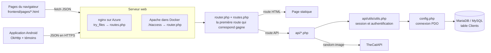
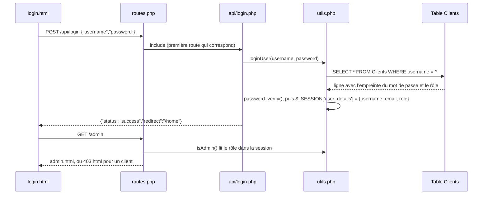
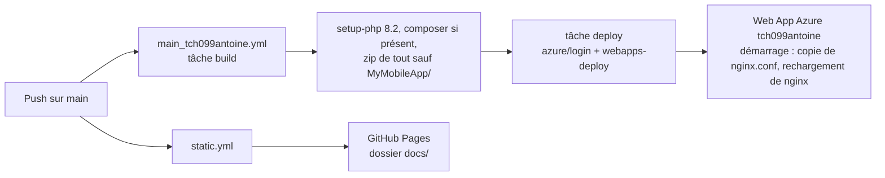
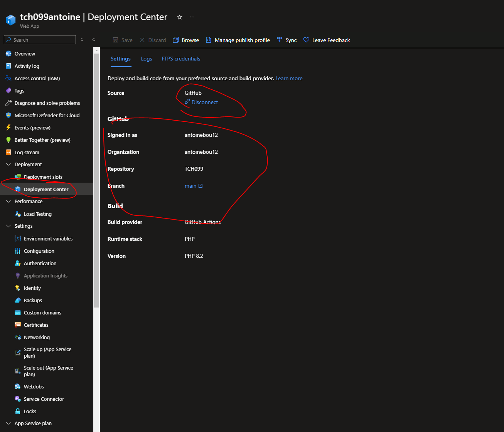

# TCH099

<div class="repo-status-row"><span class="repo-badge kind">Application web</span><span class="repo-badge api">API</span><span class="repo-badge docker">Docker</span></div>

<div class="repo-tech-badges"><span class="tag tool">PHP 8</span><span class="tag tool">MariaDB</span><span class="tag tool">PDO</span><span class="tag tool">nginx</span><span class="tag tool">Apache</span><span class="tag tool">Azure App Service</span><span class="tag tool">GitHub Actions</span><span class="tag tool">Android</span><span class="tag tool">OkHttp</span></div>

TCH099 est une petite application web PHP conçue comme démonstration à déployer sur Azure. Elle sert quelques pages HTML, une API JSON d’inscription, de connexion, de déconnexion et de détails de l’utilisateur, ainsi qu’une page d’administration qui liste tous les comptes ; une application Android parle à la même API. Son [site de documentation](https://antoinebou12.github.io/TCH099/) s’adresse aux étudiants qui commencent un projet d’équipe : histoires utilisateur, référence de l’API, initiation aux DevTools du navigateur, configuration Android et étapes de déploiement Azure.

## Aperçu {#overview}

Il n’y a pas de cadriciel. Deux fichiers font le routage, quelques scripts de `api/` font le travail et une table `Clients` contient les comptes.

- **Routes.** `routes.php` liste chaque route sous forme d’appel, par exemple `get('/login', 'frontend/pages/login.html')` ou `post('/api/login', 'api/login.php')`. `router.php` définit ces fonctions et compare la requête.
- **Pages.** `frontend/pages/` contient du HTML statique (accueil, connexion, inscription, hello world, image aléatoire, admin, 403, 404, 50x) qui appelle l’API avec `fetch`.
- **API.** `api/login.php`, `signup.php`, `logout.php`, `user_details.php`, `clients.php`, `hello-world.php` et `random-image.php` lisent des corps JSON et répondent en JSON. Les fonctions communes (`loginUser`, `registerUser`, `isAdmin`, aides CSRF) se trouvent dans `api/utils/utils.php`.
- **Données.** `config.php` ouvre une connexion PDO vers MySQL/MariaDB. `db/1create.sql` crée `Clients` (id, nom d’utilisateur et courriel uniques, empreinte du mot de passe, `role ENUM('admin','client')`, horodatages) ; `db/db.py` exécute les trois fichiers SQL avec les identifiants du `.env`.
- **Mobile.** `MyMobileApp/` est un projet Android Studio avec des activités de connexion, d’inscription et de détails de l’utilisateur. `HttpClient.java` garde un seul client OkHttp avec un gestionnaire de témoins, pour que le témoin de session PHP survive d’un appel à l’autre.

## Ce que couvre le site de documentation {#docs-site}

Le [site GitHub Pages](https://antoinebou12.github.io/TCH099/) est le fichier `docs/index.html`, publié par le flux `static.yml`. Il suit les étapes d’un projet d’équipe :

1. **Planifier.** Une épopée, « gestion des comptes et des profils utilisateurs », découpée en sept histoires utilisateur (inscription, connexion, déconnexion, message « Hello World » avec le nom de l’utilisateur, image aléatoire, détails de l’utilisateur, connexion administrateur), chacune avec ses sous-tâches : concevoir le formulaire, écrire la logique serveur, chiffrer les mots de passe, tester.
2. **Structure du projet.** Une arborescence commentée de `api/`, `db/`, `frontend/`, des fichiers de routage et des fichiers de déploiement.
3. **Base de données.** Les variables du `.env` et les commandes d’initialisation de `db.py`.
4. **API.** Point d’accès, méthode, corps de requête et réponse pour chaque route, avec un diagramme de séquence PlantUML par appel.
5. **Frontend.** Une visite des DevTools (Elements, Console, Sources, Network, Performance, Memory, Application, Security) avec captures et raccourcis.
6. **Mobile.** Installation d’Android Studio, URL de l’API dans `buildConfigField`, fichiers de mise en page, et pourquoi l’émulateur joint l’hôte à `10.0.2.2`.
7. **Déploiement.** Un diagramme de déploiement et sept étapes dans le portail Azure, de la création de la Web App et de la base jusqu’à la connexion SSH au conteneur et à l’écriture de son `.env`. Le README ajoute une huitième étape sur les liens privés.

## Architecture {#architecture}



Deux serveurs web mènent au même routeur. L’image Docker est `php:8.1-apache` ; son `.htaccess` envoie toute requête qui n’est pas un fichier statique (image, CSS, JS, SVG, ZIP ou PDF) à `router.php`, qui se termine par `require_once 'routes.php'`. Sur Azure App Service (PHP 8.2), nginx sert les fichiers existants et se rabat sur `routes.php`, qui commence par `require_once 'router.php'`. Dans les deux cas, les deux fichiers sont chargés et la liste des routes s’exécute une fois.

## Comment le routeur reconnaît une requête {#router}

`get()`, `post()`, `put()`, `patch()`, `delete()` et `any()` vérifient chacune la méthode HTTP, puis appellent `route($route, $target)`. Comme `routes.php` les appelle l’une après l’autre, la première route qui correspond inclut sa cible et appelle `exit()` ; rien de ce qui suit ne s’exécute. `route()` procède ainsi :

1. Si la cible est une chaîne sans `.php` ni `.html`, elle ajoute `.php`.
2. Elle nettoie l’URI, retire la barre oblique finale et la chaîne de requête, puis découpe la route et l’URI sur `/`.
3. Une route qui finit par `*` accepte tout chemin plus long et transmet le reste comme un seul argument.
4. Sinon, les deux doivent avoir le même nombre de segments. Un segment qui commence par `$` copie le segment de l’URI dans une variable PHP de ce nom (`$$route_part = …`) ; tout autre segment doit correspondre exactement.
5. En cas de correspondance, elle appelle la fonction anonyme avec les valeurs capturées, ou fait `include_once` du fichier, puis s’arrête.

La dernière ligne de `routes.php` est `any('/404', …)`, et `route()` renvoie directement la page 404 pour `/404` sans rien comparer. Toute requête qui a traversé les routes précédentes sans correspondre reçoit donc la page 404.

Exemple détaillé, `POST /api/hello-world/es` avec `{"nom": "Tremblay", "prenom": "Ana"}` :

- les appels `get()` l’ignorent (mauvaise méthode) ; `post('/api/login', …)` et les autres échouent sur le nombre de segments ou leur texte ;
- `post('/api/hello-world/$langue', 'api/hello-world.php')` a trois segments, comme l’URI. `api` et `hello-world` correspondent et `$langue` capture `es` ;
- `hello-world.php` est inclus à l’intérieur de `route()` : il voit `$langue = 'es'`, lit `nom` et `prenom` dans le corps (ou prend le nom d’utilisateur connecté comme `prenom`) et renvoie `{"nom": "Tremblay", "prenom": "Ana", "langue": "es", "message": "Hola Mundo Tremblay Ana!"}`.

La même URL en `GET` se comporte autrement : la branche GET de `hello-world.php` remplace `$langue` par `$_GET['langue'] ?? 'fr'`. Le segment du chemin est ignoré et la réponse est en français, sauf si l’on ajoute `?langue=es`.

## Connexion et rôles {#login}



`registerUser` calcule l’empreinte du mot de passe avec `password_hash(PASSWORD_DEFAULT)` et n’accepte que les rôles `admin` et `client`. Chaque requête passe par une requête préparée. C’est la session, et non un jeton, qui porte l’identité ; d’où le gestionnaire de témoins du client Android.

## Travail d’équipe et livraison {#workflow}

Le guide du développeur du README donne les règles de travail de l’équipe : comment ajouter une route, une page et un point d’API, et cinq bonnes pratiques (séparer les préoccupations, valider les entrées côté serveur, renvoyer des erreurs HTTP adaptées, réutiliser `utils.php`, utiliser des requêtes préparées et échapper le HTML). Les histoires utilisateur du site de documentation servent aussi de carnet de produit.



Deux flux s’exécutent à chaque push sur `main`. `main_tch099antoine.yml` compresse l’application PHP (le projet Android est exclu) et la déploie sur l’App Service `tch099antoine` avec `azure/webapps-deploy`. `static.yml` publie `docs/` sur GitHub Pages. Côté Azure, la commande de démarrage copie le `nginx.conf` du dépôt par-dessus le site par défaut et recharge nginx, pour que les chemins inconnus arrivent à `routes.php`.



## Démarrage {#installation}

Créez un `.env` avec les variables du README (`DB_HOST=tch099-db`, `MYSQL_DATABASE`, `MYSQL_USER`, `MYSQL_PASSWORD`, `MYSQL_ROOT_PASSWORD`), puis lancez la pile :

```shell
docker compose up -d --build
cd db
python3 -m pip install mysql-connector-python python-dotenv
python3 db.py
```

Compose démarre trois conteneurs sur un même réseau pont : `web` (l’image Apache, port 8001, avec le dépôt monté dans `/var/www/html`), `db` (MariaDB, port 3306, données dans le volume `dbdata`) et `phpmyadmin` (port 8060). Ouvrez `http://localhost:8001`.

## Limites {#limits}

- `config.php` code en dur les identifiants locaux (`tch099-db`, `user`/`password`) et ne lit jamais l’environnement ; `$isCloudEnv` est calculé sans être utilisé. Le guide Azure contourne le problème en écrivant un `.env` par SSH, mais PHP ne le charge pas.
- `config.php` affiche « Database connection successful. » à chaque inclusion. Les réponses de l’API commencent donc par ce texte avant le JSON, ce qui fait échouer `response.json()` dans les pages.
- `api/signup.php` prend le `role` dans le corps de la requête : n’importe qui peut créer un compte `admin`, puis ouvrir `/admin` et `/api/clients`.
- `api/clients.php` renvoie `SELECT * FROM Clients`, empreintes de mots de passe comprises.
- `router.php` envoie `Access-Control-Allow-Origin: *` et active `display_errors` pour chaque requête.
- La section « ajouter une route » du README montre un format de tableau `$routes['/chemin'] = [...]` que `routes.php` n’utilise pas ; le vrai format est celui des appels `get()` / `post()` décrits plus haut.
- Les aides CSRF de `utils.php` ne sont appelées par aucun script de l’API.

## Sources {#sources}

- [Dépôt GitHub](https://github.com/antoinebou12/TCH099)
- [Site de documentation](https://antoinebou12.github.io/TCH099/)
- [README](https://github.com/antoinebou12/TCH099/blob/main/README.md)
- [`router.php`](https://github.com/antoinebou12/TCH099/blob/main/router.php)
- [`routes.php`](https://github.com/antoinebou12/TCH099/blob/main/routes.php)
- [`api/utils/utils.php`](https://github.com/antoinebou12/TCH099/blob/main/api/utils/utils.php)
- [`api/hello-world.php`](https://github.com/antoinebou12/TCH099/blob/main/api/hello-world.php)
- [`config.php`](https://github.com/antoinebou12/TCH099/blob/main/config.php)
- [`.github/workflows/main_tch099antoine.yml`](https://github.com/antoinebou12/TCH099/blob/main/.github/workflows/main_tch099antoine.yml)
- [`docker-compose.yml`](https://github.com/antoinebou12/TCH099/blob/main/docker-compose.yml)
