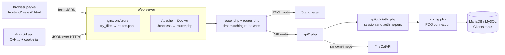
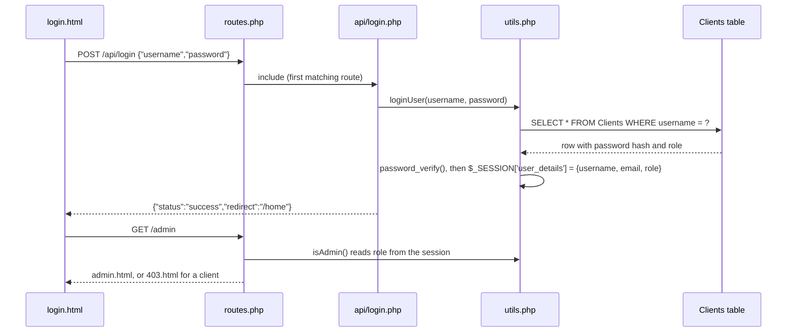
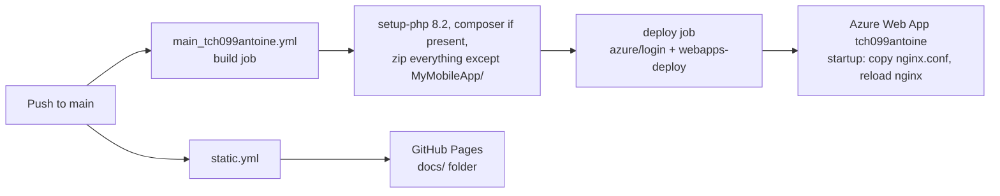
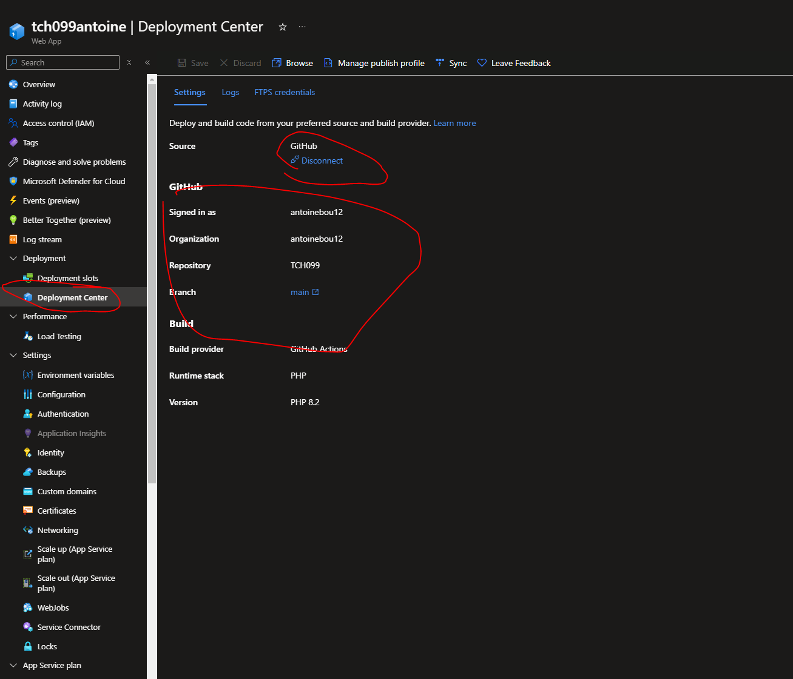

# TCH099

<div class="repo-status-row"><span class="repo-badge kind">Web app</span><span class="repo-badge api">API</span><span class="repo-badge docker">Docker</span></div>

<div class="repo-tech-badges"><span class="tag tool">PHP 8</span><span class="tag tool">MariaDB</span><span class="tag tool">PDO</span><span class="tag tool">nginx</span><span class="tag tool">Apache</span><span class="tag tool">Azure App Service</span><span class="tag tool">GitHub Actions</span><span class="tag tool">Android</span><span class="tag tool">OkHttp</span></div>

TCH099 is a small PHP web application built as a demo to deploy on Azure. It serves a few HTML pages, a JSON API for sign-up, login, logout and user details, and an admin page that lists every account; an Android app talks to the same API. Its [documentation site](https://antoinebou12.github.io/TCH099/) is written for students starting a team project: user stories, the API reference, a browser DevTools primer, the Android setup and the Azure deployment steps, all in French.

## Overview {#overview}

There is no framework. Two files do the routing, a handful of scripts in `api/` do the work, and one `Clients` table holds the accounts.

- **Routes.** `routes.php` lists every route as a call such as `get('/login', 'frontend/pages/login.html')` or `post('/api/login', 'api/login.php')`. `router.php` defines those functions and matches the request.
- **Pages.** `frontend/pages/` holds static HTML (home, login, sign-up, hello world, random image, admin, 403, 404, 50x) that call the API with `fetch`.
- **API.** `api/login.php`, `signup.php`, `logout.php`, `user_details.php`, `clients.php`, `hello-world.php` and `random-image.php` read JSON bodies and answer with JSON. Shared helpers (`loginUser`, `registerUser`, `isAdmin`, CSRF helpers) live in `api/utils/utils.php`.
- **Data.** `config.php` opens a PDO connection to MySQL/MariaDB. `db/1create.sql` creates `Clients` (id, unique username and email, password hash, `role ENUM('admin','client')`, timestamps); `db/db.py` runs the three SQL files with credentials from `.env`.
- **Mobile.** `MyMobileApp/` is an Android Studio project with login, sign-up and user-details activities. `HttpClient.java` keeps one OkHttp client with a cookie jar so the PHP session cookie survives between calls.

## What the documentation site covers {#docs-site}

The [GitHub Pages site](https://antoinebou12.github.io/TCH099/) is `docs/index.html`, published by the `static.yml` workflow. It is organised as the steps of a team project:

1. **Plan.** One epic, "account and profile management", split into seven user stories (sign-up, login, logout, hello-world message with the user's name, random image, user details, admin login), each with its sub-tasks: design the form, write the backend logic, hash passwords, test.
2. **Project structure.** An annotated tree of `api/`, `db/`, `frontend/`, the router files and the deployment files.
3. **Database.** The `.env` variables and the `db.py` initialisation commands.
4. **API.** Endpoint, method, request body and response for each route, with a PlantUML sequence diagram per call.
5. **Front end.** A DevTools tour (Elements, Console, Sources, Network, Performance, Memory, Application, Security) with screenshots and shortcuts.
6. **Mobile.** Android Studio setup, the `buildConfigField` API URLs, the layout files, and why the emulator reaches the host at `10.0.2.2`.
7. **Deployment.** A deployment diagram and seven Azure portal steps, from creating the Web App and database to SSH-ing into the container and writing its `.env`. The README adds an eighth step on private links.

## Architecture {#architecture}



Two web servers lead to the same router. The Docker image is `php:8.1-apache`; its `.htaccess` sends every request that is not a static file (image, CSS, JS, SVG, ZIP or PDF) to `router.php`, which ends with `require_once 'routes.php'`. On Azure App Service (PHP 8.2), nginx serves existing files and falls back to `routes.php`, which starts with `require_once 'router.php'`. Either way both files load and the route list runs once.

## How the router matches a request {#router}

`get()`, `post()`, `put()`, `patch()`, `delete()` and `any()` each check the HTTP method and then call `route($route, $target)`. Because `routes.php` calls them one after another, the first route that matches includes its target and calls `exit()`; nothing after it runs. `route()` works like this:

1. If the target is a string without `.php` or `.html`, it appends `.php`.
2. It cleans the request URI, strips a trailing slash and the query string, and splits both the route and the URI on `/`.
3. A route ending in `*` matches any longer path and passes the rest as one argument.
4. Otherwise the segment counts must be equal. A segment starting with `$` captures the URI segment into a PHP variable of that name (`$$route_part = …`); any other segment must match exactly.
5. On a match it calls the closure with the captured values, or `include_once`s the file, then exits.

The last line of `routes.php` is `any('/404', …)`, and `route()` short-circuits `/404` to the 404 page without comparing anything. Every request that fell through all earlier routes therefore gets the 404 page.

A worked example, `POST /api/hello-world/es` with `{"nom": "Tremblay", "prenom": "Ana"}`:

- `get()` calls skip it (wrong method); `post('/api/login', …)` and the others fail on segment count or text.
- `post('/api/hello-world/$langue', 'api/hello-world.php')` has three segments like the URI. `api` and `hello-world` match, and `$langue` captures `es`.
- `hello-world.php` is included inside `route()`, so it sees `$langue = 'es'`, reads `nom` and `prenom` from the body (or uses the logged-in username as `prenom`), and returns `{"nom": "Tremblay", "prenom": "Ana", "langue": "es", "message": "Hola Mundo Tremblay Ana!"}`.

The same URL with `GET` behaves differently: the GET branch of `hello-world.php` overwrites `$langue` with `$_GET['langue'] ?? 'fr'`, so the path segment is ignored and the answer is in French unless `?langue=es` is added.

## Login and roles {#login}



`registerUser` hashes the password with `password_hash(PASSWORD_DEFAULT)` and only accepts the roles `admin` and `client`. Every query uses a prepared statement. The session, not a token, carries the identity, which is why the Android client needs a cookie jar.

## Team workflow and delivery {#workflow}

The README's developer guide gives the team's working rules: how to add a route, a page and an API endpoint, and five good practices (separate concerns, validate input on the server, return proper HTTP errors, reuse `utils.php`, use prepared statements and escape HTML). The user stories on the documentation site double as the backlog.



Two workflows run on each push to `main`. `main_tch099antoine.yml` zips the PHP app (the Android project is excluded) and deploys it to the App Service named `tch099antoine` with `azure/webapps-deploy`. `static.yml` uploads `docs/` to GitHub Pages. On the Azure side, the startup command copies the repository's `nginx.conf` over the default site and reloads nginx, so that unknown paths reach `routes.php`.



## Getting started {#installation}

Create a `.env` with the variables from the README (`DB_HOST=tch099-db`, `MYSQL_DATABASE`, `MYSQL_USER`, `MYSQL_PASSWORD`, `MYSQL_ROOT_PASSWORD`), then start the stack:

```shell
docker compose up -d --build
cd db
python3 -m pip install mysql-connector-python python-dotenv
python3 db.py
```

Compose starts three containers on one bridge network: `web` (the Apache image, port 8001, with the repository mounted at `/var/www/html`), `db` (MariaDB, port 3306, data in the `dbdata` volume) and `phpmyadmin` (port 8060). Open `http://localhost:8001`.

## Limits {#limits}

- `config.php` hard-codes the local credentials (`tch099-db`, `user`/`password`) and never reads the environment; `$isCloudEnv` is computed and unused. The Azure guide works around this by writing a `.env` over SSH, but PHP does not load it.
- `config.php` echoes "Database connection successful." on every include. API responses therefore start with that text before the JSON, which makes `response.json()` in the pages reject.
- `api/signup.php` takes `role` from the request body, so anyone can create an `admin` account and then open `/admin` and `/api/clients`.
- `api/clients.php` returns `SELECT * FROM Clients`, password hashes included.
- `router.php` sets `Access-Control-Allow-Origin: *` and turns on `display_errors` for every request.
- The README's "add a route" section shows a `$routes['/path'] = [...]` array format that `routes.php` does not use; the real format is the `get()` / `post()` calls above.
- The CSRF helpers in `utils.php` are not called by any API script.

## Sources {#sources}

- [GitHub repository](https://github.com/antoinebou12/TCH099)
- [Documentation site](https://antoinebou12.github.io/TCH099/)
- [README](https://github.com/antoinebou12/TCH099/blob/main/README.md)
- [`router.php`](https://github.com/antoinebou12/TCH099/blob/main/router.php)
- [`routes.php`](https://github.com/antoinebou12/TCH099/blob/main/routes.php)
- [`api/utils/utils.php`](https://github.com/antoinebou12/TCH099/blob/main/api/utils/utils.php)
- [`api/hello-world.php`](https://github.com/antoinebou12/TCH099/blob/main/api/hello-world.php)
- [`config.php`](https://github.com/antoinebou12/TCH099/blob/main/config.php)
- [`.github/workflows/main_tch099antoine.yml`](https://github.com/antoinebou12/TCH099/blob/main/.github/workflows/main_tch099antoine.yml)
- [`docker-compose.yml`](https://github.com/antoinebou12/TCH099/blob/main/docker-compose.yml)
