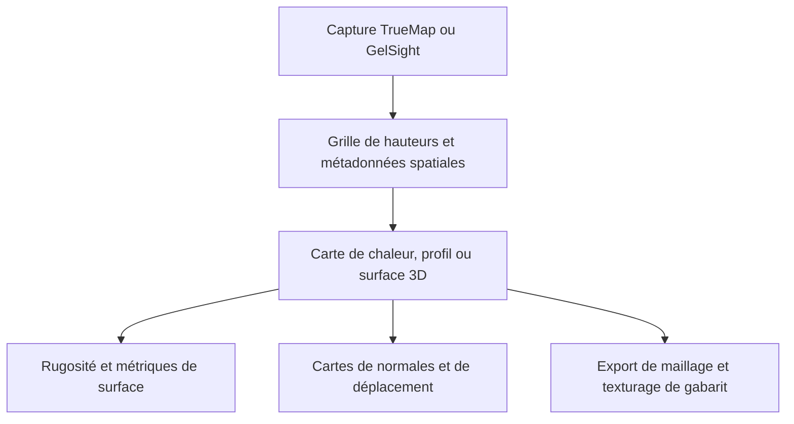

# TrueMapData

TrueMapData est une bibliothèque Python et une CLI `tmd-process` pour les cartes de hauteur TrueMap et GelSight, maintenue sous [ETSim](https://github.com/ETSim). Elle lit les captures de surface comme des tableaux NumPy et fournit analyse et export graphique. Les faits ci-dessous viennent du README et des guides du dépôt, lus pour l'[article associé]().

## Aperçu

**Pourquoi il existe.** Une même représentation de surface qui sert à la métrologie et aux ressources graphiques comme les cartes de déplacement ou les maillages.

**Cas d'usage.** Inspecter des surfaces mesurées, comparer des captures dans le temps (usure) et exporter cartes de normales, cartes de déplacement ou maillages en conservant l'échelle physique.

## Démarrage

```bash
pip install "truemapdata[viz]"
tmd-process visualize basic path/to/capture.tmd
tmd-process visualize 3d path/to/capture.tmd --plotter plotly --output surface.html
```

```python
from tmd import TMD

capture = TMD.load("path/to/capture.tmd")
heights = capture.height_map
metadata = capture.metadata
```

Les chemins sont des exemples. Extras optionnels : `truemapdata[roughness]` (Surfalize, GPL-3.0, installé séparément du cœur MIT) et les dépendances de maillage pour l'export STL, OBJ, PLY, glTF et USD.

## Fonctions et composants

| Domaine | Contenu |
| --- | --- |
| Format de fichier | En-tête `.tmd`, métadonnées spatiales et grille de hauteurs `float32` en ordre ligne ; formats v1 (ancien) et v2 de type TrueMap v6, avec vérification des en-têtes v2 alternatifs |
| Visualisation | Carte de chaleur 2D, surface 3D, profils ligne et colonne, contours, comparaison de fichiers ; Matplotlib, HTML Plotly, Polyscope en option |
| Cartes dérivées | Cartes de normales, cartes de déplacement, application sur maillage avec un gabarit OBJ/MTL utilisant les bornes du gabarit, `mm_per_pixel` et les dimensions de la capture pour le tuilage |
| Métrologie | Rugosité surfacique ISO 25178 via Surfalize (optionnel) |
| Usure | Commandes `tmd-wear` : séries de volume, évolution des rayures, heuristiques d'axe de glissement, trajectoires de rugosité ; alignement par translation et recalage OpenCV/SIFT, y compris guidé par les normales |
| Outils de pipeline | Filtres, détection de défauts, export de séquences, compression |

## Architecture



## Limites et points à vérifier

- La rugosité décrit une capture ; l'usure compare des captures dans le temps et exige la même grille et la même région dans le plan avant de soustraire les hauteurs.
- Convention de perte : `hauteur de référence − hauteur courante` ; une perte positive signifie une surface courante plus basse. Le volume physique demande aussi l'espacement des pixels dans les deux directions.
- Des erreurs de recalage ou des unités de hauteur incohérentes changent les résultats d'usure.
- Les figures du README sont des exemples du dépôt avec des hauteurs normalisées, pas des mesures du mémoire.

## Liens

- [Dépôt](https://github.com/ETSim/TrueMapData)
- [Documentation](https://etsim.github.io/TrueMapData/)
- [Guide du format binaire](https://github.com/ETSim/TrueMapData/blob/main/docs/user-guide/working-with-tmd-files.md) · [Analyse séquentielle de l'usure](https://github.com/ETSim/TrueMapData/blob/main/docs/user-guide/sequential-wear-analysis.md)
- [MistubaVideo]() rend les champs de surface enregistrés que cet outillage mesure
