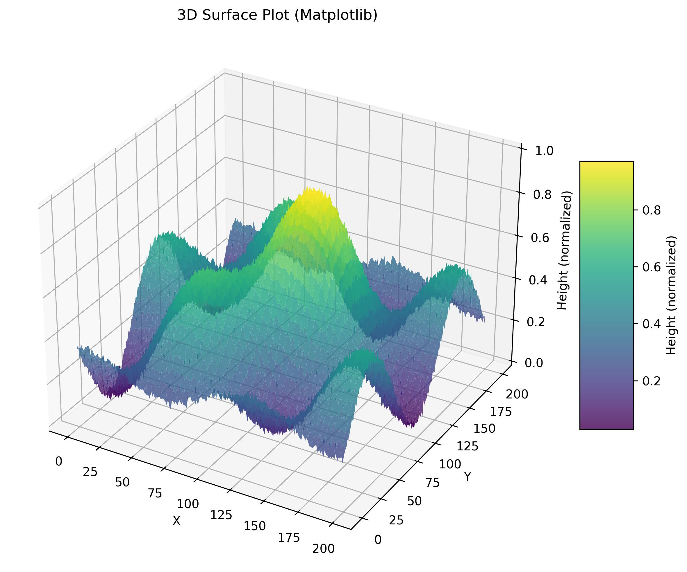
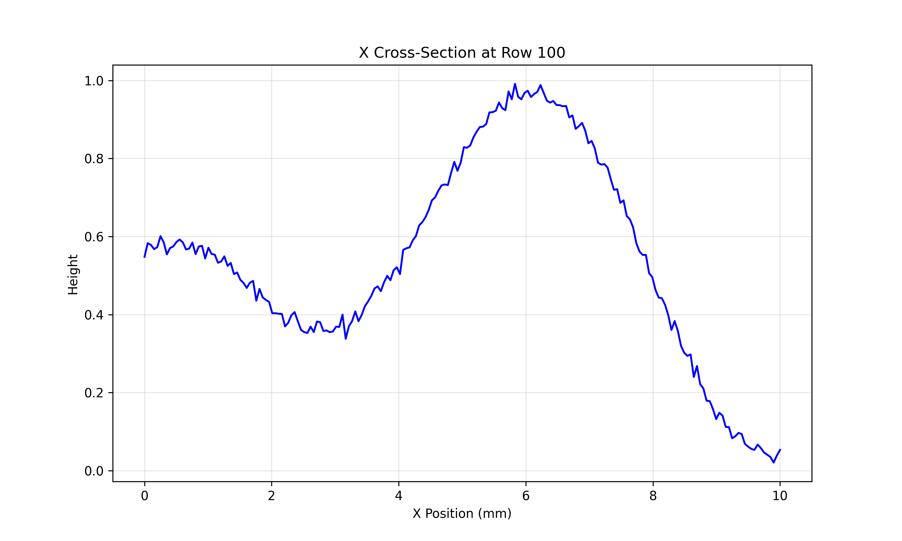
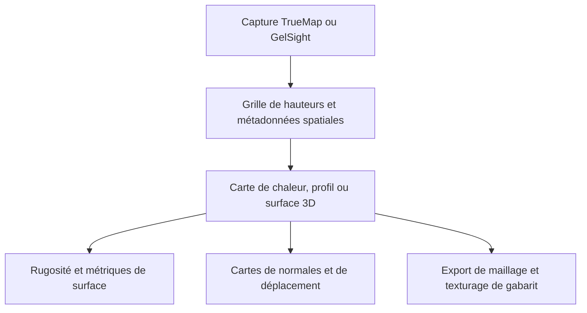

# TrueMapData

TrueMapData est une bibliothèque Python et une CLI `tmd-process` pour les cartes de hauteur TrueMap et GelSight, maintenue sous [ETSim](https://github.com/ETSim). Elle lit les captures de surface comme des tableaux NumPy et fournit analyse et export graphique. Les faits ci-dessous viennent du README et des guides du dépôt, lus pour l'[article associé]().

## Aperçu

**Pourquoi il existe.** Une même représentation de surface qui sert à la métrologie et aux ressources graphiques comme les cartes de déplacement ou les maillages.

**Cas d'usage.** Inspecter des surfaces mesurées, comparer des captures dans le temps (usure) et exporter cartes de normales, cartes de déplacement ou maillages en conservant l'échelle physique.

## Démarrage

**Paquet.** TrueMapData est publié sur PyPI sous le nom [`truemapdata`](https://pypi.org/project/truemapdata/) (licence MIT, Python 3.8 ou plus récent). La dernière version sur PyPI est la 1.0.5 ; le `pyproject.toml` du dépôt en est déjà à 1.0.6. Il n’existe pas de paquet .NET ni NuGet : la bibliothèque est uniquement en Python, et le nom d’import est `tmd`.

```bash
pip install truemapdata
```

Les extras ajoutent des fonctions optionnelles. Chacun est déclaré dans `pyproject.toml` :

| Extra | Ajoute | Pour |
| --- | --- | --- |
| `viz` | PyVista, ipywidgets, Kaleido | Vues 3D et export Plotly statique |
| `mesh` | trimesh, pygltflib, numpy-stl | Export STL, OBJ, PLY et glTF |
| `advanced` | Polyscope, scikit-image, Open3D | Visionneuse interactive et traitement d’image |
| `roughness` | Surfalize (GPL-3.0, Python 3.10+) | Rugosité surfacique ISO 25178 ; tenu hors de `full` à cause de sa licence |
| `full` | dev, docs, viz, mesh et advanced, plus pandas et nbformat | Travailler sur la bibliothèque elle-même |

```bash
pip install "truemapdata[mesh,viz]"
pip install "truemapdata[roughness]"
```

Le paquet installe deux commandes, `tmd-process` (la boîte à outils complète) et `tmd-wear` (le sous-ensemble consacré à l’usure).

**Un premier script.** Cet exemple suit `tests/core/test_tmd.py` et fonctionne donc sans fichier de capture : il construit une carte de hauteurs en mémoire, l’enregistre au format TMD v2, la relit et l’examine.

```python
import numpy as np
from tmd import TMD

# Une grille de 200 x 200 hauteurs, 0,05 mm entre deux points
y, x = np.mgrid[0:200, 0:200]
heights = (np.sin(x / 25) * np.cos(y / 30)).astype(np.float32)

surface = TMD(heights, {"comment": "synthetic", "resolution_x": 0.05, "resolution_y": 0.05})
path = surface.save("synthetic.tmd")            # version 2 par défaut, renvoie le chemin .tmd

loaded = TMD.load(path)
print(loaded.shape)                              # (200, 200)
print(loaded.dimensions)                         # largeur et hauteur physiques : 10,0 x 10,0
print(loaded.stats["min"], loaded.stats["max"])  # calculées au premier accès

patch = loaded.crop(50, 50, 64, 64)              # x_start, y_start, largeur, hauteur
small = loaded.resize(100, 100)
```

`TMD.load` lève `FileNotFoundError` ou `TMDProcessingError` si le fichier manque, et `dimensions` multiplie la taille de la grille par `resolution_x` et `resolution_y` tirés des métadonnées (1,0 s’ils sont absents). Avec une vraie capture, remplacez la grille synthétique par `TMD.load("capture.tmd")`. Le dépôt suit des captures d’exemple pour cela : des fichiers TrueMap dans `examples/v1/` et `examples/v2/` (une pièce de dix cents, une marche, des pièces de monnaie, du papier et, en v2, un marquage laser et une empreinte Vickers) et trois captures GelSight dans `examples/gelsight/`, prises après 0, 150 et 300 mm de glissement sous 100 g.

**En ligne de commande.** Les exemples d’usure du README tournent sur ces fichiers :

```bash
tmd-process visualize basic examples/v2/Dime.tmd
tmd-wear bearing curve examples/gelsight/circle_0mm_100g_heightmap_linear_detrend.tmd --json
tmd-wear volume-series examples/gelsight/circle_0mm_100g_heightmap_linear_detrend.tmd \
  tests/fixtures/gelsight_wear_volume_second_frame.tmd --json
```

La première commande d’usure affiche la courbe de portance (Abbott–Firestone) d’une capture ; la seconde compare des captures de même grille et donne la perte par rapport à la première (`z_ref - z_i`, positive là où la surface a baissé).





## Fonctions et composants

| Domaine | Contenu |
| --- | --- |
| Format de fichier | En-tête `.tmd`, métadonnées spatiales et grille de hauteurs `float32` en ordre ligne ; formats v1 (ancien) et v2 de type TrueMap v6, avec vérification des en-têtes v2 alternatifs |
| Visualisation | Carte de chaleur 2D, surface 3D, profils ligne et colonne, contours, comparaison de fichiers ; Matplotlib, HTML Plotly, Polyscope en option |
| Cartes dérivées | Cartes de normales, cartes de déplacement, application sur maillage avec un gabarit OBJ/MTL utilisant les bornes du gabarit, `mm_per_pixel` et les dimensions de la capture pour le tuilage |
| Métrologie | Rugosité surfacique ISO 25178 via Surfalize (optionnel) |
| Usure | Commandes `tmd-wear` : séries de volume, évolution des rayures, heuristiques d'axe de glissement, trajectoires de rugosité ; alignement par translation et recalage OpenCV/SIFT, y compris guidé par les normales |
| Outils de pipeline | Filtres, détection de défauts, export de séquences, compression |

## Architecture



## Limites et points à vérifier

- La rugosité décrit une capture ; l'usure compare des captures dans le temps et exige la même grille et la même région dans le plan avant de soustraire les hauteurs.
- Convention de perte : `hauteur de référence − hauteur courante` ; une perte positive signifie une surface courante plus basse. Le volume physique demande aussi l'espacement des pixels dans les deux directions.
- Des erreurs de recalage ou des unités de hauteur incohérentes changent les résultats d'usure.
- Les figures du README sont des exemples du dépôt avec des hauteurs normalisées, pas des mesures du mémoire.

## Liens

- [Dépôt](https://github.com/ETSim/TrueMapData)
- [Paquet PyPI `truemapdata`](https://pypi.org/project/truemapdata/)
- [`tests/core/test_tmd.py`](https://github.com/ETSim/TrueMapData/blob/main/tests/core/test_tmd.py), source de l’exemple d’utilisation
- [Documentation](https://etsim.github.io/TrueMapData/)
- [Guide du format binaire](https://github.com/ETSim/TrueMapData/blob/main/docs/user-guide/working-with-tmd-files.md) · [Analyse séquentielle de l'usure](https://github.com/ETSim/TrueMapData/blob/main/docs/user-guide/sequential-wear-analysis.md)
- [MistubaVideo]() rend les champs de surface enregistrés que cet outillage mesure
