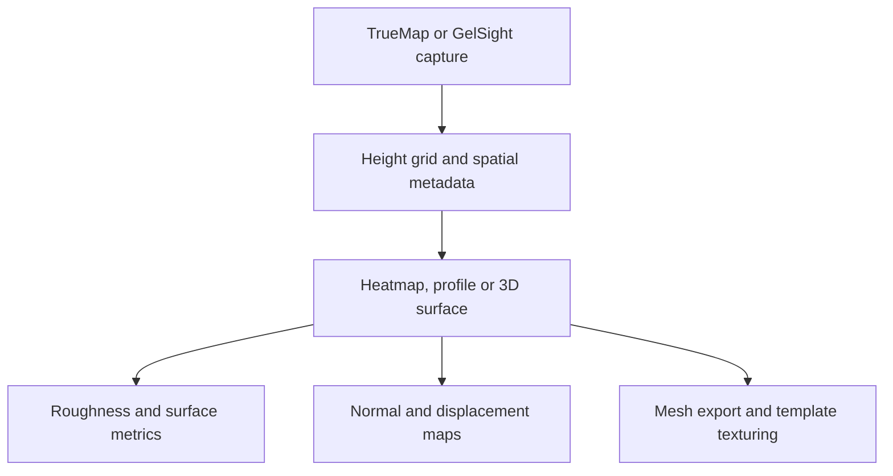

# TrueMapData

TrueMapData is a Python library and `tmd-process` CLI for TrueMap and GelSight height maps, maintained under [ETSim](https://github.com/ETSim). It reads surface captures as NumPy arrays and provides analysis and graphics export. Facts below come from the repository README and guides as read for the [companion article]().

## Overview

**Why it exists.** One surface representation that serves metrology work and graphics assets such as displacement maps or meshes.

**Best fit.** Inspecting measured surfaces, comparing captures over time (wear), and exporting normal maps, displacement maps or meshes with physical scale preserved.

## Getting started

```bash
pip install "truemapdata[viz]"
tmd-process visualize basic path/to/capture.tmd
tmd-process visualize 3d path/to/capture.tmd --plotter plotly --output surface.html
```

```python
from tmd import TMD

capture = TMD.load("path/to/capture.tmd")
heights = capture.height_map
metadata = capture.metadata
```

Paths are placeholders. Optional extras: `truemapdata[roughness]` (Surfalize, GPL-3.0, installed separately from the MIT core) and the mesh dependencies for STL, OBJ, PLY, glTF and USD export.

## Features and components

| Area | Content |
| --- | --- |
| File format | `.tmd` header, spatial metadata and a `float32` row-major height grid; legacy v1 and TrueMap v6-style v2 formats, with checks for alternate v2 headers |
| Visualisation | 2D heatmap, 3D surface, row and column profiles, contours, file comparisons; Matplotlib, Plotly HTML, optional Polyscope |
| Derived maps | Normal maps, displacement maps, apply-on-mesh with a template OBJ/MTL using template bounds, `mm_per_pixel` and capture dimensions for tiling |
| Metrology | ISO 25178 areal roughness through Surfalize (optional) |
| Wear | `tmd-wear` commands: volume series, scratch evolution, slip-axis heuristics, roughness trajectories; translation alignment and OpenCV/SIFT registration, including normals-driven registration |
| Pipeline tools | Filters, defect detection, sequence export, compression |

## Architecture



## Constraints and checks

- Roughness describes one capture; wear compares captures over time and needs the same grid and in-plane region before heights are subtracted.
- Loss convention: `reference height − current height`; positive loss means the current surface is lower. Physical volume also needs the pixel spacing in both directions.
- Registration errors or inconsistent height units change wear results.
- The README figures are repository examples with normalised heights, not thesis measurements.

## Links

- [Repository](https://github.com/ETSim/TrueMapData)
- [Documentation](https://etsim.github.io/TrueMapData/)
- [Binary format guide](https://github.com/ETSim/TrueMapData/blob/main/docs/user-guide/working-with-tmd-files.md) · [Sequential wear analysis](https://github.com/ETSim/TrueMapData/blob/main/docs/user-guide/sequential-wear-analysis.md)
- [MistubaVideo]() renders the recorded surface fields this tooling measures
