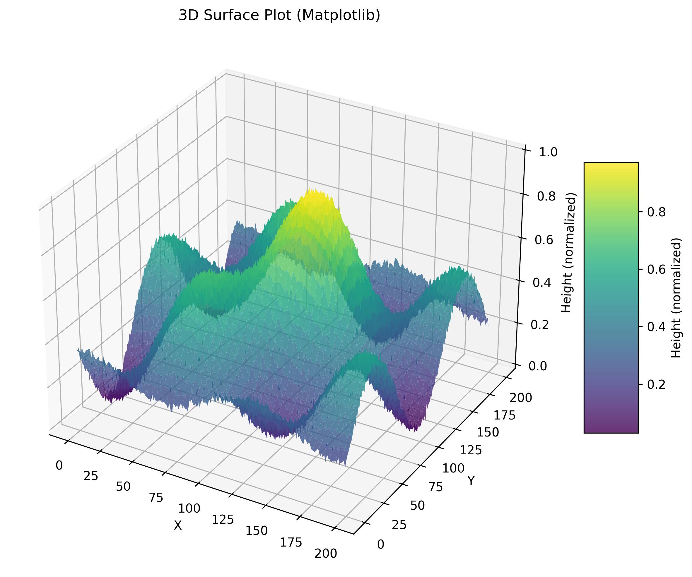
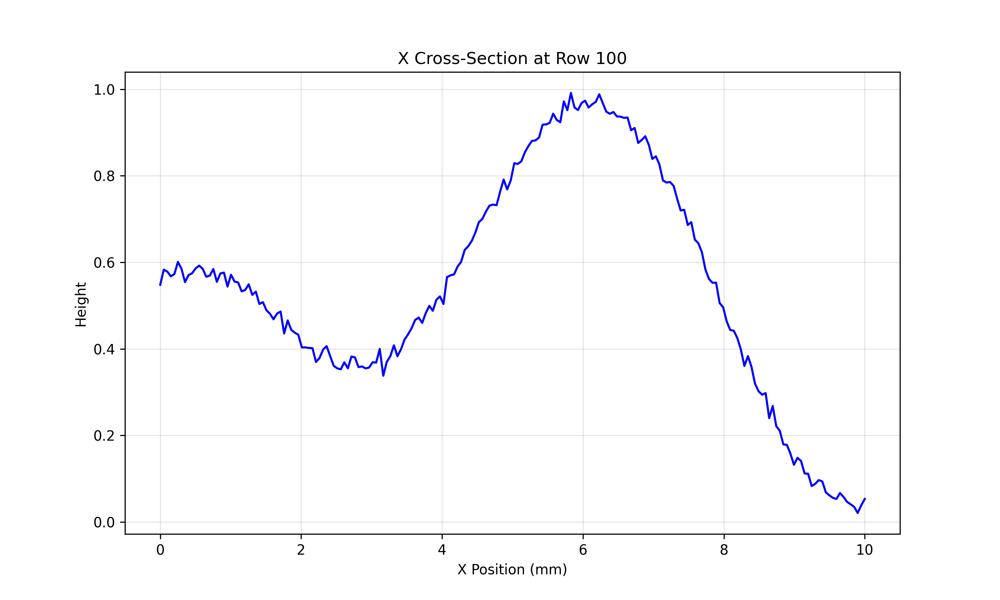
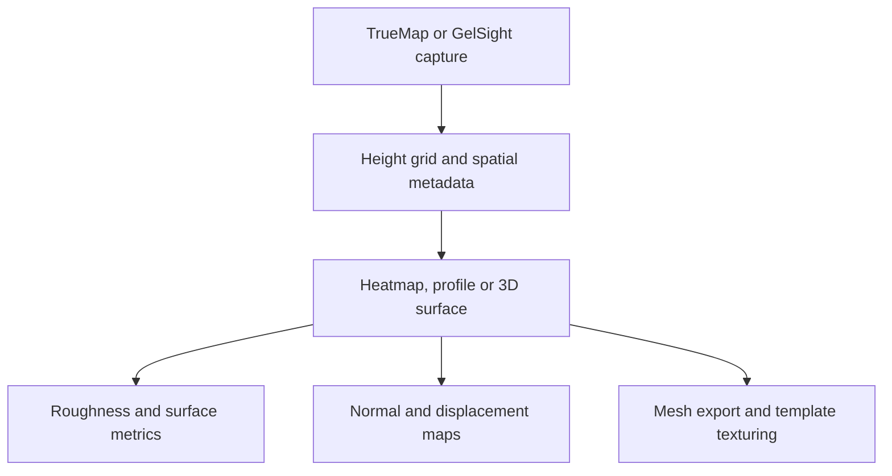

# TrueMapData

TrueMapData is a Python library and `tmd-process` CLI for TrueMap and GelSight height maps, maintained under [ETSim](https://github.com/ETSim). It reads surface captures as NumPy arrays and provides analysis and graphics export. Facts below come from the repository README and guides as read for the [companion article]().

## Overview

**Why it exists.** One surface representation that serves metrology work and graphics assets such as displacement maps or meshes.

**Best fit.** Inspecting measured surfaces, comparing captures over time (wear), and exporting normal maps, displacement maps or meshes with physical scale preserved.

## Getting started

**Package.** TrueMapData is on PyPI as [`truemapdata`](https://pypi.org/project/truemapdata/) (MIT, Python 3.8 or later). The latest release on PyPI is 1.0.5; the repository's `pyproject.toml` is already at 1.0.6. There is no .NET or NuGet package: the library is Python only, and the import name is `tmd`.

```bash
pip install truemapdata
```

The extras pull in optional features. Each one is declared in `pyproject.toml`:

| Extra | Adds | Use it for |
| --- | --- | --- |
| `viz` | PyVista, ipywidgets, Kaleido | 3D views and static Plotly export |
| `mesh` | trimesh, pygltflib, numpy-stl | STL, OBJ, PLY and glTF export |
| `advanced` | Polyscope, scikit-image, Open3D | Interactive viewer and image processing |
| `roughness` | Surfalize (GPL-3.0, Python 3.10+) | ISO 25178 areal roughness; kept out of `full` because of its licence |
| `full` | dev, docs, viz, mesh and advanced, plus pandas and nbformat | Working on the library itself |

```bash
pip install "truemapdata[mesh,viz]"
pip install "truemapdata[roughness]"
```

Installing the package adds two commands, `tmd-process` (the full toolkit) and `tmd-wear` (the wear subset).

**A first script.** This example follows `tests/core/test_tmd.py`, so it runs without a capture file: it builds a height map in memory, saves it in the TMD v2 format, reads it back and looks at it.

```python
import numpy as np
from tmd import TMD

# A 200 x 200 grid of heights, 0.05 mm between samples
y, x = np.mgrid[0:200, 0:200]
heights = (np.sin(x / 25) * np.cos(y / 30)).astype(np.float32)

surface = TMD(heights, {"comment": "synthetic", "resolution_x": 0.05, "resolution_y": 0.05})
path = surface.save("synthetic.tmd")            # version 2 by default, returns the .tmd path

loaded = TMD.load(path)
print(loaded.shape)                              # (200, 200)
print(loaded.dimensions)                         # width and height in physical units: 10.0 x 10.0
print(loaded.stats["min"], loaded.stats["max"])  # computed on first access

patch = loaded.crop(50, 50, 64, 64)              # x_start, y_start, width, height
small = loaded.resize(100, 100)
```

`TMD.load` raises `FileNotFoundError` or `TMDProcessingError` for a missing file, and `dimensions` multiplies the grid size by `resolution_x` and `resolution_y` from the metadata (1.0 when they are missing). With a real capture, replace the synthetic grid with `TMD.load("capture.tmd")`. The repository tracks sample captures for this: TrueMap files in `examples/v1/` and `examples/v2/` (a dime, a step height, coins, paper, and in v2 a laser marking and a Vickers indentation) and three GelSight captures in `examples/gelsight/` taken after 0, 150 and 300 mm of sliding at 100 g.

**From the command line.** The README's wear examples run on those fixtures:

```bash
tmd-process visualize basic examples/v2/Dime.tmd
tmd-wear bearing curve examples/gelsight/circle_0mm_100g_heightmap_linear_detrend.tmd --json
tmd-wear volume-series examples/gelsight/circle_0mm_100g_heightmap_linear_detrend.tmd \
  tests/fixtures/gelsight_wear_volume_second_frame.tmd --json
```

The first wear command prints the bearing (Abbott–Firestone) curve of one capture; the second compares captures of the same grid and reports the loss against the first one (`z_ref - z_i`, positive where the surface went down).





## Features and components

| Area | Content |
| --- | --- |
| File format | `.tmd` header, spatial metadata and a `float32` row-major height grid; legacy v1 and TrueMap v6-style v2 formats, with checks for alternate v2 headers |
| Visualisation | 2D heatmap, 3D surface, row and column profiles, contours, file comparisons; Matplotlib, Plotly HTML, optional Polyscope |
| Derived maps | Normal maps, displacement maps, apply-on-mesh with a template OBJ/MTL using template bounds, `mm_per_pixel` and capture dimensions for tiling |
| Metrology | ISO 25178 areal roughness through Surfalize (optional) |
| Wear | `tmd-wear` commands: volume series, scratch evolution, slip-axis heuristics, roughness trajectories; translation alignment and OpenCV/SIFT registration, including normals-driven registration |
| Pipeline tools | Filters, defect detection, sequence export, compression |

## Architecture



## Constraints and checks

- Roughness describes one capture; wear compares captures over time and needs the same grid and in-plane region before heights are subtracted.
- Loss convention: `reference height − current height`; positive loss means the current surface is lower. Physical volume also needs the pixel spacing in both directions.
- Registration errors or inconsistent height units change wear results.
- The README figures are repository examples with normalised heights, not thesis measurements.

## Links

- [Repository](https://github.com/ETSim/TrueMapData)
- [PyPI package `truemapdata`](https://pypi.org/project/truemapdata/)
- [`tests/core/test_tmd.py`](https://github.com/ETSim/TrueMapData/blob/main/tests/core/test_tmd.py), the source of the usage example
- [Documentation](https://etsim.github.io/TrueMapData/)
- [Binary format guide](https://github.com/ETSim/TrueMapData/blob/main/docs/user-guide/working-with-tmd-files.md) · [Sequential wear analysis](https://github.com/ETSim/TrueMapData/blob/main/docs/user-guide/sequential-wear-analysis.md)
- [MistubaVideo]() renders the recorded surface fields this tooling measures
