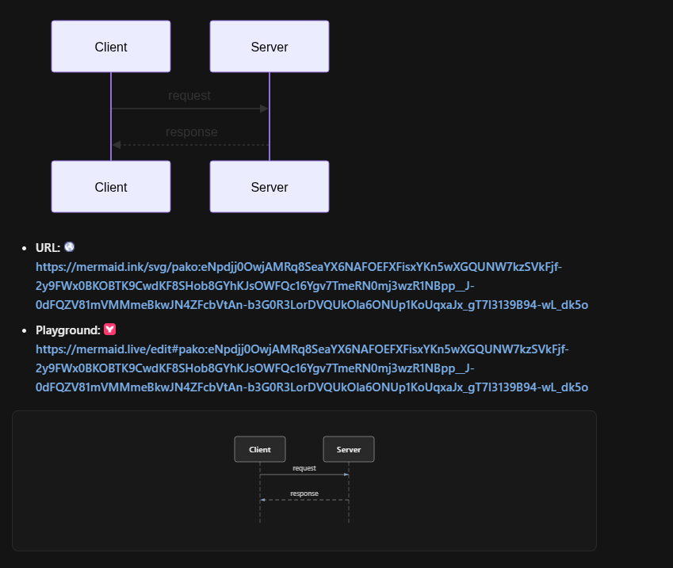
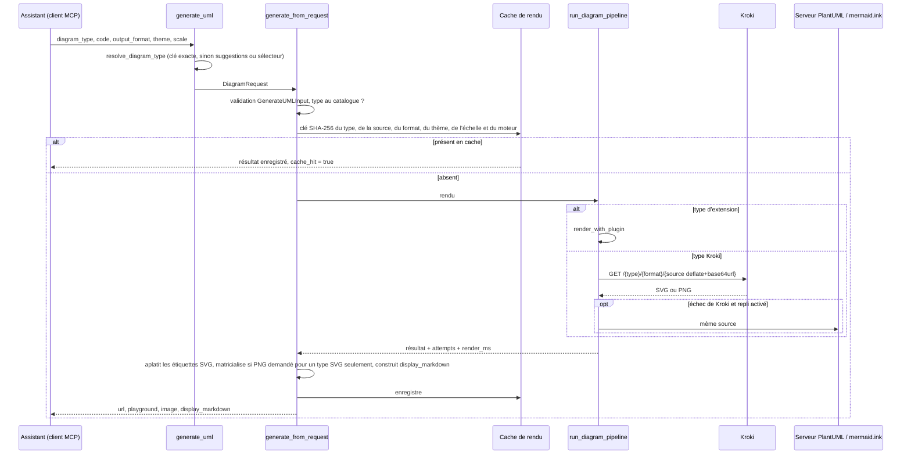

# uml-mcp

<div class="repo-status-row"><span class="repo-badge kind">Serveur MCP</span><span class="repo-badge api">API</span><span class="repo-badge docker">Docker</span></div>

<div class="repo-tech-badges"><span class="tag tool">Python 3.12+</span><span class="tag tool">FastMCP</span><span class="tag tool">FastAPI</span><span class="tag tool">Kroki</span><span class="tag tool">PlantUML</span><span class="tag tool">Mermaid</span><span class="tag tool">D2</span><span class="tag tool">MCP Apps</span><span class="tag tool">Vercel</span><span class="tag tool">Helm</span></div>

uml-mcp est un serveur Model Context Protocol qui permet à un assistant IA de dessiner des diagrammes. L’assistant écrit la source du diagramme (PlantUML, Mermaid, D2, Graphviz, C4, BPMN …), appelle un des outils du serveur et reçoit une image, un lien vers le fichier rendu et un lien vers un éditeur en ligne. Dans les clients qui prennent en charge les MCP Apps, le diagramme s’ouvre dans une visionneuse au sein de la conversation. Le paquet est publié sur PyPI sous le nom `uml-mcp` (version 1.4.0 dans `pyproject.toml`), tourne comme point d’accès hébergé sur Vercel et s’auto-héberge avec Docker ou Helm.

## Démonstration {#demo}

L’enregistrement vient du dépôt (`docs/assets/mcp-app-demo.mp4`). Un seul appel `generate_uml_batch` renvoie quatre diagrammes sous forme d’onglets dans la visionneuse MCP App ; l’utilisateur change d’onglet, puis refait le rendu d’un diagramme dans un autre format.

<figure class="article-figure">
<video controls muted playsinline preload="metadata" poster="../../../../projects/notes/uml-mcp/media/mcp-app-demo.png" style="width:100%;height:auto;border-radius:8px" aria-label="Enregistrement de la visionneuse uml-mcp dans une conversation : quatre onglets de diagrammes issus d’un appel par lot, changement d’onglet, puis nouveau rendu dans un autre format">
  <source src="../../../../projects/notes/uml-mcp/media/mcp-app-demo.mp4" type="video/mp4">
  <a href="https://github.com/antoinebou12/uml-mcp/blob/main/docs/assets/mcp-app-demo.mp4">Télécharger la vidéo de démonstration</a>
</video>
<figcaption>La visionneuse MCP App : quatre diagrammes issus d’un appel par lot, puis un nouveau rendu dans un autre format.</figcaption>
</figure>

Les clients sans MCP Apps reçoivent le même résultat sous forme d’image en ligne et de liens, ce qu’affichent la plupart des clients de conversation :




## Aperçu {#overview}

Le serveur expose cinq outils, ainsi que des ressources (`uml://types`, `uml://examples`, `uml://templates`), des invites et des fichiers de compétences qui enseignent chaque notation à l’assistant.

| Outil | Rôle |
| --- | --- |
| `generate_uml` | Rend un diagramme ; renvoie `url`, `playground`, `display_markdown` et les octets en base64 quand ils sont récupérés |
| `generate_uml_image` | La même chose, renvoyée comme `ImageContent` MCP pour l’affichage en ligne (PNG par défaut) |
| `validate_uml` | Vérifie la source avant le rendu, avec des erreurs qui disent comment corriger |
| `list_diagram_types` | Le catalogue en direct des types et de leurs formats de sortie |
| `generate_uml_batch` | Plusieurs diagrammes en un appel (`MCP_BATCH_MAX_ITEMS`, 20 par défaut) |

Le README compte 46 types de diagrammes : 37 rendus par [Kroki](https://kroki.io/) et 9 par quatre extensions fournies (graphes de forces D3 et diagrammes infonuagiques avec de vrais logos, diagrammes de pile, architecture, flux et séquences façon archify, et cartes de couches de LLM en 2D/3D).

## Ce qui se passe lors d’un appel {#pipeline}

`generate_uml`, dans `mcp_core/tools/diagram_tools.py`, n’est qu’une enveloppe ; le travail se fait dans `generate_from_request` (`mcp_core/core/diagram_service.py`) et `run_diagram_pipeline` (`mcp_core/core/diagram_rendering.py`).



Étape par étape :

1. **Type.** `mrtr.resolve_diagram_type` met la clé en minuscules et l’accepte si elle est au catalogue. Sinon, si le client sait afficher un formulaire, le serveur demande à l’utilisateur de choisir parmi jusqu’à huit types proches (`difflib`, seuil 0,45) ; sinon, il renvoie une erreur avec ces suggestions. Le thème suit le même traitement.
2. **Validation.** `GenerateUMLInput` (Pydantic) vérifie les arguments ; la source est limitée par `MCP_MAX_CODE_LENGTH`, 500 000 caractères par défaut. Un type inconnu renvoie `UNSUPPORTED_DIAGRAM_TYPE` avec un renvoi vers `uml://types`.
3. **Format.** Si le client demande du PNG ou du JPEG pour un type qui ne rend que du SVG, le service rend le SVG puis le matricialise.
4. **Cache.** Les appels qui n’écrivent pas de fichier sont mis en cache en mémoire. La clé est le SHA-256 d’un objet JSON contenant le type, la source sans espaces de bord, le format, le thème, l’échelle et l’identité du moteur. Valeurs par défaut : 300 secondes, 128 entrées, 32 Mio (`MCP_RENDER_CACHE_*`).
5. **Rendu.** Les types d’extension (moteur `plugin:`) sont rendus localement. Tout le reste part chez Kroki : la source est compressée avec zlib au niveau 9, encodée en base64url et placée dans l’URL `{kroki}/{type}/{format}/{encodé}`, qui est aussi le lien rendu à l’utilisateur.
6. **Repli.** Si Kroki échoue, les sources de la famille PlantUML sont renvoyées au serveur PlantUML et le Mermaid à mermaid.ink. Mermaid a un délai court de 8 secondes chez Kroki, et un disjoncteur évite le moteur Mermaid de Kroki pendant 60 secondes après des échecs répétés. Le repli est désactivé par défaut sur Vercel et avec un Kroki local, où les services publics ne seraient pas la bonne cible.
7. **Réponse.** Les étiquettes HTML des SVG (`foreignObject`) sont converties en texte SVG simple pour que le fichier s’affiche partout, `display_markdown` est construit pour la conversation, et chaque résultat porte `attempts`, `fallback_used` et `render_ms` : un échec dit quel moteur a échoué et pourquoi.

## Exploitation {#operations}

`uml-mcp admin` ouvre une console web sur `http://127.0.0.1:8765/admin` (sur un serveur déployé, `/admin`) : installation, réglages, activité, journaux en direct, métriques, limites de débit, outils et extensions, clients et contrôles de qualité. En local, les modifications exigent un jeton d’installation à usage unique ; avec l’authentification d’entreprise (Entra ID), la console reste en lecture seule tant que l’écriture n’est pas activée dans les réglages.

 : santé, trafic et liste de démarrage.")

## Démarrage {#installation}

Utilisez le serveur hébergé dans n’importe quel client MCP :

```json
"uml-mcp": {
  "transport": "http",
  "url": "https://uml-mcp.vercel.app/mcp"
}
```

Ou installez-le en local et laissez la commande d’installation écrire la configuration du client :

```bash
uv tool install uml-mcp && uml-mcp setup
```

Demandez ensuite un diagramme à l’assistant, par exemple « Dessine un diagramme de séquence d’un utilisateur qui se connecte par une passerelle d’API. » Le dépôt fournit des configurations prêtes pour Cursor (`.cursor/mcp.json`), VS Code (`.vscode/mcp.json`), Codex, Claude Desktop et Open WebUI, et `docs/installation.md` couvre Docker, Helm et l’exécution depuis les sources.

## Guide du dépôt {#reader-guide}

- `server.py`, `app.py` : points d’entrée stdio et HTTP ; `server.py` résout l’objet MCP à la demande, si bien qu’un import n’écrit rien sur stdout, qui transporte le protocole stdio.
- `mcp_core/tools/` : les fonctions des outils, leurs schémas, l’aide à l’élicitation (`mrtr.py`), les notifications de progression des lots et l’export.
- `mcp_core/core/` : catalogue, validation, chaîne de rendu, cache de rendu, matricialisation SVG, thèmes et configuration.
- `mcp_core/plugins/`, `examples/plugins/` : le chargeur d’extensions et les quatre extensions fournies (D3, diagramme de pile, archify, visualiseur de LLM).
- `mcp_core/apps/` : la visionneuse MCP App (`ui://uml-mcp/diagram-viewer`) et le nettoyage des SVG.
- `mcp_core/admin/`, `mcp_core/auth/`, `mcp_core/observability/` : console d’administration, authentification unique et métriques.
- `tools/kroki/` : le client Kroki, l’encodage des URL, les liens d’éditeur et les aides propres à chaque langage.
- `deploy/helm/`, `Dockerfile`, `docker-compose*.yml`, `vercel.json` : déploiement.
- `tests/` : 127 entrées, tests unitaires et d’intégration avec des bancs MCP et HTTP.

## Limites {#limits}

- Les types rendus par Kroki dépendent d’une instance Kroki joignable, et comme la source voyage dans l’URL, les très gros diagrammes donnent des liens très longs.
- Le cache de rendu est propre à chaque processus et en mémoire : il n’est pas partagé entre instances sans serveur.
- Quand ils sont activés, les replis envoient la source du diagramme à des services tiers (serveur PlantUML, mermaid.ink) ; réglez `MCP_DIAGRAM_FALLBACK=false` si la source est privée.
- La prise en charge des MCP Apps varie selon les clients ; les autres ne reçoivent que l’image et les liens.

## Sources {#sources}

- [Dépôt GitHub](https://github.com/antoinebou12/uml-mcp)
- [Documentation](https://antoinebou12.github.io/uml-mcp/)
- [Paquet PyPI](https://pypi.org/project/uml-mcp/)
- [`mcp_core/tools/diagram_tools.py`](https://github.com/antoinebou12/uml-mcp/blob/main/mcp_core/tools/diagram_tools.py)
- [`mcp_core/core/diagram_service.py`](https://github.com/antoinebou12/uml-mcp/blob/main/mcp_core/core/diagram_service.py)
- [`mcp_core/core/diagram_rendering.py`](https://github.com/antoinebou12/uml-mcp/blob/main/mcp_core/core/diagram_rendering.py)
- [`mcp_core/core/render_cache.py`](https://github.com/antoinebou12/uml-mcp/blob/main/mcp_core/core/render_cache.py)
- [`tools/kroki/kroki.py`](https://github.com/antoinebou12/uml-mcp/blob/main/tools/kroki/kroki.py)
- [Article associé]()
