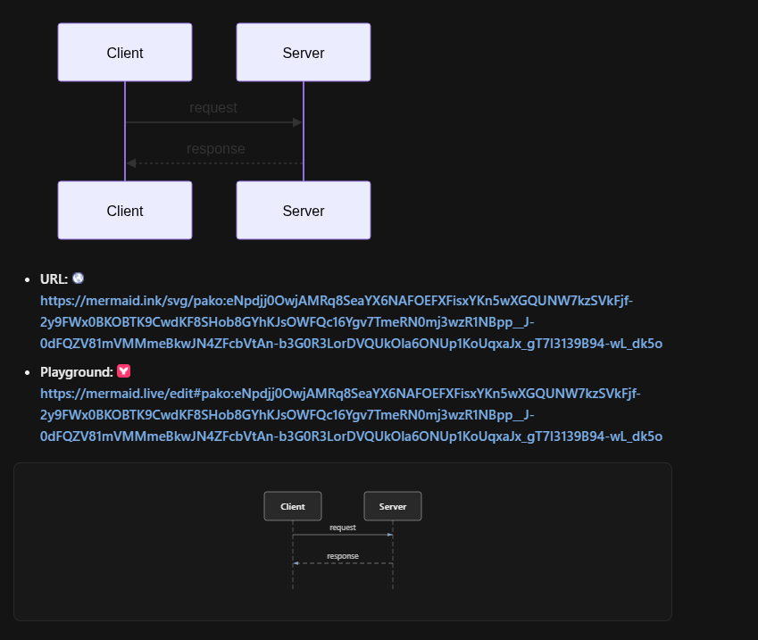
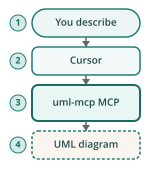
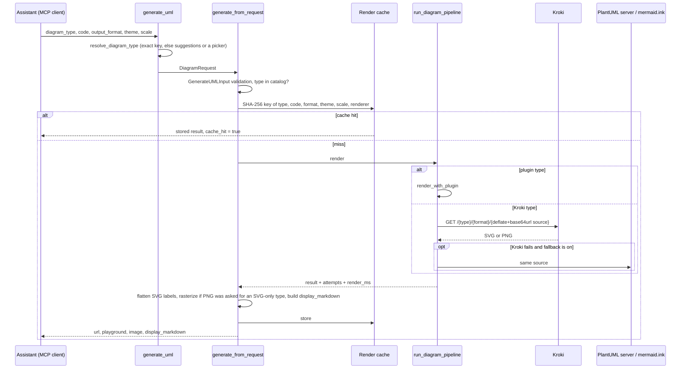

# uml-mcp

<div class="repo-status-row"><span class="repo-badge kind">MCP server</span><span class="repo-badge api">API</span><span class="repo-badge docker">Docker</span></div>

<div class="repo-tech-badges"><span class="tag tool">Python 3.12+</span><span class="tag tool">FastMCP</span><span class="tag tool">FastAPI</span><span class="tag tool">Kroki</span><span class="tag tool">PlantUML</span><span class="tag tool">Mermaid</span><span class="tag tool">D2</span><span class="tag tool">MCP Apps</span><span class="tag tool">Vercel</span><span class="tag tool">Helm</span></div>

uml-mcp is a Model Context Protocol server that lets an AI assistant draw diagrams. The assistant writes diagram source (PlantUML, Mermaid, D2, Graphviz, C4, BPMN …), calls one of the server's tools, and gets back an image, a link to the rendered file and a link to an editable playground. In clients that support MCP Apps, the diagram opens in a viewer inside the chat. It is published on PyPI as `uml-mcp` (version 1.4.0 in `pyproject.toml`), runs as a hosted endpoint on Vercel, and can be self-hosted with Docker or Helm.

## Demo {#demo}

The recording comes from the repository (`docs/assets/mcp-app-demo.mp4`). One `generate_uml_batch` call returns four diagrams as tabs in the MCP App viewer; the user switches tabs, then re-renders one diagram in another format.

<figure class="article-figure">
<video controls muted playsinline preload="metadata" poster="media/mcp-app-demo.png" style="width:100%;height:auto;border-radius:8px" aria-label="Recording of the uml-mcp viewer inside a chat: four diagram tabs from one batch call, switching tabs, then re-rendering with another format">
  <source src="media/mcp-app-demo.mp4" type="video/mp4">
  <a href="https://github.com/antoinebou12/uml-mcp/blob/main/docs/assets/mcp-app-demo.mp4">Download the demo video</a>
</video>
<figcaption>The MCP App viewer: four diagrams from one batch call, then a re-render in another format.</figcaption>
</figure>

Clients without MCP Apps get the same result as an inline image plus links, which is what most chat clients show:





## Overview {#overview}

The server exposes five tools, plus resources (`uml://types`, `uml://examples`, `uml://templates`), prompts and skill files that teach the assistant each notation.

| Tool | What it does |
| --- | --- |
| `generate_uml` | Render one diagram; returns `url`, `playground`, `display_markdown`, and the bytes as base64 when they are fetched |
| `generate_uml_image` | The same, returned as MCP `ImageContent` for inline display (PNG by default) |
| `validate_uml` | Check source before rendering, with errors that say how to fix it |
| `list_diagram_types` | The live catalog of types and their output formats |
| `generate_uml_batch` | Several diagrams in one call (`MCP_BATCH_MAX_ITEMS`, 20 by default) |

The README counts 46 diagram types: 37 rendered by [Kroki](https://kroki.io/) and 9 by four bundled plugins (D3 force and cloud diagrams with real logos, stack diagrams, archify-style architecture, workflow and sequence diagrams, and 2D/3D LLM layer maps).

## What happens on a tool call {#pipeline}

`generate_uml` in `mcp_core/tools/diagram_tools.py` is a thin wrapper; the work is in `generate_from_request` (`mcp_core/core/diagram_service.py`) and `run_diagram_pipeline` (`mcp_core/core/diagram_rendering.py`).



Step by step:

1. **Type.** `mrtr.resolve_diagram_type` lower-cases the key and accepts it if it is in the catalog. Otherwise, if the client supports form elicitation, the server asks the user to pick from up to eight close matches (`difflib`, cutoff 0.45); if not, it returns an error with those suggestions. The theme goes through the same treatment.
2. **Validation.** `GenerateUMLInput` (Pydantic) checks the arguments; source is limited to `MCP_MAX_CODE_LENGTH`, 500,000 characters by default. An unknown type returns `UNSUPPORTED_DIAGRAM_TYPE` with a pointer to `uml://types`.
3. **Format.** If the client asks for PNG or JPEG and the type only renders SVG, the service renders SVG and rasterizes it afterwards.
4. **Cache.** Calls that do not write a file are cached in memory. The key is the SHA-256 of a JSON object holding the type, the trimmed source, format, theme, scale and renderer identity. Defaults: 300 seconds, 128 entries, 32 MiB (`MCP_RENDER_CACHE_*`).
5. **Render.** Plugin types (`plugin:` backend) render locally. Everything else goes to Kroki: the source is compressed with zlib at level 9, base64url-encoded and put in the URL `{kroki}/{type}/{format}/{encoded}`, which is also the link returned to the user.
6. **Fallback.** If Kroki fails, PlantUML-family sources are retried on the PlantUML server and Mermaid on mermaid.ink. Mermaid has a fail-fast Kroki deadline of 8 seconds, and a circuit breaker skips Kroki's Mermaid engine for 60 seconds after repeated failures. Fallback is off by default on Vercel and with a local Kroki, where the public services would be the wrong target.
7. **Answer.** HTML-backed labels in SVG (`foreignObject`) are converted to plain SVG text so the file renders anywhere, `display_markdown` is built for chat, and every result carries `attempts`, `fallback_used` and `render_ms`, so a failure says which backend failed and why.

## Operations {#operations}

`uml-mcp admin` opens a web console on `http://127.0.0.1:8765/admin` (on a deployed server, `/admin`): setup, settings, activity, live logs, metrics, rate limits, tools and plugins, clients and quality checks. Locally, changes need a one-time setup token; with enterprise sign-in (Entra ID) the console is read-only unless writes are enabled in the settings.

: health, traffic and a setup checklist.")

## Getting started {#installation}

Use the hosted server in any MCP client:

```json
"uml-mcp": {
  "transport": "http",
  "url": "https://uml-mcp.vercel.app/mcp"
}
```

Or install it locally and let the setup command write the client configuration:

```bash
uv tool install uml-mcp && uml-mcp setup
```

Then ask the assistant for a diagram, for example "Draw a sequence diagram of a user logging in through an API gateway." The repository has ready-made configurations for Cursor (`.cursor/mcp.json`), VS Code (`.vscode/mcp.json`), Codex, Claude Desktop and Open WebUI, and `docs/installation.md` covers Docker, Helm and running from source.

## Repository guide {#reader-guide}

- `server.py`, `app.py`: stdio and HTTP entry points; `server.py` resolves the MCP object lazily so importing it prints nothing on stdout, which carries the stdio protocol.
- `mcp_core/tools/`: the tool functions, their schemas, elicitation helpers (`mrtr.py`), batch progress notifications and export.
- `mcp_core/core/`: catalog, validation, rendering pipeline, render cache, SVG rasterizing, themes and configuration.
- `mcp_core/plugins/`, `examples/plugins/`: the plugin loader and the four bundled plugins (D3, stack diagram, archify, LLM visualizer).
- `mcp_core/apps/`: the MCP App viewer (`ui://uml-mcp/diagram-viewer`) and SVG sanitizing.
- `mcp_core/admin/`, `mcp_core/auth/`, `mcp_core/observability/`: admin console, SSO and metrics.
- `tools/kroki/`: the Kroki client, URL encoding, playground links and per-language helpers.
- `deploy/helm/`, `Dockerfile`, `docker-compose*.yml`, `vercel.json`: deployment.
- `tests/`: 127 entries, unit and integration tests with MCP and HTTP rigs.

## Limits {#limits}

- Kroki-backed types depend on a reachable Kroki instance, and because the source travels in the URL, very large diagrams produce very long links.
- The render cache is per process and in memory, so it is not shared between serverless instances.
- The fallbacks send diagram source to third-party services (PlantUML server, mermaid.ink) when enabled; set `MCP_DIAGRAM_FALLBACK=false` if the source is private.
- MCP Apps support varies by client; other clients only get the image and links.

## Sources {#sources}

- [GitHub repository](https://github.com/antoinebou12/uml-mcp)
- [Documentation](https://antoinebou12.github.io/uml-mcp/)
- [PyPI package](https://pypi.org/project/uml-mcp/)
- [`mcp_core/tools/diagram_tools.py`](https://github.com/antoinebou12/uml-mcp/blob/main/mcp_core/tools/diagram_tools.py)
- [`mcp_core/core/diagram_service.py`](https://github.com/antoinebou12/uml-mcp/blob/main/mcp_core/core/diagram_service.py)
- [`mcp_core/core/diagram_rendering.py`](https://github.com/antoinebou12/uml-mcp/blob/main/mcp_core/core/diagram_rendering.py)
- [`mcp_core/core/render_cache.py`](https://github.com/antoinebou12/uml-mcp/blob/main/mcp_core/core/render_cache.py)
- [`tools/kroki/kroki.py`](https://github.com/antoinebou12/uml-mcp/blob/main/tools/kroki/kroki.py)
- [Companion article]()
