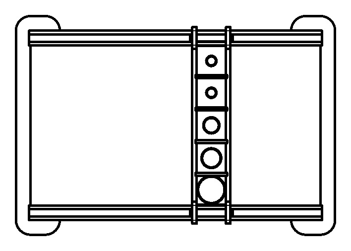

# WearMachine

<div class="repo-status-row"><span class="repo-badge kind">Matériel / CAO</span></div>

<div class="repo-tech-badges"><span class="tag tool">STEP</span><span class="tag tool">STL</span><span class="tag tool">DXF</span><span class="tag tool">SVG Inkscape</span></div>

WearMachine rassemble les pièces du banc d’abrasion utilisé dans la [recherche de maîtrise à l’ÉTS sur l’usure dans l’espace texture]() : un échantillon glisse sur un rail sous une charge choisie, puis passe sous un capteur GelSight. Le dépôt, publié sous [ETSim](https://github.com/ETSim), s’adresse à qui veut reconstruire ou adapter ce montage pour évaluer l’usure, étudier le frottement ou confronter des simulations à des mesures.

## Aperçu {#overview}

Le README donne l’objectif et les composants : un banc GelSight, des gabarits sur mesure (les fichiers CAO du dépôt), des capteurs de charge, des actionneurs linéaires et un système de commande et d’acquisition. Seuls les gabarits sont dans le dépôt. Ils forment trois familles de pièces, chacune disponible dans jusqu’à quatre formats :

- **Rail** : `Rail`, `Rail_Holder`, `Rail_Ski`, `Pusher`, `Seperator`, `Holder Berring`, un dessin de plaque `Base`, un support moteur `nema17bracket_v2` et un écrou de vis `t8_nut`. Ces noms indiquent un moteur pas à pas et une vis-mère qui déplacent l’échantillon le long du rail.
- **Weight** : des `Weight Holder` de 10, 20, 50, 100, 200, 500 et 1000 g qui fixent la charge normale sur l’échantillon.
- **Gelsight_Holder** : `30mm Sample Holder`, `40mm Sample Holder` et `Benchtop Holder Square` pour maintenir l’échantillon sous le capteur GelSight.

`Picture/Assembly.png` est une planche à l’échelle 1:8, datée de mars 2025, du cadre assemblé : deux rails et une traverse percée de cinq logements d’échantillons de tailles croissantes. `Drawing/Mold/20240430_16_Holes.svg` est une feuille A4 Inkscape avec un gabarit de moule à 16 trous.

## Vue 3D des pièces imprimées {#model}

La visionneuse ci-dessous charge les fichiers STL du dépôt, convertis en un seul GLB pour le navigateur. Faites glisser pour tourner, faites défiler ou pincez pour zoomer. Chaque famille a sa couleur et sa rangée : pièces du rail en bleu, porte-poids en orange, porte-échantillons GelSight en vert. Les pièces sont posées à plat côte à côte, pas assemblées ; le dessin d’ensemble plus bas montre comment elles s’emboîtent. L’écrou de vis T8 est laissé de côté : c’est une pièce du commerce, et son STL pèse à lui seul 6,7 Mo.

<script type="module" src="https://ajax.googleapis.com/ajax/libs/model-viewer/3.5.0/model-viewer.min.js"></script>



Les pièces et leurs dimensions, lues dans les boîtes englobantes des STL (millimètres), avec leur rôle déduit des dessins :

| Pièce | Taille | Rôle |
| --- | --- | --- |
| `Rail` | 400 × 20 × 6 | Barre droite ; le dessin d’ensemble en place une de chaque côté long du cadre |
| `Rail_Holder` | 298,5 × 60 × 6 | Pièce d’extrémité en C à pattes arrondies ; deux d’entre elles ferment le cadre et tiennent les bouts des rails |
| `Rail_Ski` | 58 × 9,8 × 6 | Petit patin à encoches |
| `Pusher` | 268,5 × 15 × 6 | Barre munie d’un crochet à chaque bout qui chevauche les rails ; la traverse de l’assemblage en compte deux |
| `Seperator` | 43 × 6 × 3,8 | Petite entretoise logée dans les fentes du pousseur, qui découpe la traverse en logements d’échantillon |
| `Holder Berring` | 30 × 25,5 × 25 | Bloc de roulement |
| `nema17bracket_v2` | 80 × 68 × 48 | Support pour un moteur pas à pas NEMA 17 |
| `Weight Holder 10g` à `200g` | 40,5 × 40,5 × 4 | Plaques avec un creux rond pour le poids ; les cinq ont le même contour |
| `Weight Holder 500g` | 50 × 50 × 4 | Plaque plus large pour la charge de 500 g |
| `Weight Holder 1000g` | 60 × 60 × 9 | Plaque plus épaisse pour la charge de 1 kg |
| `30mm Sample Holder` | 40 × 40 × 10 | Tient un échantillon de 30 mm sous le capteur GelSight |
| `40mm Sample Holder` | 50 × 50 × 10 | Même chose pour un échantillon de 40 mm |
| `Benchtop Holder Square` | 128 × 60 × 20 | Logement carré avec une lèvre courbe à l’extrémité ouverte |

Lues avec l’organisation de [WearSurfacesDatasets]() (matériau, grain du papier abrasif, charge en grammes, distance de glissement en millimètres), ces pièces décrivent un essai d’abrasion alternatif : les échantillons logent dans les cases de la traverse, un porte-poids fixe la charge sur chacun, et la traverse se déplace le long des rails sur une distance donnée ; le support de moteur pas à pas et l’écrou de vis indiquent un entraînement motorisé. L’échantillon passe ensuite dans un porte-échantillon GelSight pour être numérisé. Les pièces de mouvement et de charge sont dans le dépôt ; le moteur, la vis, le capteur et l’électronique n’y sont pas, et le README ne donne aucune étape d’assemblage : cette lecture vient donc des noms de pièces, des dessins et du jeu de données, pas d’instructions écrites.

## Dessins {#drawings}

`Picture/` contient une feuille de dessin par pièce, produite à partir du modèle CAO. Les vues ci-dessous en sont recadrées.





## Démarrage {#installation}

Il n’y a rien à exécuter. On choisit le dossier selon le besoin :

- ouvrir les STEP de `Raw/` dans un outil de CAO (FreeCAD, Fusion, SolidWorks…) pour modifier les cotes ;
- trancher les STL de `Print/` pour l’impression 3D ;
- utiliser les DXF de `Drawing/` pour les contours plans ou la découpe laser, et les planches PNG de `Picture/` comme référence visuelle.

```bash
git clone https://github.com/ETSim/WearMachine
ls WearMachine/Print/Rail WearMachine/Print/Weight WearMachine/Print/Gelsight_Holder
```

## Guide du dépôt {#reader-guide}

- `Raw/` : solides STEP des supports GelSight, des pièces du rail et de la plupart des porte-poids.
- `Print/` : maillages STL à imprimer, y compris le support moteur et l’écrou T8.
- `Drawing/` : contours DXF des deux supports GelSight ronds, des pièces du rail (dont `Base.dxf`) et de tous les porte-poids, plus le SVG du moule.
- `Picture/` : planches PNG des pièces et `Assembly.png`.
- `README.md` : objectif du banc et liste des composants nécessaires.

## Fonctionnalités {#features}

- Ensemble complet de gabarits imprimables pour un essai de glissement guidé par rail.
- Sept porte-poids de 10 g à 1000 g pour des charges normales reproductibles.
- Deux porte-échantillons ronds (30 mm et 40 mm) et un support carré de paillasse pour la capture GelSight.
- Sources STEP modifiables à côté des STL prêts à imprimer.
- Les surfaces mesurées avec ce type d’essai sont publiées dans [WearSurfacesDatasets](), avec des charges de 10 à 200 g.

## Limites {#limits}

- Le README promet des instructions de montage détaillées, mais le dépôt ne contient ni étapes d’assemblage, ni nomenclature, ni liste de matériel au-delà des noms de composants.
- Aucun firmware, câblage ni logiciel de commande n’accompagne les actionneurs, capteurs de charge et le système d’acquisition cités dans le README.
- Les formats sont inégaux : `Base` n’existe qu’en DXF, `Holder Berring` et `Weight Holder 10g` n’ont pas de STEP, et le support moteur et l’écrou n’ont ni STEP ni dessin.
- Les cartouches des planches laissent vides le titre, le matériau et les tolérances.
- Le dépôt a un `.gitignore` Python, mais aucun code.

## Sources {#sources}

- [Dépôt GitHub](https://github.com/ETSim/WearMachine)
- [README](https://github.com/ETSim/WearMachine/blob/main/README.md)
- [`Picture/Assembly.png`](https://github.com/ETSim/WearMachine/blob/main/Picture/Assembly.png)
- [`Raw/Rail/Rail.step`](https://github.com/ETSim/WearMachine/blob/main/Raw/Rail/Rail.step)
- [`Print/Rail/nema17bracket_v2.stl`](https://github.com/ETSim/WearMachine/blob/main/Print/Rail/nema17bracket_v2.stl)
- [`Drawing/Weight/Weight Holder 200g.dxf`](https://github.com/ETSim/WearMachine/blob/main/Drawing/Weight/Weight%20Holder%20200g.dxf)
