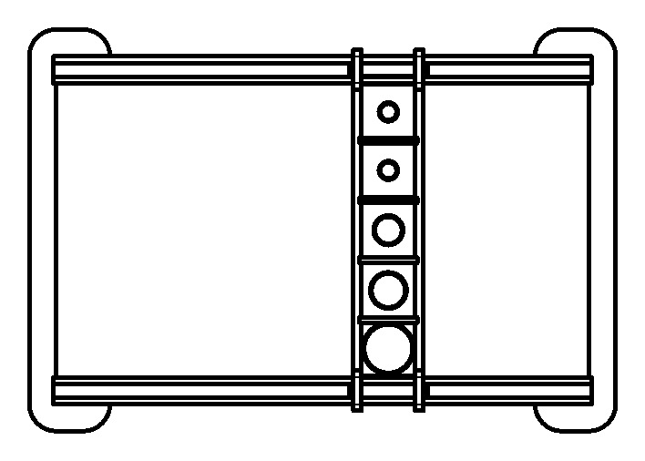

# WearMachine

<div class="repo-status-row"><span class="repo-badge kind">Hardware / CAD</span></div>

<div class="repo-tech-badges"><span class="tag tool">STEP</span><span class="tag tool">STL</span><span class="tag tool">DXF</span><span class="tag tool">Inkscape SVG</span></div>

WearMachine collects the parts of the abrasion bench used in the [ÉTS master's research on wear in texture space](): a sample slides on a rail under a chosen load, then is scanned with a GelSight sensor. The repository, published under [ETSim](https://github.com/ETSim), is for anyone who wants to rebuild or adapt the rig to evaluate wear, study friction or check simulations against measurements.

## Overview {#overview}

The README states the goal and the components: a GelSight bench, custom fixtures (the CAD files in the repository), load sensors, linear actuators and a control and acquisition system. Only the fixtures are in the repository. They are organised in three part families, each available in up to four formats:

- **Rail**: `Rail`, `Rail_Holder`, `Rail_Ski`, `Pusher`, `Seperator`, `Holder Berring`, plus a `Base` plate drawing, a `nema17bracket_v2` motor bracket and a `t8_nut` lead-screw nut. The names point to a stepper motor and lead screw moving the sample along the rail.
- **Weight**: `Weight Holder` parts for 10, 20, 50, 100, 200, 500 and 1000 g that set the normal load on the sample.
- **Gelsight_Holder**: `30mm Sample Holder`, `40mm Sample Holder` and `Benchtop Holder Square` to hold samples under the GelSight sensor.

`Picture/Assembly.png` is a 1:8 drawing sheet, dated March 2025, of the assembled frame: two rails and a crossbar with five sample holes of increasing size. `Drawing/Mold/20240430_16_Holes.svg` is an A4 Inkscape sheet with a 16-hole mold layout.

## 3D view of the printed parts {#model}

The viewer below loads the repository's own STL files, converted to a single GLB for the browser. Drag to orbit, scroll or pinch to zoom. Each family has its own colour and its own row: rail parts in blue, weight holders in orange, GelSight sample holders in green. The parts are laid flat side by side, not assembled; the assembly drawing further down shows how they fit together. The T8 lead-screw nut is left out because it is a stock part and its STL alone weighs 6.7 MB.

<script type="module" src="https://ajax.googleapis.com/ajax/libs/model-viewer/3.5.0/model-viewer.min.js"></script>



The parts and their sizes, read from the STL bounding boxes (millimetres), with roles inferred from the drawings:

| Part | Size | What it does |
| --- | --- | --- |
| `Rail` | 400 × 20 × 6 | Straight bar; the assembly drawing has one along each long side of the frame |
| `Rail_Holder` | 298.5 × 60 × 6 | C-shaped end piece with rounded tabs; two of them close the frame and hold the rail ends |
| `Rail_Ski` | 58 × 9.8 × 6 | Short notched slider |
| `Pusher` | 268.5 × 15 × 6 | Bar with a hook at each end that rides over the rails; the crossbar in the assembly is two of these |
| `Seperator` | 43 × 6 × 3.8 | Small spacer that sits in the pusher slots and splits the crossbar into sample pockets |
| `Holder Berring` | 30 × 25.5 × 25 | Bearing block |
| `nema17bracket_v2` | 80 × 68 × 48 | Mount for a NEMA 17 stepper motor |
| `Weight Holder 10g` to `200g` | 40.5 × 40.5 × 4 | Plates with a round recess for the weight; the five share the same outline |
| `Weight Holder 500g` | 50 × 50 × 4 | Wider plate for the 500 g load |
| `Weight Holder 1000g` | 60 × 60 × 9 | Thicker plate for the 1 kg load |
| `30mm Sample Holder` | 40 × 40 × 10 | Holds a 30 mm sample under the GelSight sensor |
| `40mm Sample Holder` | 50 × 50 × 10 | Same, for a 40 mm sample |
| `Benchtop Holder Square` | 128 × 60 × 20 | Square pocket with a curved lip at the open end |

Read together with the [WearSurfacesDatasets]() layout (material, sandpaper grit, load in grams, sliding distance in millimetres), the parts describe a reciprocating abrasion test: samples sit in the crossbar pockets, a weight holder sets the load on each one, and the crossbar is moved along the rails over a set distance, with the stepper bracket and lead-screw nut pointing to a motorised drive. Afterwards the sample is placed in a GelSight holder and scanned. The motion and load parts are in the repository; the motor, lead screw, sensor and electronics are not, and the README gives no assembly steps, so this reading comes from the part names, the drawings and the dataset rather than from written instructions.

## Drawings {#drawings}

`Picture/` holds a drawing sheet for each part, generated from the CAD model. These views are cropped from those sheets.





## Getting started {#installation}

There is nothing to run. Pick the folder that matches what you want to do:

- open the STEP files in `Raw/` with a CAD tool (FreeCAD, Fusion, SolidWorks…) to change dimensions;
- slice the STL files in `Print/` for 3D printing;
- use the DXF files in `Drawing/` for flat outlines or laser cutting, and the PNG sheets in `Picture/` as visual references.

```bash
git clone https://github.com/ETSim/WearMachine
ls WearMachine/Print/Rail WearMachine/Print/Weight WearMachine/Print/Gelsight_Holder
```

## Repository guide {#reader-guide}

- `Raw/` holds STEP solids for the GelSight holders, the rail parts and most weight holders.
- `Print/` holds STL meshes for printing, including the motor bracket and the T8 nut.
- `Drawing/` holds DXF outlines for the two round GelSight holders, the rail parts (including `Base.dxf`) and all weight holders, plus the mold SVG.
- `Picture/` holds PNG drawing sheets of individual parts and `Assembly.png`.
- `README.md` gives the purpose and the list of required components.

## Features {#features}

- Complete set of printable fixtures for a rail-guided sliding test.
- Seven weight holders from 10 g to 1000 g for repeatable normal loads.
- Two round sample holders (30 mm and 40 mm) and a square benchtop holder for GelSight capture.
- Editable STEP sources next to ready-to-print STL files.
- Measured surfaces from this kind of test are published in [WearSurfacesDatasets](), whose loads range from 10 to 200 g.

## Limits {#limits}

- The README says the repository provides detailed build instructions, but it contains no assembly steps, bill of materials or hardware list beyond the component names.
- No firmware, wiring or control software is included for the actuators, load sensors or acquisition system the README lists.
- Formats are uneven: `Base` exists only as DXF, `Holder Berring` and `Weight Holder 10g` have no STEP file, and the motor bracket and nut have no STEP or drawing.
- The drawing sheets have empty title, material and tolerance fields.
- The repository has a Python `.gitignore` but no code.

## Sources {#sources}

- [GitHub repository](https://github.com/ETSim/WearMachine)
- [README](https://github.com/ETSim/WearMachine/blob/main/README.md)
- [`Picture/Assembly.png`](https://github.com/ETSim/WearMachine/blob/main/Picture/Assembly.png)
- [`Raw/Rail/Rail.step`](https://github.com/ETSim/WearMachine/blob/main/Raw/Rail/Rail.step)
- [`Print/Rail/nema17bracket_v2.stl`](https://github.com/ETSim/WearMachine/blob/main/Print/Rail/nema17bracket_v2.stl)
- [`Drawing/Weight/Weight Holder 200g.dxf`](https://github.com/ETSim/WearMachine/blob/main/Drawing/Weight/Weight%20Holder%20200g.dxf)
