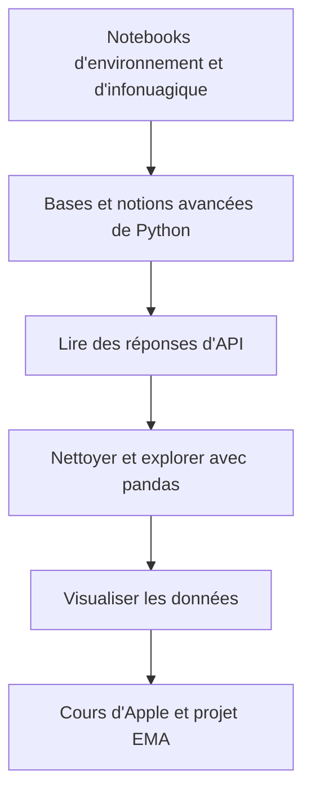

# Workshop1

Workshop1 est un atelier Python d'[AlgoÉTS](https://github.com/AlgoETS) construit autour de notebooks. La progression part de l'installation, passe par les appels API, pandas et la visualisation, puis se termine par un exercice d'EMA sur le cours d'Apple. Les faits ci-dessous viennent du dépôt, lu pour l'[article associé]().

## Aperçu

**Pourquoi il existe.** Un atelier d'initiation où chaque notion a une suite : une requête devient un tableau, le tableau devient un graphique.

**Cas d'usage.** Premier contact avec Python pour des étudiants en finance, avant de passer à une expérience par lots comme [BatchBacktesting]().

## Démarrage

- Ouvrir le premier notebook dans Colab : [1.1_python_basic.ipynb](https://colab.research.google.com/github/AlgoETS/Workshop1/blob/main/1.0-basic/1.1_python_basic.ipynb) (lien du README).
- Ou cloner le dépôt et lancer Jupyter en local ; les notebooks d'installation couvrent l'environnement.

La disponibilité des API, les clés et les versions de paquets peuvent avoir changé depuis l'atelier. Les notebooks sont du matériel pédagogique à examiner et adapter.

## Fonctions et composants

Neuf notebooks Jupyter répartis dans six dossiers numérotés :

| Étape | Notebooks |
| --- | --- |
| Environnement et infonuagique | 2 |
| Bases et notions avancées de Python | 2 |
| Lecture de réponses d'API | 1 |
| Nettoyage et exploration avec pandas | 1 |
| Visualisation | 2 |
| Projet final | 1 — [`5.1_project_ema.ipynb`](https://github.com/AlgoETS/Workshop1/blob/main/5.0-project/5.1_project_ema.ipynb) trace les cours de clôture d'Apple avec des EMA de 12, 26, 50, 100 et 200 jours |

Ce sont des décomptes du matériel versionné, pas des statistiques de participation.

## Architecture

## Limites et points à vérifier

- L'exercice final relie une requête, des données tabulaires, des colonnes d'indicateurs et un graphique annoté. Il n'établit pas qu'un croisement soit rentable.
- Vérifications utiles en classe : dates ordonnées, traitement volontaire des valeurs manquantes, pourquoi une EMA plus longue réagit plus lentement, et si toutes les courbes utilisent les mêmes observations.

## Liens

- [Dépôt](https://github.com/AlgoETS/Workshop1)
- [Notebook de bases Python](https://github.com/AlgoETS/Workshop1/blob/main/1.0-basic/1.1_python_basic.ipynb)
- [Notebook du projet EMA](https://github.com/AlgoETS/Workshop1/blob/main/5.0-project/5.1_project_ema.ipynb)
