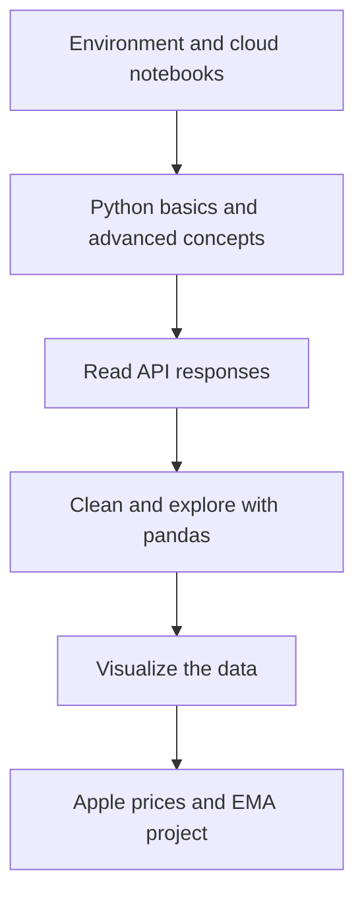

# Workshop1

Workshop1 is an [AlgoÉTS](https://github.com/AlgoETS) notebook-based Python workshop. The sequence moves from setup through API calls, pandas and visualisation, and ends with an Apple-price EMA exercise. Facts below come from the repository as read for the [companion article]().

## Overview

**Why it exists.** A beginner workshop where each new concept has somewhere to go: a request becomes a table, the table becomes a chart.

**Best fit.** First contact with Python for finance students, before moving to a batch experiment such as [BatchBacktesting]().

## Getting started

- Open the first notebook in Colab: [1.1_python_basic.ipynb](https://colab.research.google.com/github/AlgoETS/Workshop1/blob/main/1.0-basic/1.1_python_basic.ipynb) (linked from the README).
- Or clone the repository and run local Jupyter; the setup notebooks cover the environment.

API availability, keys and package versions can change since the original workshop. The notebooks are teaching material to inspect and adapt.

## Features and components

Nine Jupyter notebooks across six numbered directories:

| Stage | Notebooks |
| --- | --- |
| Environment and cloud setup | 2 |
| Python basics and advanced concepts | 2 |
| Reading API responses | 1 |
| Cleaning and exploring with pandas | 1 |
| Visualisation | 2 |
| Final project | 1 — [`5.1_project_ema.ipynb`](https://github.com/AlgoETS/Workshop1/blob/main/5.0-project/5.1_project_ema.ipynb) plots Apple closing prices with 12-, 26-, 50-, 100- and 200-day EMA curves |

These are counts of checked-in material, not attendance or completion statistics.

## Architecture

## Constraints and checks

- The final exercise connects a request, tabular data, indicator columns and a labelled chart. It does not establish that any crossover is profitable.
- Classroom checks worth keeping: ordered dates, intentional handling of missing values, why a longer EMA responds more slowly, and whether every curve uses the same observations.

## Links

- [Repository](https://github.com/AlgoETS/Workshop1)
- [Python basics notebook](https://github.com/AlgoETS/Workshop1/blob/main/1.0-basic/1.1_python_basic.ipynb)
- [EMA project notebook](https://github.com/AlgoETS/Workshop1/blob/main/5.0-project/5.1_project_ema.ipynb)
